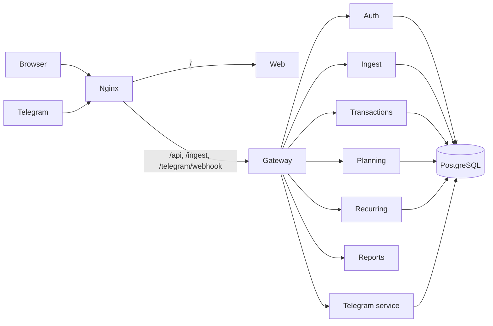

# LBStash

A private budget tracker you run from a Telegram chat. Send `/350 food` when you spend, `+1500 salary` when money comes in. It is saved, tagged and shown in the web app. Amounts are in ₹.

## How it works

1. **Log.** `/350` = money out, `+1500` = money in. Add a tag (`/350 food`) or pick one from the buttons.
2. **Save.** The server stores it and deletes your message from the chat.
3. **Tag.** Known payees are tagged for you. Tag a new one once and it is remembered.
4. **Track.** Balance, limits, alerts, trends and repeating payments come from your tagged payments. A payment you forgot to log shows up as "Unaccounted".

You can also log from the web app, or (optionally) let another tool post bank SMS text to `/ingest/message`.

## The three parts

| Part | What it is | Tech | Folders |
|---|---|---|---|
| **Backend** | 8 small services that own the data and rules | Python 3.12, FastAPI, PostgreSQL 17 | `backend/` |
| **Frontend** | The web app you use in the browser | Next.js (TypeScript) | `frontend/` |
| **Infra** | Runs and protects everything | Docker Compose, nginx, certbot / Cloudflare | `infra/`, `docker-compose.yml` |



## Folder structure

```
lbstash/
├── backend/                     Python 3.12 + FastAPI (a uv workspace; also the Docker build folder of every Python image)
│   ├── services/                one folder per service
│   │   ├── gateway/             only door to the backend: login, CSRF, rate limits
│   │   ├── auth/                users, sessions, 2FA, passkeys, audit log
│   │   ├── transactions/        payments, categories, tag rules, balance checks
│   │   ├── ingest/              optional bank-message route
│   │   ├── planning/            monthly plans, limits, alerts
│   │   ├── recurring/           repeating payments
│   │   ├── reports/             dashboard and trends (stores nothing)
│   │   └── telegram/            the bot
│   │       (each has: src/  migrations/  tests/  Dockerfile  pyproject.toml)
│   ├── packages/lbstash/        code shared by every service (money, crypto, db, queue, clients)
│   ├── pyproject.toml, uv.lock  Python workspace and locked versions
│   └── .dockerignore
│
├── frontend/                    Next.js web app
│   ├── src/app/                 pages (sign-in, create-account, reset, pay, the app screens)
│   ├── src/components/          shared UI pieces
│   ├── src/features/            data and logic for each screen
│   ├── src/lib/                 API calls and hooks
│   ├── src/brand/               logo, name, icons
│   ├── src/common/, contracts/  copies of money rules and response types
│   ├── public/                  images and brand SVGs
│   ├── test/                    web tests
│   └── next.config.mjs, package.json, Dockerfile
│
├── infra/
│   ├── docker/base.Dockerfile   shared Python base image
│   ├── nginx/                   public entry: templates/, snippets/, certbot/, entrypoint.sh
│   └── scripts/                 gen-secrets.py (makes .env), e2e.py (end-to-end test)
│
├── docs/                        ARCHITECTURE, SYSTEM_DESIGN, SERVICE_GUIDE, COLOURS, BRAND
├── docker-compose.yml           starts the whole stack (kept at the top so `docker compose up` just works)
├── .env, .env.example           secrets and settings (.env is never committed)
└── README.md
```

## Backend

Each service owns its own database schema and login, and never reads another's tables.

| Service | Job |
|---|---|
| gateway | Login check, CSRF, rate limits, security headers, forwards by path |
| auth | Users, sessions, 2FA, passkeys, recovery codes, export, account deletion |
| transactions | Payments, categories, tag rules, credits, balance checks |
| ingest | Optional bank-message route: device tokens, OTP guard, parser |
| planning | Monthly plans, limits, alerts |
| recurring | Repeating payments and the cron that posts them |
| reports | Dashboard and trend views, worked out when read |
| telegram | Logging, tagging, Google Pay button, daily digest |

How they work together:
- **Calls** are typed HTTP clients. Reads may retry; writes are never blindly retried.
- **Events** are saved with the change (outbox), then moved to a Postgres queue. Failed jobs retry; every consumer is safe to run twice.
- **Money** is whole paise as integers, never floats. Months and "today" use your time zone.
- More: [ARCHITECTURE](docs/ARCHITECTURE.md), [SYSTEM_DESIGN](docs/SYSTEM_DESIGN.md), [SERVICE_GUIDE](docs/SERVICE_GUIDE.md).

## Frontend

A Next.js app with these pages: Now · Transactions · Plan · Limits · Repeats · Trends · Add credit · Needs a look · Account · Setup guide. It only talks to the gateway. Colours: [COLOURS](docs/COLOURS.md). Logo and name: [BRAND](docs/BRAND.md).

## Infra

- **nginx** is the only public entry. `/` goes to the web app; `/api`, `/ingest`, `/telegram/webhook` go to the gateway. Nothing else is exposed.
- **Docker images:** one per service on a shared, slimmed Python base (built from `backend/`; the web image from `frontend/`) (about 240MB each; web about 225MB). The 8 Python images share the same base layers, so together they take roughly one image of disk.
- **Start order:** `db-init` creates roles and schemas, then the services, gateway, web and nginx start.
- **https:** Cloudflare Tunnel or Let's Encrypt (see below).

## Security

- **Sign-in:** 12+ character password (Argon2id), authenticator app required, passkeys, 10 hashed recovery codes. Optional allowed-IP list.
- **Sessions:** 15-minute access token; refresh token rotates and a reused one revokes the session. `HttpOnly`, `Secure`, `SameSite=Strict` cookies and a CSRF token on every change.
- **Brute force:** 5 wrong passwords lock for 30 s, doubling up to 15 min. Per-IP limits.
- **Data:** AES-256-GCM for secrets, tokens stored as hashes, one Postgres login and schema per service, row-level security on user tables.
- **Between services:** not on the internet; a signed 60-second token on every call.
- **Telegram:** only your account can link; your message is deleted after it is read; sensitive prompts stay hidden until you tap Reveal.
- **Never collected:** bank logins, UPI PINs, card numbers, OTPs. The app never moves money.
- **Yours:** export any time, delete your account (7-day grace), append-only audit log, logs hold ids only.

## Run it

You need Docker.

```bash
python3 infra/scripts/gen-secrets.py   # once: writes .env with random secrets
docker compose up --build        # db, services, gateway, web, nginx
```

Open http://localhost:8088 and create your account. **Back up `FIELD_KEY` from `.env`**: encrypted data cannot be read without it. Then follow the in-app **Setup guide** to connect your Telegram bot. For the Google Pay button, set `PUBLIC_URL` to an address your phone can reach.

Stop with `docker compose down` (add `-v` to wipe the database).

### Put it on a domain (https)

Set `PUBLIC_URL=https://your-domain` in `.env` (or use `DOMAIN`). Telegram needs https, so save the bot token once the site is live. Pick one:

- **Cloudflare Tunnel** (home machine, no open ports): create a tunnel to `http://nginx:80`, put the token in `.env` as `TUNNEL_TOKEN`, set `COMPOSE_PROFILES=tunnel`, run `docker compose up -d`.
- **Let's Encrypt** (public IP): point the A record at the machine, open ports 80 and 443, set `LETSENCRYPT_EMAIL`, run `docker compose up -d`. Try `LETSENCRYPT_STAGING=1` first.

### Develop and test

```bash
docker compose --profile test up -d test-db  # throwaway Postgres (run from the top folder)
export TEST_DATABASE_URL=postgres://lbstash_admin:<POSTGRES_PASSWORD from .env>@127.0.0.1:5544/lbstash

cd backend
uv sync                                      # Python environment
uv run pytest services/auth/tests            # backend tests, one service at a time
uv run python ../infra/scripts/e2e.py        # end-to-end test (needs PUBLIC_URL and REGISTRATION=open)

cd ../frontend && npm install && npm test    # web tests
```
