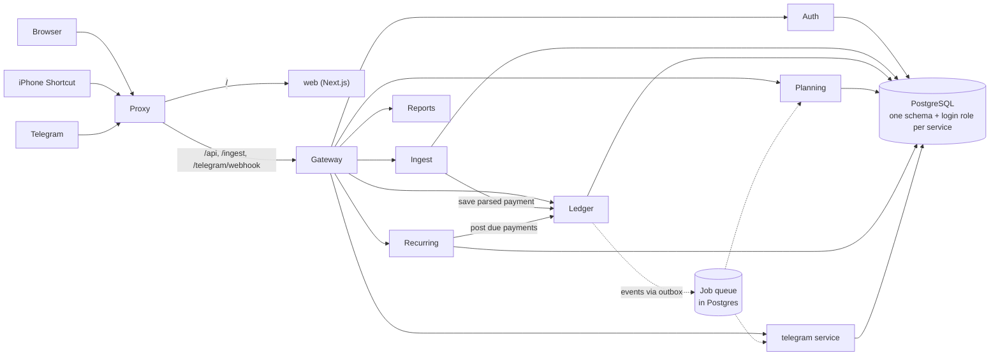
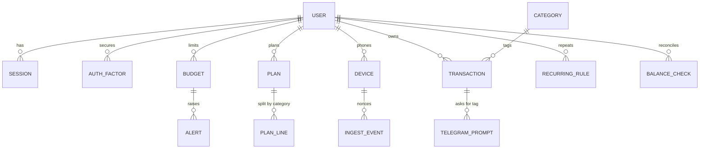
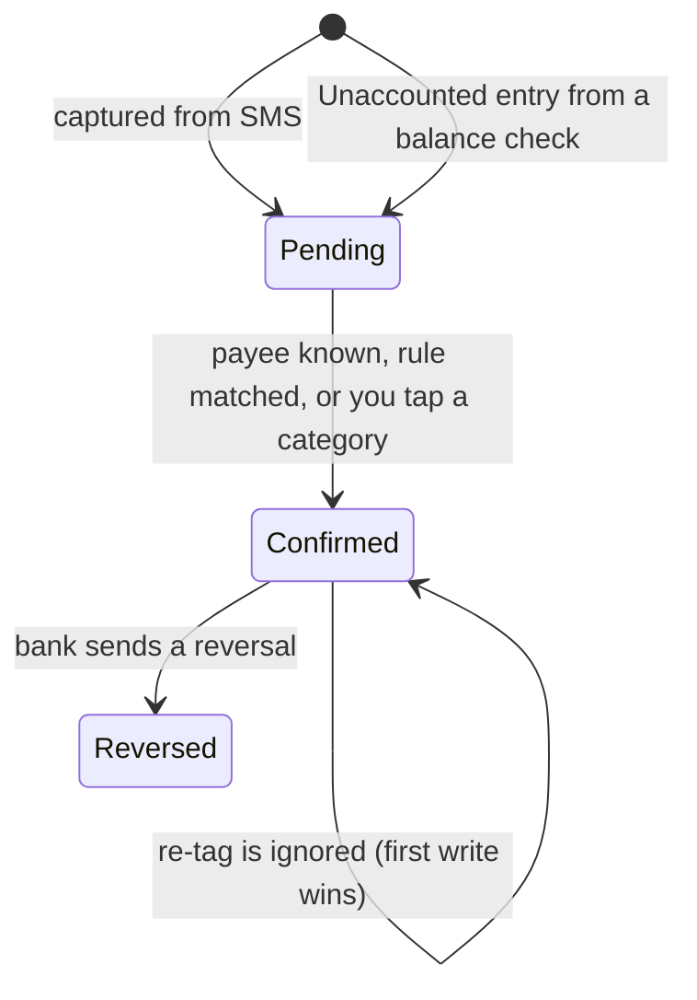
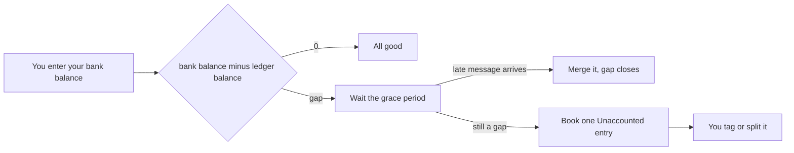

# Budget Tracker

A private budget tracker for iPhone and Indian bank SMS. Every bank debit or credit message is captured automatically, shows up in a Telegram chat and the web app, and you tag it with one tap. Amounts are in INR (₹).

## About and how it works

You decide how much to plan each month and split it across categories. The app does the rest:

1. **Capture.** An iPhone Shortcut forwards bank debit and credit messages to your server. (iPhone apps cannot read SMS, so the Shortcut does it.)
2. **Read.** The server pulls out the amount, direction, time and payee, then throws the message away.
3. **Tag.** Known payees are tagged automatically. New ones arrive in Telegram with category buttons. Tag once and the payee is remembered.
4. **Track.** Balance, limits, alerts, trends and recurring payments are worked out from your tagged payments.

Where a payment can come from:

| Source | Used for |
|---|---|
| iPhone Shortcut | Bank SMS (main route) |
| Telegram bot | Tagging payments on the go |
| Web app | Everything, plus hand-added credits |

If a message arrives late or never, the payment is booked at the time written in the message, and a balance check books any gap as "Unaccounted" for you to tag.

### Web app pages

Now · Ledger · Plan · Limits · Repeats · Trends · Add credit · Needs a look · Account (profile, security, devices) · Setup guide

## Architecture

**Stack:** Python 3.12 + FastAPI services, PostgreSQL 17, a Next.js web app, Caddy as the public proxy, all run by Docker Compose. Each service owns its own database schema and never reads another service's tables.



| Service | Job |
|---|---|
| proxy (Caddy) | The only public entry. Routes `/` to the web app and `/api`, `/ingest`, `/telegram/webhook` to the gateway |
| gateway | The only door to the backend: checks login, CSRF and rate limits, adds security headers, forwards by path |
| auth | Users, sessions, 2FA, passkeys, recovery codes, audit log, data export, account deletion |
| ingest | Device tokens, the OTP guard and the bank-message reader |
| ledger | Transactions, categories, tag rules, credits, balance checks |
| planning | Monthly plans, limits, alerts |
| recurring | Repeating payments and the cron that posts them |
| reports | Dashboard and trend views, built on read from other services (stores nothing) |
| telegram | The bot, tagging prompts, daily digest, the encrypted bot token |

### How services work together

- **Calls:** services talk over typed HTTP clients. Reads may retry; writes are never blindly retried.
- **Events and jobs:** a change and its event are saved in the same database transaction (outbox pattern). A relay moves them into a Postgres queue (`SKIP LOCKED`). Failed jobs retry with backoff (2 s up to 10 min, 5 tries) before being marked failed. Delivery is at-least-once, so every consumer is idempotent.
- **Cron:** nightly cleanup per service, recurring-payment posting, balance checks and the Telegram digest run from the same queue. Only one replica fires each tick.
- **Events used:** `transaction.changed` (planning re-checks limits, Telegram updates prompts), `credit.added`, `alert.created`, `unparsed.created`, `account.deleted` (every service purges that user), `audit.record`.
- **Derived, not stored:** balance, spend per category, pace and trends are calculated when read, so there are no cached totals to drift out of date.
- **Money:** whole paise as integers, never floats. Months and "today" use your time zone.
- **Shared code:** `packages/bt` holds what every service needs (money, crypto, contracts, DB access, queue, HTTP clients). Details: [docs/ARCHITECTURE.md](docs/ARCHITECTURE.md).
- **Deploy:** one Docker image per service on a shared base image. A one-shot `db-init` job creates roles and schemas, then services start, then the gateway, then the proxy.

### What happens to one bank message

```mermaid
sequenceDiagram
  participant Bank
  participant Phone as iPhone Shortcut
  participant Ingest
  participant Ledger
  participant Q as Queue
  participant Telegram
  participant You
  Bank->>Phone: SMS "Rs 450 debited..."
  Phone->>Ingest: POST /ingest/message (token + nonce + time)
  Ingest->>Ingest: check token, nonce, time; drop OTPs; read amount and payee; discard text
  Ingest->>Ledger: save transaction (duplicates ignored)
  Ledger->>Q: transaction.changed (same DB transaction)
  Q->>Telegram: send prompt
  Telegram->>You: "Money out" + category buttons
  You->>Telegram: tap a category
  Telegram->>Ledger: tag it (payee remembered)
  Q->>Planning: re-check limits, raise alert once if crossed
```

## System design

**Goal:** capture every bank debit and credit with no typing, keep the data private, and never lose or double-count a payment.

**Shape of the load:** personal, one account per install (`REGISTRATION=first-only`), a few dozen events a day, bursts when several messages land at once. So the design favours correctness and privacy over raw scale.

### Key decisions

| Decision | Why |
|---|---|
| iPhone Shortcut reads the SMS | iOS apps cannot read SMS, so no native app is needed |
| Amount first, tag later | The payment counts in your balance at once; the tag only adds the "why" |
| Parse on the server, then discard the text | One parser to fix for all banks; the raw message is not kept |
| Book at the time written in the message | A late Shortcut run still lands on the right day |
| Balance check instead of trusting delivery | Anything that never arrived shows up as a gap you can tag |
| Learn payees | Tag "RAMESH" once, every later payment is tagged by itself |
| Microservices, one schema each | Clear ownership and security boundaries; each can change alone |
| Postgres as the queue (outbox) | No extra broker; the event is saved with the change, so none is lost |
| Compute on read, no cached totals | Numbers can never drift from the payments |
| Telegram carries no bank details | Telegram keeps what it is sent, so it only gets "money out, 6:42 pm" |

### Data model



| Schema | Main tables |
|---|---|
| auth | users, sessions, refresh_tokens, auth_factors, challenges, login_throttle, audit_log |
| ledger | transactions, categories, tag_rules, tx_links, balance_checks |
| ingest | devices, ingest_events (nonces), unparsed_messages |
| planning | plans, plan_lines, plan_credits, budgets, alerts |
| recurring | recurring_rules |
| telegram | telegram_bots, telegram_links, telegram_sessions, telegram_prompts |

Every user table carries `user_id` and has row-level security.

### Payment life cycle



Pending payments already count in your balance. A message the reader cannot understand goes to **Needs a look** (kept encrypted, 30 days) and you fix it by hand.

### Balance check



### When things go wrong

| Failure | What happens |
|---|---|
| Shortcut runs late or never | Booked at the message time; the balance check catches the rest |
| Same SMS sent twice | Nonce and dedupe key make it one payment |
| A service crashes mid-way | The event is still in the outbox; the job retries with backoff |
| A handler runs twice | Handlers are idempotent, so the result is the same |
| Telegram is down or blocked | Payments are already saved; the web app shows "Needs a tag" |
| Database restarts | Services wait for it; unsent events are still stored |
| Bank wording unknown | Message goes to Needs a look instead of being guessed |
| Phone lost | Revoke the device token; it stops at once |

### Scaling and limits

- Fine for one person or a household on a small machine. Postgres is the only stateful piece, so back up the database and `FIELD_KEY`.
- To grow: run more copies of any stateless service (queue claims use `SKIP LOCKED`, and only one copy fires each cron tick), then move to a managed Postgres.
- Not built yet: Android, bank aggregators (Account Aggregator), statement import, push notifications and email capture.

## Security

**Sign-in and sessions**
- Passwords: at least 12 characters, common ones rejected, hashed with Argon2id (64 MiB, 3 passes).
- Mandatory second step (authenticator app); passkeys supported; 10 one-time recovery codes stored hashed.
- Short-lived access token (15 min) plus a rotating refresh token. If an old refresh token is used again it was copied, so the whole session family is revoked.
- A session ends after 12 hours idle or 30 days total. You can end sessions from the web app.
- Cookies are `HttpOnly`, `Secure`, `SameSite=Strict`. Every state-changing browser request needs a CSRF token (double-submit).
- Progressive lockout: 5 wrong passwords lock that email and IP for 30 s, doubling up to 15 min; 3 wrong second-step codes lock for 60 s, doubling. Lock keys are hashes, so no email or IP is stored.
- Error messages are generic, so nobody can find out which emails have accounts.

**Idempotency and replay protection**
- Each phone request carries a one-time `nonce`; reuse returns `409`. The timestamp must be within 5 minutes of server time.
- Every payment has a unique dedupe key per user (reference or fingerprint). The same SMS sent twice, or a retried request, saves one transaction.
- All queue consumers are idempotent because delivery is at-least-once: alerts fire once per budget, period and level; a hand-added credit raises the plan once per transaction; balance checks skip closed checks; recurring posting runs under a row lock; account deletion can run twice safely.
- Telegram buttons use opaque one-use tokens, checked against the user and open prompt, so a stale or repeated tap does nothing. Your sign-in code works once per time step.

**Data protection**
- Encrypted with AES-256-GCM: authenticator secrets, the Telegram bot token, and messages the reader could not parse (kept at most 30 days). The key (`FIELD_KEY`) comes from the environment, never the repo.
- Device tokens (256-bit random, shown once) and refresh tokens are stored only as hashes.
- Parsed bank messages are never stored, only amount, payee, reference, time and last 4 digits.
- Never collected: bank logins, UPI PINs, card numbers, OTPs. The app only reads results; it never moves money.
- Self-serve export, and account deletion with a 7-day grace period; deletion purges every service.
- Nightly retention sweeps remove expired rows and old nonces.

**Isolation**
- One Postgres login per service and one schema per service. Row-level security is forced on every user table, so a bug in a query still cannot read another user's rows.
- Services are not exposed to the internet. Every call between them carries a signed 60-second token naming the caller and user, and internal-only routes reject anything forwarded from outside.

**Edge hardening**
- Gateway checks, in order: path, who you are, rate limits, session still alive, CSRF. Extra per-IP limits apply to login, second step, reset, phone ingest and the Telegram webhook, plus per-device limits inside ingest.
- Headers: HSTS, `X-Content-Type-Options: nosniff`, `Referrer-Policy: no-referrer`, a locked-down CSP (`default-src 'none'`, no framing) on API responses, and a Permissions-Policy that disables camera, microphone and location. The server header is removed.
- All input is validated with strict pydantic models and every query is parameterised. Secrets are compared in constant time.
- Same-origin `/api` keeps `SameSite=Strict` cookies working. Use HTTPS in production (the proxy gets certificates automatically for a real domain).

**Phone and Telegram**
- The OTP guard drops OTP-looking text before parsing or logging and stores nothing (`202`). Pick your Shortcut trigger words carefully (see the Setup guide).
- Telegram: only your own numeric id works, in a private chat, after `/signin` with an authenticator code (the bot deletes your message). The webhook has a secret header (stored hashed) and a random path. Messages carry no amount, payee, balance or account number; an optional Reveal button shows details for 30 seconds.
- Lost phone: revoke its device token in the web app and it stops working at once.

**Logging and audit**
- Logs hold ids and outcome codes only, never message text, amounts or payees, and common sensitive fields are redacted.
- An append-only audit log records sign-ins, device changes, exports and deletions.

## Run it

You need Docker.

```bash
python3 scripts/gen-secrets.py   # once: writes .env with random secrets
docker compose up --build        # db, services, gateway, web and proxy
```

Open http://localhost:8088 and create your account. Back up `FIELD_KEY` from `.env`; encrypted data cannot be read without it. Registration allows one account unless you set `REGISTRATION=open`.

Then follow the in-app **Setup guide** (Account menu) to connect your iPhone Shortcut and Telegram bot.

Stop with `docker compose down` (add `-v` to wipe the database).

### Develop and test

```bash
uv sync                                      # Python environment
docker compose --profile test up -d test-db  # throwaway Postgres for tests
uv run pytest                                # backend tests
cd apps/web && npm install && npm test       # web tests
uv run python scripts/e2e.py                     # end-to-end check against the running stack
```

`scripts/e2e.py` needs `PUBLIC_URL` set and `REGISTRATION=open`; see the header of the script.
