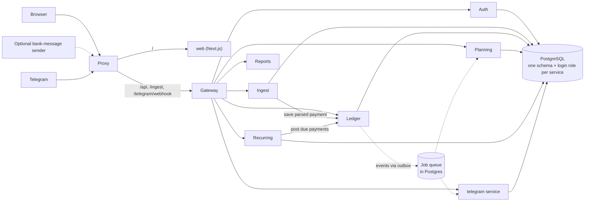
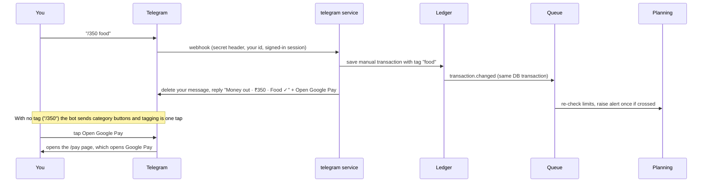

# Budget Tracker

A private budget tracker run from a Telegram chat. Send `/350 food` when you spend, `+1500 salary` when money comes in. It is saved, tagged and shown in the web app. Amounts are in ₹.

## How it works

1. **Log.** Send `/350` (money out) or `+1500` (money in). Add a tag to file it at once (`/350 food`), or pick one from the buttons. Money out also gets an **Open Google Pay** button.
2. **Save.** The server stores the amount, direction and time, then deletes your message from the chat.
3. **Tag.** Known payees are tagged for you. Tag a new one once and it is remembered.
4. **Track.** Balance, limits, alerts, trends and repeating payments come from your tagged payments.

A payment you forget to log shows up in the balance check as "Unaccounted", for you to tag.

| Source | Used for |
|---|---|
| Telegram bot | Logging and tagging (main route) |
| Web app | Everything, plus hand-added credits |
| Bank-message token (optional) | Another tool posting bank SMS text to `/ingest/message` |

**Web pages:** Now · Ledger · Plan · Limits · Repeats · Trends · Add credit · Needs a look · Account (profile, security, devices) · Setup guide

## Architecture

**Stack:** Python 3.12 + FastAPI services, PostgreSQL 17, a Next.js web app, nginx in front, all run by Docker Compose. Each service owns its own schema and never reads another's tables.



| Service | Job |
|---|---|
| nginx | Only public entry (also does https): `/` to the web app, `/api`, `/ingest`, `/telegram/webhook` to the gateway |
| gateway | Only door to the backend: login, CSRF, rate limits, security headers, forwards by path |
| auth | Users, sessions, 2FA, passkeys, recovery codes, optional allowed addresses, audit log, export, account deletion |
| ingest | Optional bank-message route: device tokens, OTP guard, message reader |
| ledger | Transactions, categories, tag rules, credits, balance checks |
| planning | Monthly plans, limits, alerts |
| recurring | Repeating payments and the cron that posts them |
| reports | Dashboard and trend views, built on read (stores nothing) |
| telegram | The bot: logging, tagging, Google Pay button, daily digest, encrypted bot token, who may link |

### How the services work together

- **Calls:** typed HTTP clients. Reads may retry; writes are never blindly retried.
- **Events and jobs:** a change and its event are saved in one transaction (outbox), then moved to a Postgres queue. Failed jobs retry with backoff (2 s to 10 min, 5 tries). Delivery can repeat, so every consumer is idempotent.
- **Cron:** cleanup, repeating payments, balance checks and the digest run from the same queue; one replica fires each tick.
- **Events:** `transaction.changed`, `credit.added`, `alert.created`, `unparsed.created`, `account.deleted` (every service purges that user), `audit.record`.
- **Derived, not stored:** balance, spend, pace and trends are worked out when read.
- **Money:** whole paise as integers, never floats. Months and "today" use your time zone.
- **Shared code:** `packages/bt` (money, crypto, contracts, DB, queue, clients). More: [ARCHITECTURE](docs/ARCHITECTURE.md), [COLOURS](docs/COLOURS.md). Logo, icons and name: `apps/web/src/brand` (SVGs in `apps/web/public/brand`).
- **Deploy:** one image per service on a shared base. `db-init` creates roles and schemas, then services, gateway and nginx start.

### One logged payment



## System design

Built for one person's money: correctness and privacy first, not scale. One Postgres, small services that own their data, safe retries, and a balance check that catches anything lost. More: [SYSTEM_DESIGN](docs/SYSTEM_DESIGN.md).

## Security

| Area | What we do |
|---|---|
| **Sign-in** | • 12+ character password, common ones rejected, Argon2id hash<br>• Authenticator app is required<br>• Passkeys and 10 hashed recovery codes |
| **Sessions** | • Access token 15 min; refresh token rotates<br>• A reused refresh token means it was copied: session revoked<br>• Ends after 12 h idle or 30 days |
| **Allowed addresses (optional)** | • Account > Security: list the IPs or ranges that may use the web app<br>• Sign-in, refresh and every page refuse other addresses<br>• Needs a fresh authenticator code; your own address must stay on the list<br>• Not for the bot: Telegram never shows your address, so the bot is locked to your Telegram account |
| **Cookies and CSRF** | • `HttpOnly`, `Secure`, `SameSite=Strict`<br>• CSRF token on every change |
| **Brute force** | • 5 wrong passwords lock 30 s, doubling to 15 min<br>• Per-IP limits on login, reset and webhook<br>• Generic errors, so emails cannot be guessed |
| **Safe to repeat** | • Each Telegram update is handled once<br>• Bank-message route: one-time `nonce`, 5-min window, unique key<br>• Queue jobs can run twice with the same result<br>• Telegram taps and sign-in codes work once |
| **Encryption** | • AES-256-GCM for 2FA secrets, bot token, unreadable messages<br>• Tokens stored only as hashes<br>• Key from the environment |
| **Data isolation** | • One Postgres login and schema per service<br>• Row-level security on every user table |
| **Between services** | • Not on the internet<br>• Signed 60-second token on every call<br>• Internal routes refuse outside requests |
| **Edge** | • HSTS, `nosniff`, `no-referrer`, strict CSP, Permissions-Policy<br>• Strict input checks, parameterised queries<br>• Constant-time secret checks |
| **Bank-message token (optional)** | • Per-device, ingest-only, shown once, revocable<br>• OTP-like text dropped unread, nothing stored<br>• Parsed messages not kept |
| **Telegram** | • Setup asks for your username or id first; only that account can link, others are ignored even with a valid code<br>• Then only your id, private chat<br>• `/signin` with an authenticator code before any `/350`<br>• Your message is deleted; the confirmation repeats the amount you typed<br>• Bank-message prompts show no amount, payee or balance unless you tap Reveal<br>• Webhook secret header, stored hashed |
| **Never collected** | • Bank logins, UPI PINs, card numbers, OTPs<br>• The app never moves money |
| **Logs and audit** | • Logs hold ids and outcome codes only<br>• Append-only audit log |
| **Your data** | • Export any time<br>• Delete account (7-day grace)<br>• Old rows cleaned nightly |

## Run it

You need Docker.

```bash
python3 scripts/gen-secrets.py   # once: writes .env with random secrets
docker compose up --build        # db, services, gateway, web, nginx
```

Open http://localhost:8088 and create your account. Back up `FIELD_KEY` from `.env`: encrypted data cannot be read without it. One account is allowed unless `REGISTRATION=open`.

Then follow the in-app **Setup guide** (Account menu): create a bot in @BotFather, paste its token, enter your Telegram username, send the code to the bot (or tap the link under it). For the Google Pay button, set `PUBLIC_URL` to an address your phone can reach.

### Put it on a domain (https)

`docker compose up -d` also starts **nginx** (`nginx/`). Two ways to get `https://aegios.co.in`:

- **Cloudflare Tunnel** (home machine, no public IP, no open ports). In Cloudflare Zero Trust > Networks > Tunnels, create a tunnel with the public hostname `aegios.co.in` -> `http://nginx:80` and delete any A record for it. Put the token in `.env` as `TUNNEL_TOKEN`, set `COMPOSE_PROFILES=tunnel`, run `docker compose up -d`. Cloudflare supplies the certificate; turn on "Always Use HTTPS".
- **Let's Encrypt** (public IP). Point the A record at the machine, open ports 80 and 443, set `LETSENCRYPT_EMAIL` in `.env`, run `docker compose up -d`. **certbot** writes the certificate to `nginx/certs` (never committed) and nginx switches to https. Try `LETSENCRYPT_STAGING=1` first.

Either way, set `PUBLIC_URL=https://aegios.co.in` in `.env` (or another domain via `DOMAIN`). Telegram needs https for its webhook, so save the bot token once the site is live.

Stop with `docker compose down` (add `-v` to wipe the database).

### Develop and test

```bash
uv sync                                      # Python environment
docker compose --profile test up -d test-db  # throwaway Postgres
export TEST_DATABASE_URL=postgres://bt_admin:<POSTGRES_PASSWORD from .env>@127.0.0.1:5544/budget
uv run pytest services/auth/tests            # backend tests, one service at a time
cd apps/web && npm install && npm test       # web tests
uv run python scripts/e2e.py                 # end-to-end against the running stack
```

Backend tests run one service at a time (each has its own `conftest.py`); `ledger` has no tests yet. `scripts/e2e.py` needs `PUBLIC_URL` and `REGISTRATION=open` (see the script header).
