# Budget Tracker

A secure, private budget tracker built around an **iPhone** and Indian bank messages. You decide how each month's money is split. Every bank **debit and credit message** is captured the moment it arrives, lands in a **Telegram chat** (and the web app) with category buttons, and you tag it whenever you like. One database sits behind everything, so a tag set anywhere shows up everywhere.

This is the single source of truth for the product: what it does, how data gets in, how tagging works, the architecture and data flows, security, and the delivery plan. Currency is INR (₹) by default. The interface is specified page by page in [`docs/ui-spec/`](docs/ui-spec/README.md).

**Contents**

- [Status](#status)
- [1. What the app does](#1-what-the-app-does)
- [2. How it works, in plain words](#2-how-it-works-in-plain-words)
- [3. Core concepts](#3-core-concepts)
- [4. Getting transactions in (iPhone first)](#4-getting-transactions-in-iphone-first)
- [5. Telegram tagging inbox](#5-telegram-tagging-inbox)
- [6. Screens](#6-screens)
- [7. Architecture overview](#7-architecture-overview)
- [8. Backend modules](#8-backend-modules)
- [9. Data model and API](#9-data-model-and-api)
- [10. Core data flows](#10-core-data-flows)
- [11. Page → API → data map](#11-page--api--data-map)
- [12. Derived metrics](#12-derived-metrics)
- [13. Transaction lifecycle](#13-transaction-lifecycle)
- [14. Async jobs and events](#14-async-jobs-and-events)
- [15. Security (non-negotiable requirements)](#15-security-non-negotiable-requirements)
- [16. Deployment and operations](#16-deployment-and-operations)
- [17. Failure modes and consistency](#17-failure-modes-and-consistency)
- [18. Edge cases to handle](#18-edge-cases-to-handle)
- [19. Phased delivery plan](#19-phased-delivery-plan)
- [20. Acceptance checklist](#20-acceptance-checklist)
- [21. Open decisions and parked ideas](#21-open-decisions-and-parked-ideas)

---

## Status

| Area | State |
|---|---|
| Product, capture, Telegram inbox, architecture, security (this file) | **Designed** |
| UI: 16 screens (7 app pages, Needs a look, 3 account pages, 4 sign-in pages, Setup guide), light editorial style, one accent | **Designed and specified** in [`docs/ui-spec/`](docs/ui-spec/README.md): a design system, 16 page specs and 16 reference files, in sync with the canvas |
| iPhone capture and Telegram bot | Designed; **two things need a real-device test first** (see section 4.10) |
| Backend, web app build, Telegram bot, Shortcut | **Not started.** Delivery is planned in 12 phases (0 to 11) in [section 19](#19-phased-delivery-plan); **Phase 0 (real-device and real-message checks) comes first** |
| Parked (not part of this architecture) | Android app, Account Aggregator, Pay-through-app, screen-reading capture, statement import, Web Push, email, cached month totals, category rollover. See the parked list in section 21 |
| Not yet seen in a real browser | The canvas was checked as markup and by running its logic, not by eye. The reference files contain click-through stand-ins (any password passes, any 6-digit code works); `docs/ui-spec/README.md` lists each one and what the real app must do instead |

**Decisions already made**

| Decision | Choice |
|---|---|
| Phone | iPhone (iOS apps cannot read SMS, so no native app is needed to start) |
| Capture | iPhone Shortcut forwards bank debit and credit messages to the server |
| Tagging | The Telegram bot is the inbox; the web app Ledger shows the same data. If Telegram is down, payments wait under Needs a tag in the web app |
| Credits | Captured from bank credit messages **or** added by hand; both counted immediately, tagged later |
| Accent colour | Emerald `#00875A` (Caribbean `#007F95` also designed) |
| Stack | Next.js web app; Python 3.12 + FastAPI services (pydantic, psycopg); PostgreSQL with SQL migrations; a Postgres-backed queue (transactional outbox) |

### Project layout

```
budget-tracker/
├── README.md             product, capture, Telegram, architecture, security, delivery (this file)
├── docker-compose.yml    the whole stack in one file: db, services, gateway, web, proxy (`docker compose up --build`)
├── pyproject.toml        Python workspace (uv); uv.lock pins it
├── .env.example          every setting; scripts/gen-secrets.py fills in the secrets
├── .context/             short notes per area so agents do not re-read the whole repo
├── apps/web/             Next.js app, the 16 screens
│   └── src/              app (routes), components, features (per-page logic), common (pure helpers), contracts (API types), lib (api, hooks)
├── services/             Python/FastAPI services, each with its own Dockerfile: gateway, auth, ledger, ingest, planning, recurring, reports, telegram
├── packages/bt/          shared Python library (common, crypto, contracts, db, queue, clients, kit)
├── docker/               shared Python base image, Caddyfile
├── docs/                 ARCHITECTURE.md, SERVICE_GUIDE.md, ui-spec/ (design system, 16 page specs, 16 reference files)
└── scripts/              secrets generator, end-to-end check
```

### Live designs (private Claude artifacts)
- Emerald accent: https://claude.ai/artifact/TvRcbS8jWC82q5xB1WV2r3
- Caribbean-blue accent: https://claude.ai/artifact/8bie2RSFM8PVaJEB2XihGF

---

## 1. What the app does

| # | Feature | Summary |
|---|---------|---------|
| 1 | **Monthly plan** | Enter how much you have this month (e.g. ₹50,000), then split it: ₹10,000 SIP, ₹20,000 Rent, … The leftover is shown as "unassigned". |
| 2 | **Dynamic categories** | You never pre-create categories. A new tag creates a new category on the spot. |
| 3 | **Auto-capture from bank messages** | A debit or credit SMS from your bank is picked up the moment it arrives (iPhone Shortcut) and added to the ledger. Known payees are tagged automatically. |
| 4 | **Telegram tagging inbox** | Each new transaction arrives in a private Telegram chat with category buttons. Tag now or later; five payments in a minute is five messages. Everything syncs with the web app. |
| 5 | **Credits in** | Money you receive is captured from the bank's credit message, or added by hand (cash, banks without alerts). It counts in the balance immediately and you tag it later. |
| 6 | **Recurring payments** | Define things that leave your account on their own (SIP, rent, EMI, subscriptions). They post themselves on the due date. |
| 7 | **No monthly reset** | Balance is cumulative. What's left at month-end carries into the next month. |
| 8 | **Budgets + alerts** | A limit per category. Green under your alert level (default 80%), yellow at it, red once exceeded; you are told through Telegram. |
| 9 | **Security** | Authenticated, encrypted, 2FA, whitelisted Telegram id plus `/signin` sessions, ingest-only phone token, parsed messages never kept. See section 15. |
| 10 | **Balance check** | The ledger is compared with your bank balance. If a payment never arrived (small UPI alerts, a locked phone), the gap becomes one **Unaccounted** entry you can tag or split later. See section 3.6. |

---

## 2. How it works, in plain words

Three parts, one database:

```
iPhone  ──▶  Server  ──▶  Database
                ▲  │
   Web app ─────┘  └──▶  Telegram bot
```

- **Your iPhone** catches bank messages. It cannot read other apps, so a built-in Shortcut forwards each debit or credit message.
- **The server** reads the message, saves it once, tags it if it knows the payee, and sends you a Telegram prompt. It also does all the maths: balance, limits, alerts.
- **The web app and the Telegram chat** are two windows onto the same database. Tag in one, it shows in the other.

**One payment, start to finish**

1. You pay with GPay (or anything).
2. Your bank sends an SMS: "₹450 debited".
3. The Shortcut on your phone sends that text to the server. Only messages containing "debited" or "credited" are sent, so OTPs never leave the phone.
4. The server reads the amount, time and payee, saves it once, and your balance changes straight away.
5. If it knows the payee (you tagged them before), it tags the payment itself. Otherwise Telegram shows "Money out · 6:42 pm" (no amount, no payee) with category buttons.
6. You tap a category, or type a new one. That payee is automatic from then on.
7. The server checks your limits; if you crossed one, you get an alert.
8. Open the web app and the payment is there, tagged, with the bars updated.

**What is automatic and what is yours**
- Automatic: capturing amounts, times and (usually) payees; balance; limits and alerts; recurring payments.
- Yours: the category, once per new payee; credits the bank does not message about (cash).

**How data is kept safe, in one paragraph.** The phone holds a token that can only *add* data, never read it, and you can cancel it any time. Messages are checked, de-duplicated and not kept once read (only a message the parser cannot read is kept, encrypted, until you resolve it). Rows are locked to your user in the database. Only your own Telegram id is accepted by the bot, you must `/signin` to it, and Telegram messages carry no bank details. We never touch bank logins, UPI PINs or OTPs. Details in section 15.

---

## 3. Core concepts

### 3.1 Money model (no reset)

```
Available balance = opening balance
                  + Σ credits   (bank credit messages + added by hand, ever)
                  − Σ debits    (captured + recurring + added by hand, ever)
```

- The balance **never resets** on the 1st. Month views are just *filters* over the same ledger.
- Credits are never invented. They arrive from the bank's credit message or the Add credit page, count in the balance immediately, and wait for a tag (`#salary`, `#refund`, …).
- Debits come from three sources: `captured` (bank message), `recurring` (auto-posted rule), `manual` (typed in).
- Moving money between your own accounts is tagged `#transfer` and excluded from "spent", "income", plans and budgets.
- The opening balance is the balance of your **one tracked bank account** (version 1). Cash goes in by hand. The balance check (3.6) compares the ledger with that account.

### 3.2 Monthly plan (allocation)

Each month you create a plan:

```
Month: Nov 2026
Total to plan: ₹50,000
  SIP            ₹10,000
  Rent           ₹20,000
  Food           ₹8,000
  Travel         ₹3,000
  ───────────────────────
  Allocated      ₹41,000
  Unallocated     ₹9,000   ← shown live ("unassigned" in the UI), goes red if you over-allocate
```

- "Total to plan" is a number you set (it can differ from what you've earned that month).
- Each line is a category + amount. Unspent money is never lost: the balance carries into the next month.
- Plan page shows, per category: `allocated · spent · remaining`.

### 3.3 Dynamic categories from tags

Categories are created from tags, not from a fixed list.

How a transaction gets its category (first match wins):

1. **Payee memory**: the same payee (UPI ID or merchant name) you tagged before → same category.
2. **Keyword rules**: a keyword in the payee name you mapped before (`swiggy` → Food). Rules are created whenever you tag something, so the app improves over time.
3. **You choose**: otherwise the transaction stays **Needs a tag**. It shows in the Ledger's *Needs a tag* filter and as a Telegram prompt. One tap assigns a category and saves a rule (payee memory).

The bank message carries no note, so nothing is parsed for hashtags. Typing a tag in the Telegram reply box or the Ledger is how a new category is created (`#gym` → Gym).

Tag normalisation: lowercase, trimmed, singular/plural not merged automatically (`#food` ≠ `#foods`; the app suggests merging).

### 3.4 Budgets and alerts

A **budget** is a spending limit on a category over a period (monthly by default).

- Create from the **Budgets** page: pick category (or type a new tag), amount, period.
- Optional: "use this month's allocation as the limit".
- Alert level (user-selectable **70 / 80 / 90%**, default **80%**) and **100%** exceeded, plus an optional "projected to exceed" based on pace.
- Status shown for every limit: **On track**, **Spending fast** (projected to pass the limit but still under), **Close to the limit** (spent ≥ alert level), **Over the limit**.
- Pace projection: `round(spent ÷ days elapsed × days in month, to nearest 10)`; the UI says "At this pace you reach ₹X by month end, ₹Y over/under".
- Bar colour reports where you are **now**: green under the alert level, **yellow** at or above it, **red** once exceeded. "Spending fast" keeps a green bar with an outlined yellow dot.
- Evaluated **every time a transaction is added/edited/deleted** (not on a timer), so alerts are immediate.
- Each threshold fires **once per period** (no spam); it re-arms next period or if the limit is raised.
- Delivery: a **Telegram message** (at the alert level and when exceeded), plus the in-app badge and the Limits page.

### 3.5 Recurring payments

Manual rules for payments that leave your account without you doing anything on the phone:

```
name: Rent · amount: 20000 · category: Rent · day: 1 · from: next month · ends: never
name: SIP  · amount: 10000 · category: SIP  · day: 5
```

- A scheduler posts the transaction on the due date (`source = recurring`).
- Frequency: monthly, weekly, yearly, custom day-of-month; handles short months (31st → last day).
- **De-duplication:** if a captured transaction of the same amount appears within ±2 days of a due date and matches the rule's payee/keyword, it is linked to the rule instead of double-counted.
- Can be paused, edited (applies from next occurrence), or skipped for one month.
- Upcoming recurring payments are shown on the dashboard so "how much is really left" accounts for what's about to go out.

### 3.6 Balance check and "Unaccounted"

Some money movements never produce a message the Shortcut can send: the bank skips small UPI alerts (HDFC stopped SMS for UPI debits under ₹100 and credits under ₹500 from June 2024; check your own bank), the Shortcut did not fire while the phone was locked, or a bank charge sent no alert. Left alone, the ledger drifts away from the bank. A **balance check** closes the gap.

| Where the bank balance comes from | How |
|---|---|
| **In the message** | If your bank's alert contains "Avl Bal", the parser reads it (4.7) and a check runs after every message. Not yet verified for any bank: look at a real message of yours. |
| **By hand** | **Check balance** on the Now page: type the number from your bank app. Suggested about weekly; a Telegram nudge (no amounts) has a button that opens the web app. The number is typed in the web app only, never in Telegram. |

Rules

- **Gap** = bank balance − ledger balance for the tracked account. A gap under ₹1 is ignored.
- **Wait before booking.** A late message (iPhone delay) looks exactly like a missed one, so the gap stays `open` for a grace period (default **6 hours**) and is rechecked whenever a new message arrives. If a late message closes the gap, nothing is booked.
- **After the grace period** one **Unaccounted** entry is booked for the gap: a debit if the bank is lower, a credit if it is higher. It counts in the balance, sits under *Needs a tag* with an "Unaccounted" label, and belongs to no category budget.
- **A late message arrives after booking.** If it has the same direction and amount as an Unaccounted entry (within 3 days), it **replaces** that entry. The balance does not change and nothing is counted twice.
- **Tag or split.** Tag the whole entry (for example Food), or split it (₹800 into ₹500 Food and ₹300 Other; the parts must add up). Left alone it simply stays Unaccounted.
- **Only the newest balance counts.** A balance read from a message is used only if that message is the newest by the time written in it; out-of-order arrivals are ignored for this check.
- Gaps often have a real cause: SMS charges, minimum-balance fees and interest send no message. Tag those as `#bank charges` or `#interest` and the payee memory handles the next one.
- Multiple accounts and cash tracking are parked (section 21).

Flow in [10.9](#109-balance-check-a-gap-becomes-unaccounted).

---

## 4. Getting transactions in (iPhone first)

How money in and money out reach the ledger **automatically**, using the bank's own SMS alerts. You categorise afterwards.

### 4.1 What is and is not possible

- **Google Pay has no public API** for reading your own payments. Google's India developer tools are for shops that accept payments. Your history is visible only inside the app, and a community report suggests exports omit descriptions and tags (unverified for GPay).
- **iPhone apps cannot read SMS** or other apps' notifications. So a native iOS app would not help; the built-in **Shortcuts** app can run an automation when a message arrives.
- **The bank SMS usually has** the amount, debit or credit, time, last digits of the account, and often the payee name or UPI ID and UPI reference. It almost never has the **note you typed in GPay**.
- **Other routes are parked** (section 21). Account Aggregator is limited to RBI, SEBI, IRDAI and PFRDA-regulated entities, so a personal app likely cannot use it. An Android app, a Pay-through-app button, screen reading and statement import are not needed for this design.

So the plan is: capture **what, how much, when and (often) who** automatically, and let **you add the why once per payee**.

### 4.2 The three ways data gets in

| Way | What | Your note? |
|---|---|---|
| **iPhone Shortcut on bank SMS** (primary) | A Shortcuts "Message contains debited/credited" automation posts the text to `POST /ingest/message`; the server parses it and discards the body | No (amount, time, payee or UPI ref) |
| **Telegram bot and the Ledger** | Where you categorise: one tap per payment, once per new payee (section 5) | You choose it |
| **Added by hand** | The Add credit page, for cash and banks without alerts | You enter it |

Everything is saved in one PostgreSQL database. The web app and the Telegram bot are two views of it.

### 4.3 Amount first, description later

1. **A debit or credit arrives** (from the Shortcut) → a transaction is created with amount, time, payee, reference. It is saved immediately and counts in your balance.
2. **It is tagged** in one of two ways:
   - the **payee is already known** (payee memory) or a keyword rule matches → tagged automatically;
   - **neither** → it stays *Needs a tag* and a Telegram prompt with category buttons is sent. One tap closes it and teaches the payee.
3. Tags resolve to a category (3.3). Budgets re-evaluate (3.4).

Result: **you never enter an amount or a date**; at most you tap a category, and only once per payee.

### 4.4 What the bank message gives us (and does not)

| Usually in the SMS | Usually **not** in the SMS |
|---|---|
| Amount, debit or credit, date/time | The note you typed in GPay |
| Last 4 digits of the account | Your category |
| Payee name or UPI ID (many banks) | |
| UPI reference number (many banks) | |

So the message gives **what, how much, when and (often) who**. The **why** is yours to add once per payee.

**Payee learning** keeps this to a few taps. Tag "RAMESH KUMAR" as Food once and every later payment to that payee is tagged automatically. If the SMS has no payee at all, only the amount and time exist, and you tag each one by hand (still one tap each).

### 4.5 iPhone setup (one time, about 10 minutes per bank keyword)

In the **Shortcuts** app → **Automation** → **New Automation** → **Message**:

1. **Trigger:** *Message Contains* → type the word your bank uses (`debited`). Make a second automation for `credited`. Add more for other wording your bank uses (`sent`, `received`, `withdrawn`, `spent`) after looking at your real messages.
   - Do **not** use "any message from the bank". Bank senders also send **OTPs**, and an OTP must never leave your phone. Keyword triggers keep OTPs out.
2. **Run Immediately** (not "Ask Before Running"), and turn **Notify When Run** off.
3. **Actions**, in order:
   1. *Dictionary* with keys: `text` = **Shortcut Input** (the message), `receivedAt` = **Current Date** (ISO 8601; the moment the Shortcut runs, used only as a fallback for the payment time), `nonce` = **Random Number** (large) joined with **Current Date**.
   2. *Get Contents of URL* → `https://<your-api>/ingest/message`
      - Method **POST**, request body **JSON** = the dictionary.
      - Header `Authorization: Bearer <device token>` (the token is created in the web app under Devices, shown once).
4. **Keep it to exactly these two actions.** Fewer steps are reported to run more reliably while the phone is locked. If your iOS version has a "run while locked" setting for the shortcut, turn it on (wording differs by version).
5. **Test:** have someone text you a line containing the keyword (for example `Rs 1.00 debited test`) and watch the web app.

**Delays are normal.** Apple does not promise that a Message automation runs the moment a message arrives on a locked phone, and user reports are mixed. The design therefore never depends on speed:
- The server books the payment at the **time written in the message**, so a late run still lands on the right day and in the right order.
- The Now page shows "last captured", and a late arrival is marked "captured 3 h after".
- Anything that never arrives is caught by the balance check (3.6).

Keep the device token private. If the phone is lost, revoke the device in the web app and the token dies instantly.

> Cannot-do list on iPhone: apps cannot read SMS, cannot read GPay or other apps' notifications, and cannot see your GPay note. The Shortcut only sees **text messages**.

### 4.6 Server endpoint

`POST /ingest/message`

```http
Authorization: Bearer <device token>
Content-Type: application/json

{ "text": "Rs.450.00 debited from a/c XX1234 on 18-10-26 to VPA ramesh@okaxis (UPI Ref 123456789012)",
  "receivedAt": "2026-10-18T18:42:07+05:30",
  "nonce": "58213947-20261018184207" }
```

Responses

| Code | Meaning |
|---|---|
| `201 created` | New transaction saved (body has id, type, amount, status) |
| `200 duplicate` | Already saved (same reference or same fingerprint) |
| `202 ignored` | Looked like an OTP, promo or non-transaction message; **nothing stored** |
| `422 unparsed` | Looked like a transaction but could not read amount or direction. The text is kept **encrypted** in **Needs a look** (never if it looks like an OTP) and a no-details Telegram nudge is sent (4.7) |
| `401` | Bad or revoked token |
| `409` | Nonce already used, or timestamp too old (replay) |

Processing order inside the API: authenticate → rate limit → nonce/timestamp check → **OTP/promo guard** → parse (unreadable: keep encrypted in Needs a look, `422`) → dedupe → classify → save + outbox jobs (budget check, balance check, ask-tag push).

`receivedAt` is when the Shortcut ran, so it must be within 5 minutes of server time. The payment's own time is read from the message text; `receivedAt` is the fallback only.

### 4.7 Parsing

Every bank words its alerts differently, so parsing is a **small library of patterns plus a generic fallback**, tuned with your real messages.

Generic fallback (works on many banks):

| Field | Pattern idea |
|---|---|
| Amount | `(?:Rs\.?\|INR\|₹)\s?([\d,]+(?:\.\d{1,2})?)` |
| Direction | debit words: `debited, sent, paid, spent, withdrawn, purchase`; credit words: `credited, received, deposited` |
| UPI reference | `(?:UPI\s*(?:Ref(?:\s*No)?)?\|Ref(?:\s*No)?)[:\s.]*([0-9]{9,12})` |
| Payee | `to\s+VPA\s+(\S+)` · `to\s+([A-Z][A-Z .]+?)\s+(?:On\|Ref\|UPI)` · for credits: `from\s+(?:VPA\s+)?(\S.+?)` |
| Account | `(?:a/c\|acct)\s*[Xx*]*(\d{3,4})` |
| Time | date and time in the message (preferred, so a delayed run still books the right moment), else `receivedAt` |
| Balance after | `(?:Avl\|Available)\s*Bal(?:ance)?[:\s]*(?:Rs\.?\|INR)?\s*([\d,]+\.?\d*)` (optional; feeds the balance check in 3.6 and is never stored as the balance) |

Rules
- Money is converted to **integer paise** immediately.
- **Reversals and refunds** (`reversed`, `refund`, `failed`) are flagged: a reversal marks the matching earlier debit `reversed` when the reference matches, otherwise it is saved as a credit to tag as `#refund`.
- Bank-specific patterns are added per sender style once we see real examples. **Please share one debit and one credit message with account digits and names hidden.**
- Parser behaviour is covered by a table of test messages (input → expected fields) so a pattern change cannot silently break another bank.

**Keeping the parser current.** Banks reword alerts without warning, so the parser is built to degrade gracefully and to be easy to change.
- **Templates are data.** A versioned table (sender style → patterns) sits on top of the generic fallback. A bank changing its wording is a data change plus one new test row, not new code.
- **Only amount and direction are required.** If a template stops matching but the fallback still finds those two, the payment is captured with no payee and flagged `weak parse`.
- **If even those cannot be read, nothing is guessed.** The text is stored **encrypted** in **Needs a look** (table `unparsed_messages`), the Shortcut gets `422`, and Telegram sends a no-details nudge: "1 message could not be read". OTP-looking text is never kept.
- **Resolve it in the Ledger:** type the amount and direction by hand (this creates the transaction) or dismiss it. Resolved and dismissed rows are deleted; unresolved ones expire after 30 days.
- **A cluster of failures from one sender style means the wording changed.** Add the sample (digits and names hidden) as a test row, fix the template, release. More than 3 failures in 24 hours triggers the nudge.
- **The test table holds your real messages** and runs in CI.

### 4.8 Credits, transfers and categorising later

| Case | Behaviour |
|---|---|
| **Credit SMS** | Saved as a credit, counts in the balance immediately, shown under **Needs a tag** until tagged (`#salary`, `#refund`, `#gift`, …). |
| Tagging a credit | The Ledger offers "add to this month's plan?" once; the default is remembered. |
| Manual credit already added | If you added the same credit by hand and the SMS arrives within ±1 day with the same amount, they are **linked**, not doubled. |
| **Own-account transfer** (shows as a debit and a credit) | Tag `#transfer`. Transfers are excluded from "spent", "income", plans and budgets, so they net out. |
| Payee seen before | Auto-tagged by payee memory, no prompt. |
| New payee or no payee | `Needs a tag`; a message in your Telegram bot chat with category buttons (see [section 5](#5-telegram-tagging-inbox)). |
| Cash income, bank without alerts | Use the **Add credit** page. |

Because a credit is no longer always typed by you, the **Add credit** page remains for cash and anything the bank does not message about.

### 4.9 Ingestion rules

- **Debits and credits.** Both are accepted. A credit counts in the balance immediately and shows under **Needs a tag** (`#salary`, `#refund`, …). If you had already added the same credit by hand, the bank message is **linked**, not doubled. Own-account transfers are tagged `#transfer` and excluded from spent, income, plans and budgets.
- **Idempotent.** Every ingested event carries a dedupe key: `UPI ref` if available, else `hash(amount, payee, timestamp-bucket, source)`. Re-sending never double-counts.
- **Parsed messages are not kept.** The Shortcut sends the message text, the server parses it and **discards the body** (only amount, payee, ref, time and account last 4 are kept). The one exception is a message the parser cannot read: it is kept encrypted in Needs a look for at most 30 days (4.7). OTP messages are never sent (keyword triggers) and the server drops them before parsing, so they are never kept either.
- **Sender allow-list.** Only SMS from registered bank sender IDs (e.g. `HDFCBK`, `ICICIB`, `SBIUPI`) are considered. Everything else is ignored.
- **Failed / reversed payments.** Parse "failed", "reversed", "refund" messages; reversal marks the original transaction `reversed` and prompts you to add the refund as a credit.
- **Gaps are visible and repaired.** The Shortcut does not queue anything if the phone is offline, and iOS may run it late or not at all while locked. The Now page shows "last captured", and the balance check (3.6) turns anything that never arrived into an Unaccounted entry you can tag or split. A missing payment can also be added by hand.

### 4.10 What to test first

1. **Automation reliability and delay (run for a full day before building on it).** Create the `debited` automation with Run Immediately. Send yourself test messages in each state: unlocked, locked, Low Power Mode, a Focus mode on, and left alone overnight. Record how long each takes to reach the API. If the median delay while locked is more than a few minutes, or any message never arrives, add the parked **bank email forwarding** route (section 21) as a second source.
2. **Your bank's wording.** Collect 5 real debit and 5 real credit messages (hidden digits) and run them through the parser table.
3. **OTP safety.** Confirm that a real OTP message never triggers the automation and, if forced, is dropped by the server with `202`.
4. **Latency.** Time from SMS arrival to "Needs a tag" appearing in the web app (target: under 30 seconds unlocked; record the locked figure).
5. **Dedupe.** Fire the same message twice; only one transaction exists.

---

## 5. Telegram tagging inbox

Every payment lands in a private Telegram chat with **your own bot**, with category buttons. You tag it now or whenever you have a minute. The tag is saved in the same database the web app reads, so both always agree.

**Why Telegram:** reliable notifications on iPhone, one-tap tagging, and a natural queue for several payments at once. **The cost is privacy:** Telegram's servers carry whatever text we put in the messages (section 5.8).

### 5.1 The flow

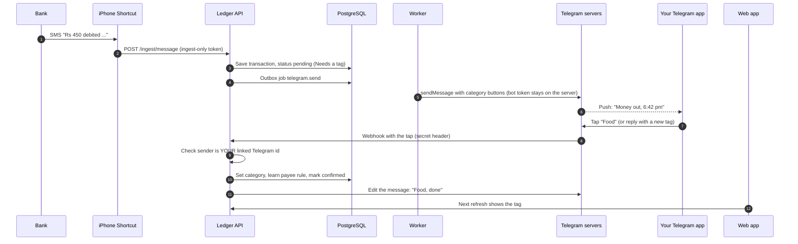

One database, three doors in (iPhone Shortcut, Telegram, web app) and two doors out (Telegram messages, web app).

### 5.2 Why the Shortcut talks to our server, not to Telegram

| Option | Verdict |
|---|---|
| Shortcut → our server → Telegram (this design) | **Use this.** The Telegram bot token never leaves the server. The phone holds only an ingest-only token. The server can dedupe, parse, and keep the bot, database and web app consistent. |
| Shortcut calls the Telegram Bot API directly | Avoid. The bot token would sit inside the Shortcut. The message would reach Telegram unparsed and unsaved, so nothing would be in the database. |

### 5.3 Several payments at once: nothing gets missed

You get **one message per transaction**, in order. Five payments in a minute is five messages in the chat, each with its own buttons. You can tag them later, in any order.

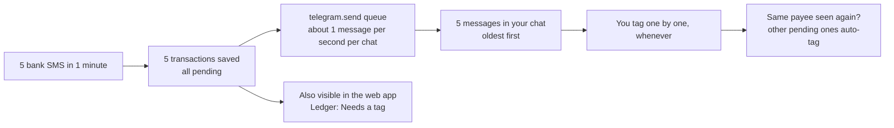

Why you cannot lose one
1. **Saved first, notified second.** A transaction exists in the database before any Telegram message is sent. If Telegram is down, the payment is still in the web app under *Needs a tag*, and the message is sent when Telegram is back.
2. **Messages stay in the chat** until you tag them. Tagged ones collapse to a single line, so the unresolved ones stand out.
3. **`/pending`** shows how many are untagged and re-sends the oldest, with a **Next ▶** button to walk through the rest one by one.
4. **Reminders:** a daily digest (for example 9 pm): "3 payments still need a tag", with a button to start. Time and quiet hours are settings.
5. **Auto-tag cascade:** when you tag a payee once, every *other* pending payment to the same payee is tagged automatically and its message is edited ("auto-tagged Food").
6. **Gaps are visible:** the web app shows "last captured 6:42 pm" so a silent failure on the iPhone side is noticed.

Telegram limits how fast a bot can message one chat (about one message per second; the Bot FAQ describes this). The `telegram.send` job queue spaces messages out and honours `retry_after`, so a burst arrives in order, a few seconds apart.

### 5.4 What the messages look like

Messages carry **no bank details**: no amount, payee, balance, account or bank name. They say only that money went out or came in, and when.

**Debit (money out)**
```
Money out · 6:42 pm

[ Food ] [ Travel ] [ Fun ]
[ Bills ] [ SIP ] [ Rent ]
[ ＋ New tag ] [ Reveal ] [ Later ]
```
**Credit (money in)**
```
Money in · 9:10 am

[ salary ] [ refund ] [ gift ]
[ transfer ] [ ＋ New tag ]
[ Reveal ] [ Later ]
```
Messages from an earlier day start with the date (`18 Oct · 6:42 pm`). Most payees are tagged automatically, so only new payees reach you, one message each.

| Button | What it does |
|---|---|
| A category (up to 6, your most used first) | Tags this payment, learns the payee, edits the message to `Money out · Food ✓` |
| **＋ New tag** | Bot asks "Reply with the tag" (a reply box opens). You type `food` or `#gym`. A new tag creates a new category on the spot, like everywhere else in the app. |
| **Reveal** | Edits this one message to show the amount and payee for 30 seconds, then back. Can be switched off in Settings (5.8) |
| **Later** | Does nothing now; stays pending and in `/pending` and the digest |
| **transfer** (credits and debits) | Marks an own-account transfer; excluded from spent, income, plans, budgets |
| After tagging a **credit**: `Add to this month's plan? [Yes] [No]` | Optional; your answer is remembered |

Commands (all except `/start` and `/signin` need an active session, 5.5)

| Command | Result |
|---|---|
| `/signin` | Start a session: send your authenticator code (5.5) |
| `/signout` | End the session at once; payments keep saving and wait |
| `/pending` | Count of untagged, oldest one re-sent, **Next ▶** |
| `/undo` | Reopen the last tag you set |
| `/pause 2h` | Silence prompts, keep saving (quiet hours also configurable) |
| `/unlink` | Disconnect this chat |

There is no balance command: balance checks are typed in the web app only (3.6).

When you tag something in the **web app**, the bot edits its old message to the final state so you never tap a stale button.

### 5.5 Whitelisting and sign-in: only you can use it

Two locks. **Pairing** ties the bot to your Telegram id once. **`/signin`** opens a session, so someone holding your unlocked phone still cannot use the bot until you have signed in.

Telegram identifies people by a numeric **user id** that others cannot spoof. The server stores your id once, during a pairing step, and ignores everyone else.

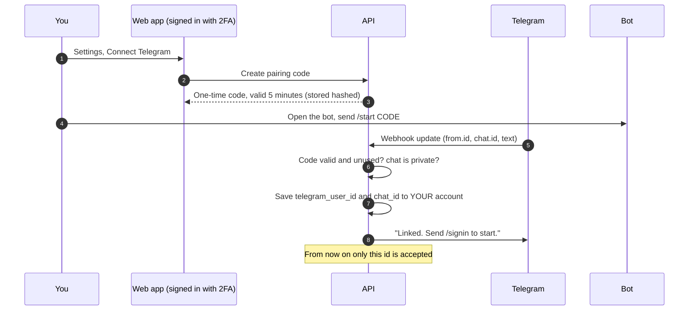

Rules
- **Private chat only.** Messages from groups or channels are ignored.
- Every update must come from the stored `telegram_user_id`. Anything else gets **no reply** and is counted for rate limiting.
- The pairing code is single-use and expires in 5 minutes. It can only be created while signed in to the web app (2FA).
- `/unlink` or "Disconnect Telegram" in the web app deletes the link instantly. Re-linking needs a new code.
- One account can link one Telegram id at a time (default). Changing it requires the web app.

**Signing in to the bot**

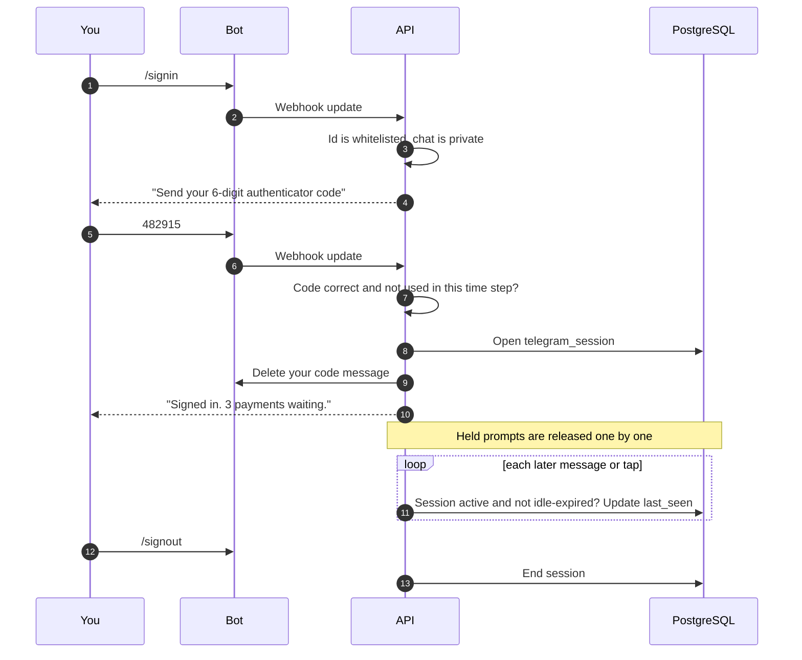

- **A session lasts until you send `/signout`**, with two safety nets: it also ends after **30 days without use** (a setting), and **Sign out of Telegram** in the web app ends it from anywhere.
- **While signed out the bot sends nothing.** Payments are still saved; their prompts are *held*. On `/signin` you get a count ("3 payments waiting"), then the prompts one by one, and a one-line note if a limit alert was held.
- **Every update is checked in this order:** id whitelisted, chat private, session active. A whitelisted id with no session gets only "Signed out. Send /signin."; every other id gets no reply.
- **The code** is a normal authenticator (TOTP) code, accepted once per time step. The bot deletes your message right after reading it. Three wrong codes in 15 minutes pause sign-in for 15 minutes and write an audit entry. Passkeys cannot be used inside a chat, so `/signin` uses the authenticator.

### 5.6 One database: how everything stays in sync

| Event | Telegram | Web app |
|---|---|---|
| Payment arrives | message with buttons | appears in Ledger → Needs a tag; badge on nav |
| Tag in Telegram | message edited to `Food ✓` | Ledger shows the tag on next refresh (or immediately if live updates are on) |
| Tag in web app | message edited to the final state, buttons removed | updated in place |
| Same payee tagged | other pending messages edited "auto-tagged" | those rows update too |
| Tag from two places at the same moment | **First write wins**; the second tap gets "already tagged as Food" and the message is refreshed | same, with a small notice |

Rules
- The **database is the only truth**. The bot keeps no state except the message ids it needs to edit.
- Callback data is a short opaque token (Telegram allows 64 bytes), never raw data: it maps server-side to *(prompt, category)*. The server re-checks that the prompt belongs to the caller and is still open.
- Taps are idempotent: tapping twice or after a retry changes nothing the second time.

### 5.7 Backend additions

| Piece | Detail |
|---|---|
| Webhook | `POST /telegram/webhook/<random path>`; Telegram is configured with `setWebhook` and a **secret token** that arrives in the `X-Telegram-Bot-Api-Secret-Token` header on every call ([Telegram webhook docs](https://core.telegram.org/bots/api#setwebhook)). Reject anything without the right header. HTTPS on an allowed port (443). Optionally allow-list Telegram's published IP ranges as a second layer. |
| Module `telegram` | pairing, sign-in sessions, send prompt, hold prompts while signed out, handle taps and replies, commands, edit messages |
| Jobs | `telegram.send` (tag prompts, budget alerts and the digest; per-chat queue about 1 per second; retries with `retry_after`), `telegram.digest` (daily), `telegram.sync_prompt` (edit messages after a tag elsewhere), `telegram.expire` (retire old prompts and idle sessions) |
| Uses existing modules | `ingest` (creates the pending transaction), `classification` (tag + payee memory + cascade), `ledger`, `budgets` (a tag changes spent per category, so `budget.evaluate` runs) |
| No Telegram link, or no active session | Prompts are not sent (with a session missing they are *held* and released on `/signin`); payments wait under Needs a tag in the web app |
| Web UI | A Settings area to connect, disconnect, switch Reveal on or off, set session length and end the session (not yet designed; see section 6). The first connection happens in the Setup guide (designed). |

Typed replies: when you press **＋ New tag** the server remembers "waiting for a tag for prompt X" for ~2 minutes; the next plain-text message from you is read as the tag.

### 5.8 Privacy: be honest about Telegram

**What Telegram can see.** Bot conversations are ordinary "cloud" chats. They are **not end-to-end encrypted** (only one-to-one *Secret Chats* are, and bots cannot use those), so Telegram's servers can read and store whatever the bot sends or you type. Check Telegram's current docs and FAQ before launch, since details can change.

**So we send it nothing from the bank.** Every message says only that money went out or came in, and when. The category buttons show your own category names (for example Rent, SIP), which say a little about you but nothing about the bank.

| Never in any message | |
|---|---|
| Amount, payee, balance | account numbers, bank name, UPI IDs, the original SMS |

**Reveal (optional, `allow_reveal`, on by default).** The **Reveal** button edits one message to show the amount and payee for 30 seconds, then back. During that time the details pass through Telegram. Turn Reveal off in Settings and Telegram never sees a single bank detail; use the Ledger when you need to know which payment is which.

**Budget alerts** name the category and the level only ("Food reached 80%"), never a rupee figure.

**What you type into the chat.** Only tag names and your one-time `/signin` code (the bot deletes it). Balances are never typed into Telegram.

**Optional "tidy up":** after you tag, the bot **deletes** the message or edits it to `Money out · Food ✓`, so the chat does not become a log. Telegram allows bots to delete their own messages for a limited time after sending; the bot edits older ones instead.

The threat table for the bot is in section 15.4.

---

## 6. Screens

Sixteen boards are designed. **One header on every signed-in page (no logo, the sign-in pages keep their wordmark):** six sections (Now, Ledger, Plan, Limits, Repeats, Trends) each marked by a small line icon instead of a sequence number, a **+ Add credit** button, an **Account** menu, and a **month ruler** showing day 18 of 31. The Account menu holds *Profile and preferences*, *Security*, *Devices and Telegram*, *Setup guide*, *Needs a look* and **Sign out**; it closes on Escape or a click outside. The pale numeral that used to head each page's left column is now the same icon, drawn large. The sign-in pages keep a simpler header (wordmark only) because nobody is signed in yet. No sidebar, no cards, no rounded corners; one accent colour; the page itself never scrolls (panels scroll inside).

| Area | Page | Route | What it does | Spec |
|---|------|-------|--------------|------|
| App | **Now** | `/` | Hero available balance, plain-language sentence, three action links, money-flow diagram, day-by-day spend bars (toggle) | [`01-now`](docs/ui-spec/01-now/SKILL.md) |
| App | **Ledger** | `/ledger` | All transactions with category and source filters, lazy-loaded list, `tag it` for untagged debits and credits (the in-app twin of the Telegram inbox; credits appear here too) | [`02-ledger`](docs/ui-spec/02-ledger/SKILL.md) |
| App | **Plan** | `/plan` | Money-to-plan stepper, split bar, per-category planned amounts, new categories from typed tags (this is where categories are created and managed) | [`03-plan`](docs/ui-spec/03-plan/SKILL.md) |
| App | **Limits** | `/limits` | One bar per category, alert level, status words, month-end pace, add-limit form, recent warnings | [`04-limits`](docs/ui-spec/04-limits/SKILL.md) |
| App | **Repeats** | `/repeats` | Recurring payments, 30-day timeline, pause switches | [`05-repeats`](docs/ui-spec/05-repeats/SKILL.md) |
| App | **Trends** | `/trends` | One sentence, one chart (money in and out for six months, with October's pace hatched in) and a short list of what is changing against a usual month. No toggles | [`06-trends`](docs/ui-spec/06-trends/SKILL.md) |
| App | **Add credit** | `/credit` | Amount, tag, date, note, add-to-plan switch, live arithmetic, success state | [`07-add-credit`](docs/ui-spec/07-add-credit/SKILL.md) |

**Auth and onboarding (designed on the canvas, five more boards).** *Sign in* (password, then authenticator, passkey or recovery code), *Create account*, *Secure your account* (authenticator, passkey, recovery codes), *Reset password*, and the *Setup guide* inside the app shell: connect the iPhone (token, Shortcut screens with copy buttons, live test), connect Telegram (bot token, link), choose Reveal and session length, and enter the first month. They use the same tokens and components; specs: [`12-sign-in`](docs/ui-spec/12-sign-in/SKILL.md), [`13-create-account`](docs/ui-spec/13-create-account/SKILL.md), [`14-secure`](docs/ui-spec/14-secure/SKILL.md), [`15-reset`](docs/ui-spec/15-reset/SKILL.md), [`16-setup-guide`](docs/ui-spec/16-setup-guide/SKILL.md).

**Account area and capture screens (designed on the canvas, six more boards).**

| Page | Route | What it does |
|---|---|---|
| **Profile** | `/account` | Name; change email (needs an authenticator code and a confirmation link to the new address); fixed region note (₹, India time); **export everything** (code, then a one-time download that expires in 10 minutes); **delete account** (type DELETE plus a code; scheduled for 7 days so signing in cancels it); sign out of this browser Spec: [`09-profile`](docs/ui-spec/09-profile/SKILL.md) |
| **Security** | `/account/security` | Change password (current, new of 12+ characters, code; signs other browsers out); replace authenticator (goes to the Secure flow); passkeys list with add and remove; recovery codes (8 of 10 left; new set needs a code, shown once); signed-in browsers with per-browser sign out and "sign out all others"; append-only activity log Spec: [`10-security`](docs/ui-spec/10-security/SKILL.md) |
| **Devices and Telegram** | `/account/devices` | iPhone capture status and last message time; send a test message; ingest token (masked) with **make a new token** and **cancel token**, both behind a code; Telegram link status; bot session (sign out, or send `/signin`); Reveal switch; idle days; daily reminder; after-tag behaviour; tracked bank account, last balance check, grace period Spec: [`11-devices`](docs/ui-spec/11-devices/SKILL.md) |
| **Needs a look** | `/ledger/unread` | Messages the parser could not read, shown as the original text with direction, amount and payee fields; add to the ledger, or delete; 30-day note. Reached from a **LOOK** link on Now and Ledger and from the Account menu; the Ledger stays lit in the header Spec: [`08-needs-a-look`](docs/ui-spec/08-needs-a-look/SKILL.md) |
| **Ledger additions** | `/ledger` | A **CHECK** row opens the balance-check panel (type the bank's balance, see match or gap, book it now or wait). The **Unaccounted** entry shows a yellow square, an `UNACCOUNTED` source and a **split** action (amount and tag for one part; the rest stays Unaccounted); the source filter gained Unaccounted |

All three account pages share one left column: the pages of the area, then a small summary. Anything that could lock you out or move your data asks for the authenticator code inline, never in a pop-up.

**Still open on the design side:** the Ledger's control for adding a missed payment by hand, and a first-run empty state for every page. Nothing here has been seen in a real browser yet; see the note at the top of this section.

### Colour meaning (applies everywhere)

| Meaning | Colour |
|---|---|
| Money out: debits, spent, committed | **Black** |
| Money in: credits, income, kept, carried over | **Green** (accent) |
| The balance itself (available, balance now, new balance, opening balance) | **Black**, because it is a position, not a movement |
| Limit under the alert level | Green |
| Limit at or above the alert level (default 80%) | **Yellow** |
| Limit exceeded | **Red** |

A debit is never green and a credit is never black. The one exception to "no gradients": every bar shades from a deeper tone of its colour at the base (or start) to the normal, slightly brighter tone at the tip. The range is kept narrow on purpose, so a bar reads as a solid colour with depth, never as a glow or a fade-out. Full rules, tokens and the single type scale are in [`docs/ui-spec/00-design-system/SKILL.md`](docs/ui-spec/00-design-system/SKILL.md).

---

## 7. Architecture overview

### 7.1 Goals, constraints, principles

**What the system must do**

| Need | Architectural consequence |
|---|---|
| Payments appear on their own | An iPhone Shortcut forwards each bank debit and credit message to an ingest endpoint with an ingest-only token; the server parses, de-duplicates and saves it. |
| Money in is explicit and visible | Credits arrive from the bank's credit message or the Add-credit page. Each one counts in the balance immediately and waits under "Needs a tag" until you tag it. Nothing is invented. |
| Balance never resets | Balance is **derived** (`opening + Σcredits − Σdebits`), never stored as a mutable number. Month views are filters over one ledger. |
| Budgets alert immediately, once per period | Budget evaluation is triggered by **writes** (outbox → worker), not by a timer; alert rows make firing idempotent. |
| Safe and private | Row-level security on every table, ingest-only device token, whitelisted Telegram id, field-level encryption of secrets, 2FA, no raw message stored. |

**Principles**
1. **Single source of truth:** one append-mostly `transactions` ledger. Everything on screen is a query over it plus the plan, budgets and rules.
2. **Idempotent ingestion:** every inbound event carries a dedupe key; replays create nothing new.
3. **Derive, don't duplicate:** balances, per-category spend, pace and trends are computed on read from the ledger. There are no cached totals.
4. **Write path is transactional:** a transaction write and the jobs it triggers commit together (transactional outbox).
5. **Do not keep the raw message:** the server parses the forwarded text and discards it; only an unreadable message is kept, encrypted, for at most 30 days. OTPs never leave the phone.
6. **Money is integers:** paise as `bigint`, never floats.
7. **Never move money:** the system reads results of payments; it holds no bank credentials, PINs or OTPs.

### 7.2 System context

Who and what talks to the system.

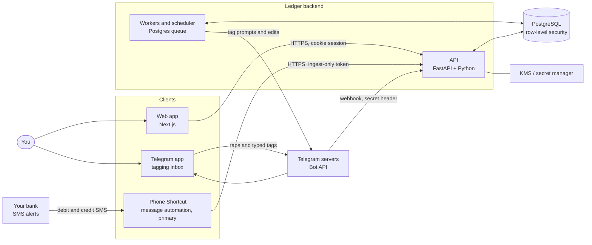

Notes
- The **queue lives in PostgreSQL** (a transactional outbox plus a small `SKIP LOCKED` job queue), so API and worker share one datastore and the outbox is a normal transaction.
- Your iPhone **writes** (the Shortcut) and **receives** prompts (Telegram). The ledger itself is read only through the web app.
- iPhone is the primary phone. iOS apps cannot read SMS, so a **Shortcut** forwards bank messages containing `debited` or `credited` to the ingest endpoint. The server parses and discards the body; OTPs are never sent. See [section 4](#4-getting-transactions-in-iphone-first).

### 7.3 Containers and connections

| Container | Tech | Responsibility | Talks to | Protocol / auth |
|---|---|---|---|---|
| **Web app** | Next.js, CSS variables from `docs/ui-spec` | Sixteen screens (Now, Ledger, Plan, Limits, Repeats, Trends, Add credit, Needs a look, Profile, Security, Devices and Telegram, Sign in, Create account, Secure, Reset, Setup guide) | API | HTTPS, `HttpOnly; Secure; SameSite=Strict` cookie + CSRF token |
| **Telegram bot** | Telegram Bot API, webhook | Your tagging inbox: one prompt per transaction with category buttons, receives taps and typed tags, edits messages when a tag changes elsewhere | API (webhook in), Worker (messages out) | HTTPS; webhook secret-token header; whitelist by numeric Telegram user id; bot token only on the server |
| **iPhone Shortcut** (primary) | Shortcuts "Message" automation | Forward bank debit/credit SMS text to `POST /ingest/message` | API | HTTPS, per-device ingest-only bearer token + nonce + timestamp |
| **API** | Python 3.12, FastAPI, pydantic | AuthN/Z, validation, all reads and writes, enqueue jobs | PostgreSQL, KMS | SQL over TLS; sets `app.user_id` per request for RLS |
| **Worker** | Same code, runs inside each service (consumers and cron on the Postgres queue) | Budget evaluation, recurring posting, Telegram sends and digests | PostgreSQL, Telegram | SQL; outbound HTTPS |
| **PostgreSQL** | PostgreSQL 17, psycopg, SQL migrations | System of record, queue, RLS | none | TLS, least-privilege roles |
| **Secret manager / KMS** | Cloud secret manager | Field-encryption keys, Telegram bot token and webhook secret, JWT keys | API, Worker | IAM |

Direction of data
- **Inbound writes:** iPhone Shortcut → `/ingest/message`; Telegram taps → `/telegram/webhook`; Web → `API` (credits, tags, plan, limits, rules).
- **Outbound notifications:** Worker → Telegram only. Messages carry no bank details (section 5.8).
- **Reads:** Web → `API` → PostgreSQL only.

### 7.4 Suggested stack (default; swap freely)

| Layer | Choice | Why |
|---|---|---|
| Backend | Python 3.12 + FastAPI, one service per module group | Typed models, async I/O, simple webhooks |
| DB | PostgreSQL + psycopg and plain SQL migrations | Strong constraints; row-level security, per-service roles and the outbox are plain SQL |
| Web | Next.js | Sixteen screens, works on phone and desktop |
| Phone capture | **iPhone Shortcut → `/ingest/message`** | iOS cannot read SMS; Shortcuts can forward it |
| Tagging inbox | **Telegram bot** (Bot API webhook, whitelist by your Telegram user id) | Reliable notifications and one-tap tagging from the same database |
| Queue and scheduler | Postgres outbox + `SKIP LOCKED` job queue with cron (`bt.queue`) | Recurring posts, outbox jobs, retries; no extra infrastructure |
| Validation | pydantic on every boundary | Reject malformed input early |
| UI styling | CSS variables from `docs/ui-spec/00-design-system` (type scale, colour tokens, row/bar sizes) | One accent swap, consistent sizing |
| Fonts | Geist + Geist Mono (Google Fonts) | The design's two typefaces |

---

## 8. Backend modules

Many modules, each owned by one service (the module-to-service split is in `docs/ARCHITECTURE.md`). Dependencies only point downward or along the arrows below; across services an arrow is an API call or an event.

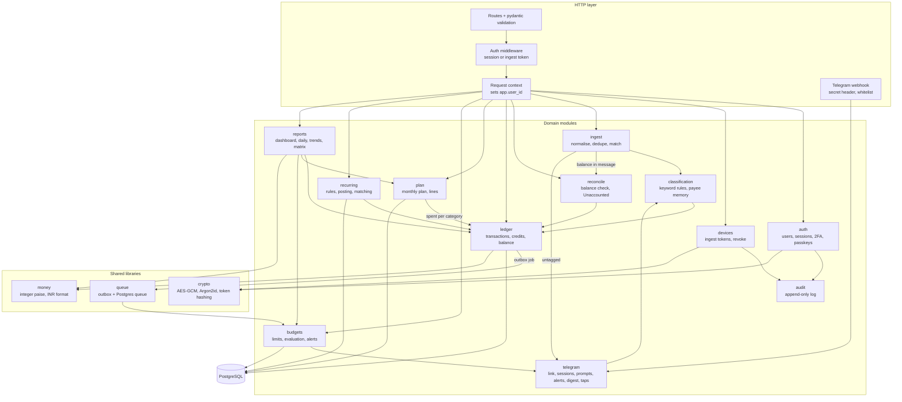

| Module | Owns | Key rules |
|---|---|---|
| `auth` | users, sessions, TOTP, passkeys | Argon2id; short access token, rotating refresh with reuse detection; mandatory 2FA |
| `devices` | ingest tokens (hashed) | Token shown once; revocation is immediate |
| `ingest` | `ingest_events`, `unparsed_messages`, dedupe, matching, bank-message parser (templates as data) | Debits and credits; OTP/promo guard; strict schema; replay protection (timestamp skew ≤ 5 min, nonce unused); payment time read from the message; discards parsed text, keeps unreadable text encrypted ≤ 30 days |
| `reconcile` | `balance_checks` | Compares bank balance with the ledger; waits the grace period; books one Unaccounted entry; merges a late real message into it; splits on request |
| `classification` | `categories`, `tag_rules` | Resolution order: payee memory → keyword rule → you choose. A new tag creates a category |
| `ledger` | `transactions` | Single writer for money rows; every write emits an outbox job |
| `plan` | `plans`, `plan_lines` | Over-assigning allowed, flagged; "unassigned" = total − assigned |
| `budgets` | `budgets`, `alerts` | Alert level 70/80/90 (default 80) and 100; fire once per (budget, period, level); each new alert is sent through `telegram` |
| `recurring` | `recurring_rules` | Post on due date; link to a captured debit within ±2 days instead of double counting |
| `reports` | read models | Pure queries over ledger, plan, budgets; nothing cached |
| `telegram` | `telegram_links`, `telegram_pairings`, `telegram_sessions`, `telegram_prompts` | Whitelist by numeric Telegram id, private chat only, active `/signin` session required; sends no-details tag prompts, budget alerts and the digest, holds them while signed out; opaque callback tokens; edits messages when a tag changes elsewhere |
| `audit` | `audit_log` | Append-only: `UPDATE/DELETE` revoked |

---

## 9. Data model and API

Everything is scoped by `user_id`; every query is additionally enforced by Postgres row-level security.

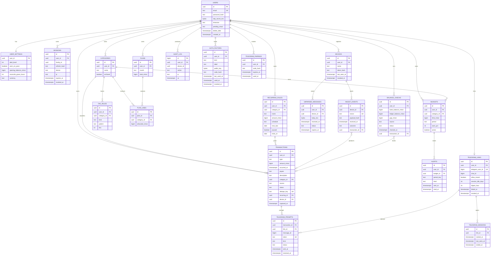

**Tables beyond the basic set** (needed by the flows in section 10)
- `ingest_events`: one row per received event; `nonce` unique per device gives replay protection; records the outcome (created, duplicate, rejected) for audit and debugging.
- `user_settings`: alert level (70/80/90), pace warning, opening balance (of the tracked bank account), balance-check grace hours (default 6), currency.
- `unparsed_messages`: the only place message text is kept: encrypted, only when the parser cannot read amount and direction, never for OTP-like text, deleted when resolved or dismissed and expired after 30 days.
- `balance_checks`: one row per comparison of bank balance and ledger balance; a booked gap points at its Unaccounted transaction.
- `telegram_sessions`: one row per `/signin`; active while `ended_at` is empty and the last use is within the idle limit.

- `telegram_links`, `telegram_pairings`, `telegram_prompts`: the bot link (your numeric Telegram id and chat id, whether Reveal is allowed, session idle days, digest hour), one-time pairing codes (stored hashed, 5-minute life), and one row per message sent (a tag prompt, budget alert or digest: message id, opaque callback token, kind, status; the transaction id is empty for alerts and digests).

**Constraints that matter**
| Constraint | Why |
|---|---|
| `UNIQUE (user_id, dedupe_key)` on `transactions` | Idempotent ingestion |
| `UNIQUE (device_id, nonce)` on `ingest_events` | Replay protection |
| `UNIQUE (user_id, lower(name))` on `categories` | One category per tag |
| `UNIQUE (budget_id, period_key, level)` on `alerts` | Fire once per period and level |
| `amount_minor > 0` with `type` carrying direction | No sign bugs; credits and debits are explicit |
| RLS `user_id = current_setting('app.user_id')::uuid` | A bug cannot leak across users |
| `REVOKE UPDATE, DELETE` on `audit_log` | Append-only |
| Deleting a category with transactions is blocked | Reassign or archive instead |

**Allowed values**
- `transactions.type`: `debit | credit`
- `transactions.source`: `captured | recurring | manual | unaccounted`
- `transactions.status`: `pending | confirmed | reversed`
- `tag_rules.kind`: `keyword | payee`
- `auth_factors.kind`: `passkey | recovery_code` (a passkey row holds the public key and label; a recovery-code row holds the hash and `used_at`)
- `alerts.level`: `alert | exceeded` (alert = the user's 70/80/90 level)
- `telegram_prompts.status`: `queued | held | sent | tagged | auto_tagged | expired | failed`
- `telegram_prompts.kind`: `tag | alert | digest`
- `unparsed_messages.status`: `open | resolved | dismissed | expired`
- `balance_checks.source`: `message | manual`
- `balance_checks.status`: `open | booked | resolved | ignored`

**Key API endpoints**

```
POST   /auth/register | /auth/login | /auth/refresh | /auth/logout
POST   /auth/2fa/enable | /auth/2fa/enable/confirm | /auth/2fa/verify      (authenticator set-up, then the second sign-in step)
POST   /auth/passkey/register/options | /auth/passkey/register/verify     (enrol a passkey, signed in)
POST   /auth/passkey/login/options | /auth/passkey/login/verify           (second step with a passkey)
POST   /auth/reset/verify | /auth/reset/complete                          (lost password: recovery code, then a new password)
POST   /auth/password | /auth/recovery-codes        GET /auth/factors   DELETE /auth/passkey/:id   (Security page; each needs a fresh 2FA code)
POST   /ingest/message             (iPhone Shortcut: ingest-only bearer token, nonce, timestamp)
POST   /telegram/webhook/<secret>  (Telegram: secret-token header, whitelisted sender)
GET|PATCH /me                               (GET is composed by the gateway: name, zone and the header's three counts; PATCH sets the name)
POST   /me/email | /me/email/confirm       (code, then a confirmation link to the new address; the link's token confirms it)
GET    /dashboard?month=YYYY-MM
GET    /ledger?cat&src&cursor&limit        (cursor-paginated; Needs a tag included)
PATCH  /transactions/:id                   (tag, category, #transfer)
GET|PUT /plans/:month
GET|POST|PATCH|DELETE /budgets | /recurring | /categories
GET|POST /credits                          (add by hand; recent list)
GET    /reports/daily?month=   | /reports/months?range=6 | /reports/category-matrix?range=6
GET    /alerts           POST /alerts/:id/read
GET|PATCH /settings                        (alert level, pace warning, Reveal on/off, session idle days, digest, grace hours)
GET|POST /devices  PATCH|DELETE /devices/:id   (list; create or rotate the ingest token; rename; revoke. Rotate and revoke need a 2FA code)
POST   /devices/test                       (Devices page: send a test message, never stored in the ledger)
GET    /telegram/link      POST /telegram/bot-token                              (link and bot-session status; save the bot token, stored encrypted)
POST   /telegram/pairing  DELETE /telegram/link  DELETE /telegram/session   (end the bot session from the web)
POST   /balance-check      GET /balance-checks     POST /balance-checks/:id/book   (type the bank balance; history; book a gap now instead of waiting out the grace period)
POST   /transactions/:id/split                      (split an Unaccounted entry; parts must add up)
GET    /unparsed           POST /unparsed/:id/resolve | /unparsed/:id/dismiss   (Needs a look)
GET    /sessions           DELETE /sessions/:id    GET /audit                    (Security page)
POST   /account/export     DELETE /account     POST /account/restore            (export; schedule deletion for 7 days; signing in inside the 7 days cancels it)
DELETE /sessions                                                                  (sign out every browser except this one)
GET    /health  /health/deps               (gateway: liveness; every service answers /health and /ready; /health/deps needs an internal token)
```

Everything above is reached through the gateway at `/api/<path>` from the browser (the reverse proxy strips `/api`); `/ingest/message` and `/telegram/webhook/<secret>` are also reachable without the prefix because the Shortcut and Telegram call them directly. Routes under `/internal/*` exist only between services and are never routed from outside (`docs/ARCHITECTURE.md`).

---

## 10. Core data flows

### 10.1 Bank message captured from the iPhone (debit or credit)

The main automatic flow. The bank SMS gives amount, time and often the payee; you add the category afterwards. Full detail in [section 4](#4-getting-transactions-in-iphone-first).

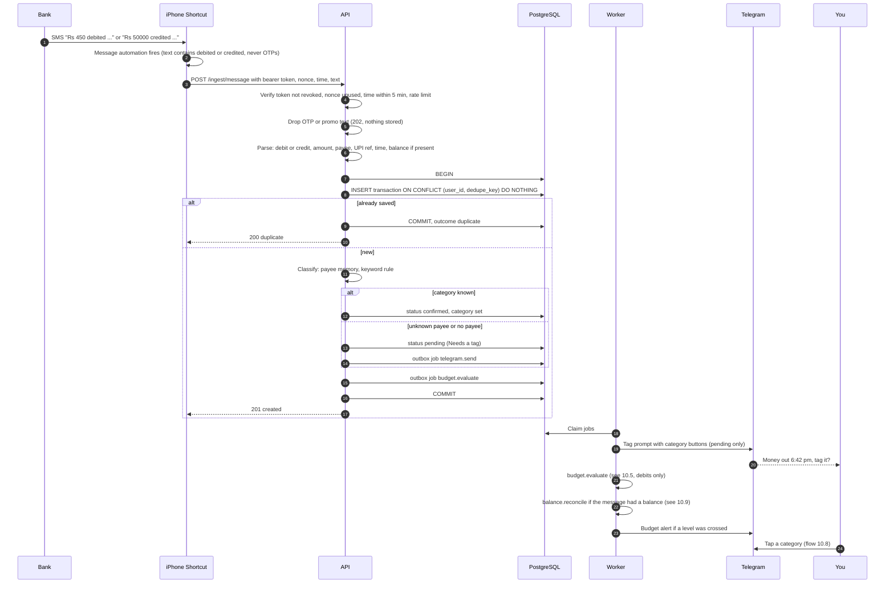

Points to remember
- **Tag prompts and budget alerts go to Telegram** (flow 10.8); the web app shows the same data.
- **Both directions are accepted.** A credit counts in the balance immediately and waits under "Needs a tag" for `#salary`, `#refund` and so on. If you had already added the same credit by hand, the SMS is **linked** (same amount within one day), not doubled.
- The Shortcut forwards only messages containing the trigger word, so **OTPs never leave the phone**; the server also drops OTP-like text before parsing or logging.
- The raw message is **not stored**, only parsed fields. If it cannot be read it goes encrypted to Needs a look (4.7) and you get `422`.
- The payment is booked at the **time in the message**, so a delayed run still lands on the right moment; the row also records when it was captured.
- If the bot session is signed out, the Telegram prompt is **held** and released on `/signin` (5.5).
- Own-account transfers are tagged `#transfer` and excluded from spent, income, plans and budgets.
- Reversals (`reversed`, `refund`, `failed`) mark the matching earlier debit `reversed` when the reference matches.

### 10.2 Untagged debit gets a tag (Ledger page)

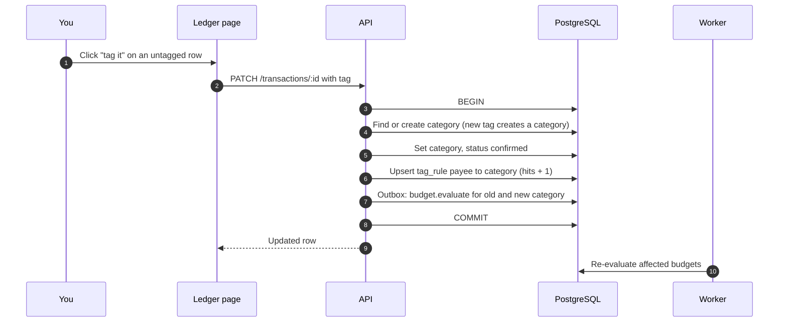

Next time the same payee or keyword arrives, step "Classify" in 10.1 resolves it automatically.

### 10.3 Add credit by hand (cash, or a bank without alerts)

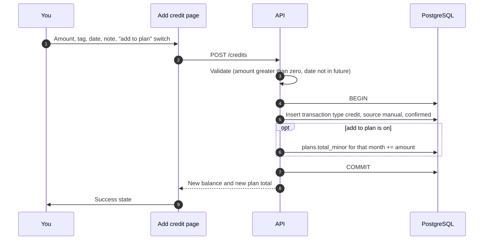

Balance is not "updated" anywhere; it is derived, so the next dashboard read already includes the credit.

Credits that arrive as a **bank message** go through flow 10.1 instead. If the same credit was added here first, the SMS is **linked** to it (same amount within one day) rather than doubled.

### 10.4 Recurring payment posts itself

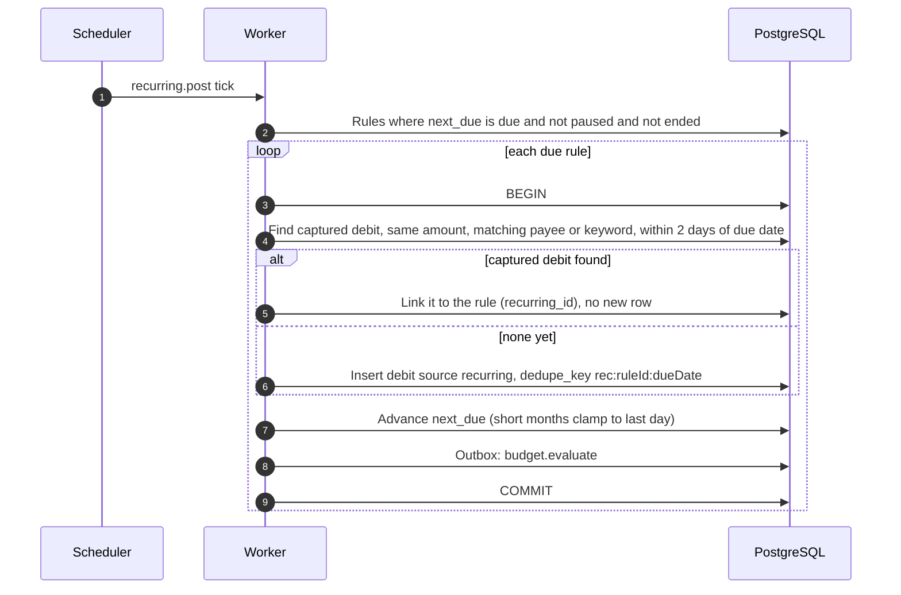

Reverse case: if the **phone captures first and the rule fires later**, the match above links it. If the rule posted first and the phone event arrives later, `ingest` looks for an open recurring post within ±2 days and merges into it, so rent is never counted twice.

### 10.5 Budget evaluation and alert firing

Triggered by every transaction insert, edit or delete (via the outbox), plus period rollover.

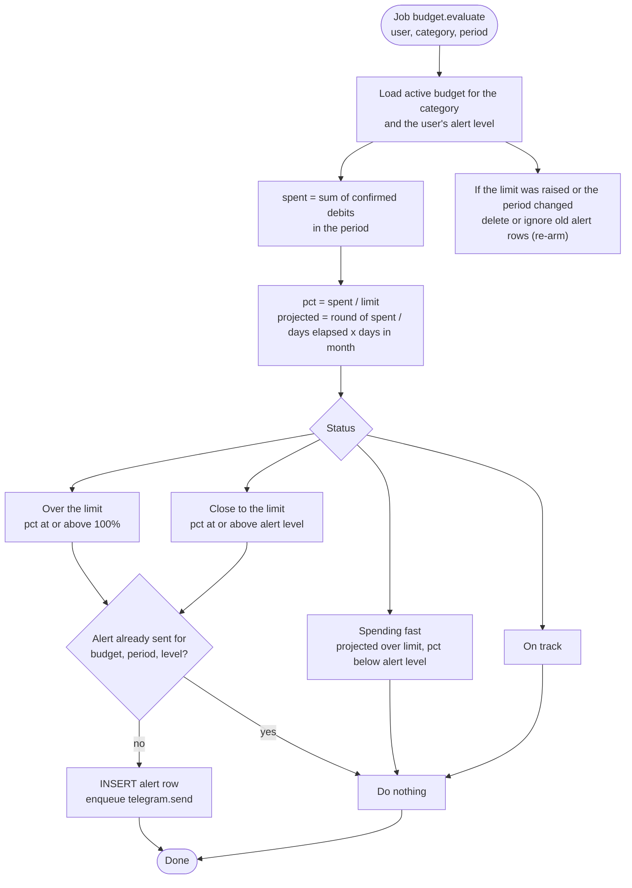

The UI reads the same logic: bar is **green** under the alert level, **yellow** at or above it, **red** once exceeded; "spending fast" keeps a green bar with an outlined yellow dot (only an on-screen status, no push).

### 10.6 Balance and month rollover (no reset)

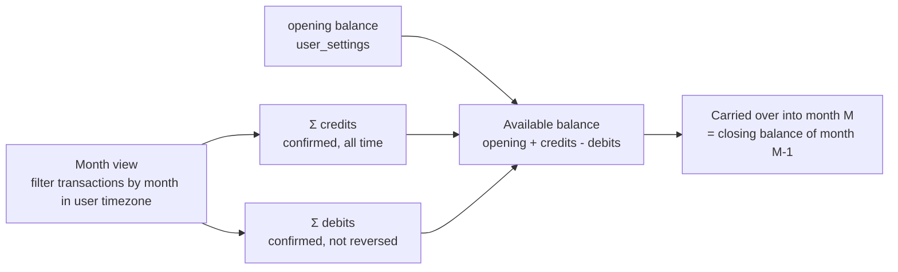

- There is **no month-end job that resets anything**. Month boundaries use the user's time zone.
- "Safe to spend" = `(plan total − spent this month for planned categories) ÷ days left`.
- The derived balance is compared with the bank by the balance check (3.6, flow 10.9).

### 10.7 Sign-in, 2FA and session rotation

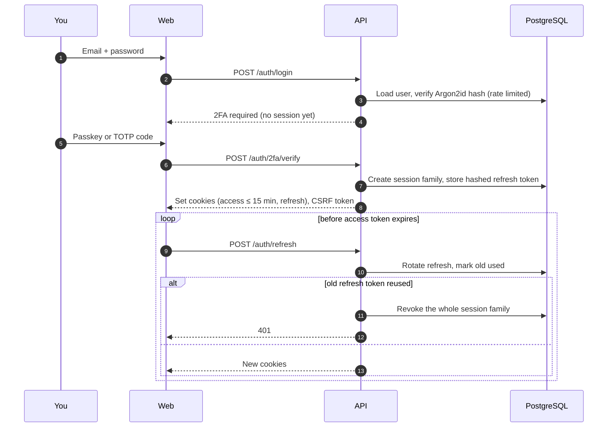

### 10.8 Tagging in Telegram

Full design, message layouts, sign-in sessions and security in [section 5](#5-telegram-tagging-inbox).

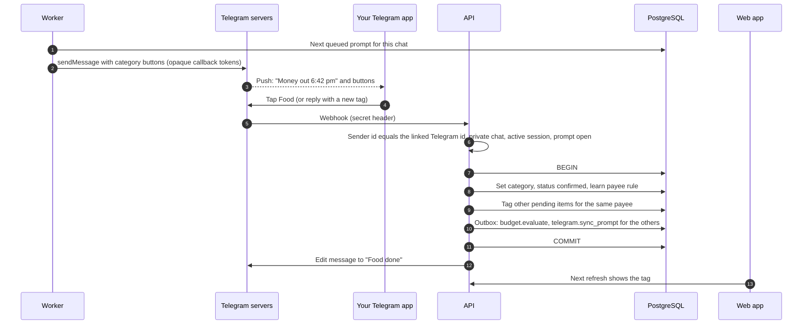

Several payments in one minute become several messages in order, about a second apart. Nothing depends on Telegram being up: the transaction is saved first and appears under Needs a tag in the web app either way.

### 10.9 Balance check: a gap becomes "Unaccounted"

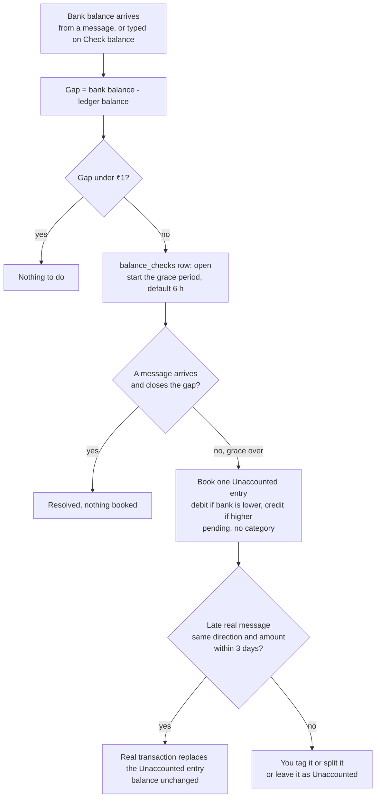

- Job `balance.reconcile` runs after any ingest that carried a balance, after a manual check, and every 30 minutes for open checks whose grace period has ended.
- Only the newest message by the time written in it may supply a balance; older out-of-order arrivals are ignored.
- The entry counts in the balance and in "Spent"/"Income", belongs to no category budget, and shows in the Ledger under Needs a tag with an Unaccounted label.

---

## 11. Page → API → data map

What each screen calls and which tables it ends up reading or writing. Endpoints marked **new** are required by the UI spec beyond the original auth/plan/budget endpoints.

| Page | Reads | Writes | Tables touched |
|---|---|---|---|
| **Now** | `GET /dashboard?month=YYYY-MM` (balance, carried over, income, spent, safe-to-spend, flow groups, alerts, untagged count, next recurring, last captured) · `GET /reports/daily?month=` **new** (daily spend excluding fixed payments) | `POST /balance-check` (Check balance) | `transactions`, `plans`, `plan_lines`, `budgets`, `alerts`, `recurring_rules`, `balance_checks` |
| **Ledger** | `GET /ledger?cat&src&cursor&limit` **new** (cursor pagination for lazy loading; counts per category) · `GET /unparsed` (Needs a look) | `PATCH /transactions/:id` (tag, category) · `POST /transactions/:id/split` · `POST /unparsed/:id/resolve\|dismiss` | `transactions`, `categories`, `tag_rules`, `unparsed_messages` |
| **Plan** | `GET /plans/:month` (total, lines with planned and spent) | `PUT /plans/:month` · `POST /categories` (new tag) | `plans`, `plan_lines`, `categories`, `transactions` |
| **Limits** | `GET /budgets` (with pct, projected, status) · `GET /alerts` | `POST/PATCH/DELETE /budgets` · `PATCH /settings` (alert level, channels) | `budgets`, `alerts`, `user_settings`, `transactions` |
| **Repeats** | `GET /recurring` (rules, next due, committed total) | `POST/PATCH/DELETE /recurring` (create, pause, edit) | `recurring_rules`, `transactions` |
| **Trends** | `GET /reports/months?range=6` **new** (income, spent, kept, month-end balance per month, plus the month-end pace for the month in progress) · `GET /reports/category-matrix?range=6` **new** (per category per month, plus each category's pace; the page lists only the flexible categories) | none | `transactions`, `categories` |
| **Add credit** | `GET /credits?limit=3` **new** (recent) | `POST /credits` **new** | `transactions`, `plans` |
| **Header and Account menu** | `GET /me` (name, email, alert badge count, unread-message count) | `POST /auth/logout` (sign out) | `users`, `transactions`, `unparsed_messages`, `sessions` |
| **Profile** | `GET /me` | `PATCH /me` (name) · `POST /me/email` (code, then confirmation link) · `POST /account/export` (code) · `DELETE /account` (type DELETE, code; sets `delete_after` 7 days out) · `POST /account/restore` (sign-in during the 7 days) | `users` (`pending_email`, `delete_after`), `audit_log` |
| **Security** | `GET /sessions` · `GET /audit?limit=` · `GET /auth/factors` (passkeys, recovery-code count) | `POST /auth/password` (code) · `POST /auth/passkey/*` · `DELETE /auth/passkey/:id` · `POST /auth/recovery-codes` (code) · `DELETE /sessions/:id` · `DELETE /sessions` (all others) | `users`, `sessions`, `auth_factors`, `audit_log` |
| **Devices and Telegram** | `GET /devices` · `GET /telegram/link` · `GET /settings` · `GET /balance-checks?limit=1` | `POST /devices/test` · `POST /devices` (rotate, code) · `DELETE /devices/:id` (code) · `DELETE /telegram/link` · `DELETE /telegram/session` · `PATCH /settings` (Reveal, idle days, digest, after-tag) | `devices`, `telegram_links`, `telegram_sessions`, `user_settings`, `balance_checks` |
| **Needs a look** | `GET /unparsed` | `POST /unparsed/:id/resolve` (direction, amount, payee) · `POST /unparsed/:id/dismiss` | `unparsed_messages`, `transactions` |
| **Setup guide** | `GET /settings` · `GET /devices` (live test status) · `GET /me` | `POST /devices` (ingest token) · `POST /telegram/pairing` · bot token save · `PATCH /settings` (Reveal, session days, alert level, opening balance) · `PUT /plans/:month` | `devices`, `telegram_links`, `telegram_pairings`, `user_settings`, `plans` |
| **Sign in, Create account, Secure, Reset** | none | `POST /auth/register\|login\|2fa/verify\|passkey/*`, recovery-code reset | `users`, `sessions`, `audit_log` |

Example response shape for the dashboard (all money in paise):

```json
{
  "month": "2026-10",
  "dayOfMonth": 18, "daysInMonth": 31,
  "balance": { "carriedOver": 2730000, "income": 5000000, "spent": 3970900, "available": 3759100 },
  "safeToSpend": { "planLeft": 579100, "daysLeft": 13, "perDay": 44500 },
  "flow": [
    { "name": "Rent", "amount": 2000000 }, { "name": "SIP", "amount": 1000000 },
    { "name": "Food", "amount": 542000 }, { "name": "Fun", "amount": 164000 },
    { "name": "Travel", "amount": 135000 }, { "name": "Bills", "amount": 129900 },
    { "name": "Still available", "amount": 3759100 }
  ],
  "attention": [
    { "kind": "limit", "category": "Fun", "pct": 82 },
    { "kind": "untagged", "count": 1 },
    { "kind": "recurring", "name": "Rent", "amount": 2000000, "due": "2026-11-01" }
  ]
}
```

Rules for the API layer
- All money is integer paise; the UI formats with Indian grouping.
- Month boundaries and "today" use the user's time zone.
- Lists are cursor-paginated (`cursor` = `(occurred_at, id)`); the Ledger asks for 8, then 5 per load.
- Every mutating endpoint returns the updated row **and** the figures the page shows next to it (e.g. Add credit returns new balance and new plan total) to avoid a second round trip.

---

## 12. Derived metrics

Everything on screen that is not a stored column, with its definition.

| Metric | Definition | Source |
|---|---|---|
| Available balance | `opening + Σ credits − Σ debits` (confirmed, not reversed, including Unaccounted entries), all time | `transactions`, `user_settings` |
| Balance gap | bank balance − available balance for the tracked account | `balance_checks`, `transactions` |
| Carried over (month M) | Closing balance of month M−1 (running sum over the ledger) | `transactions`, `user_settings` |
| Income (month) | Σ credits in month, excluding `#transfer` | `transactions` |
| Spent (month) | Σ debits in month, excluding `#transfer` | `transactions` |
| Kept (month) | income − spent; rate = kept ÷ income | `transactions` |
| Spent per category | Σ debits per category in month | `transactions` |
| Left (plan line) | planned − spent for that category | `plan_lines`, `transactions` |
| Unassigned | plan total − Σ planned | `plans`, `plan_lines` |
| Plan left | Σ planned − Σ spent over the planned categories (45,500 − 39,709 = 5,791 in the sample) | `plan_lines`, `transactions` |
| Safe to spend per day | plan left ÷ days left (inclusive of today) | derived |
| Limit pct | spent ÷ limit | `budgets`, `transactions` |
| Month-end pace | `round(spent ÷ days elapsed × days in month, nearest 10)` | derived |
| Limit status | over (≥100%), close (≥ alert level), fast (pace over limit), else on track | derived |
| Daily spend | Σ debits per day, excluding rent/SIP-type fixed payments for the Now chart | `transactions` |
| Committed per month | Σ amount over active recurring rules | `recurring_rules` |
| Balance trend | month-end closing balance per month | `transactions` |
| Category × month matrix | Σ debits per category per month; shading is per row (min/max of that category) | `transactions` |

Caching: none. Everything is derived on read with indexed queries: `(user_id, occurred_at DESC, id)`, `(user_id, category_id, occurred_at)`, `(user_id, dedupe_key) UNIQUE`. Add a cache only if profiling shows a real problem.

---

## 13. Transaction lifecycle

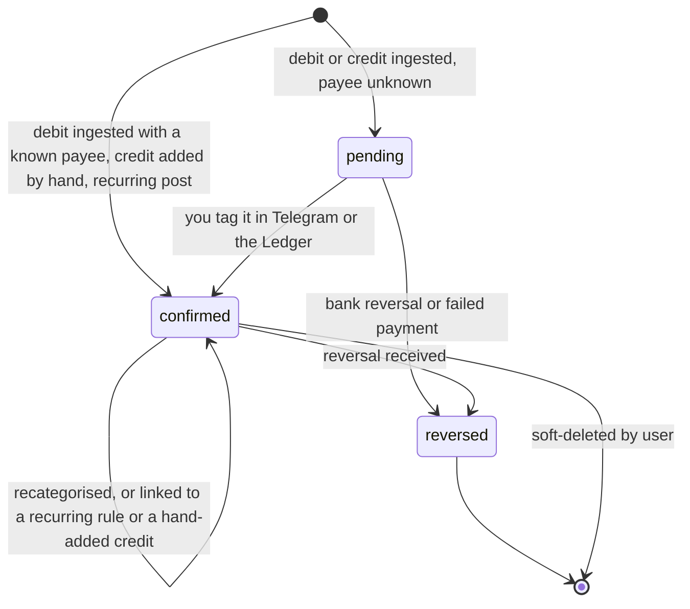

| Status | Counts in balance and budgets? | Shown in Ledger |
|---|---|---|
| `pending` | **Yes** (money has left; only the category is unknown) | Yes, "Needs a tag", category empty |
| `confirmed` | Yes | Yes |
| `reversed` | **No** | Yes, struck through, with a prompt to add the refund as a credit |

A `pending` debit counts toward the balance immediately but toward **no** category budget until tagged (it appears in "Uncategorised"). An **Unaccounted** entry (3.6) is a `pending` row with `source=unaccounted` and behaves the same way until you tag or split it.

---

## 14. Async jobs and events

All jobs are rows in PostgreSQL (the `queue` schema) written **in the same transaction** as the change that causes them (transactional outbox).

| Job | Trigger | Payload | Idempotency | Retry | Effect |
|---|---|---|---|---|---|
| `budget.evaluate` | any transaction insert / update / delete, budget edit, period rollover | `userId, categoryId, periodKey` | unique per payload; collapses bursts | exponential, 5 tries | Computes status; inserts alert row once per level (10.5) |
| `telegram.send` | pending transaction, new alert, digest, edit request, sign-in | `promptId` | one message per prompt id | honours Telegram `retry_after`, then retries | Sends the no-details tag prompt, budget alert or digest; per-chat queue about 1 message per second, oldest first. With no active session the prompt is held and released on `/signin` |
| `telegram.sync_prompt` | tag set in the web app, auto-tag cascade | `promptId` | latest state wins | 3 tries | Edits the Telegram message to its final state so no stale buttons remain |
| `telegram.digest` | cron, daily at the user's chosen hour | `userId` | one per user per day | next day | "3 payments still need a tag" with a Start button |
| `balance.reconcile` | an ingest with a balance, a manual balance check, cron every 30 minutes | `userId, checkId` | one open check per user | next tick | Computes the gap, waits the grace period, books or merges the Unaccounted entry (3.6, 10.9) |
| `recurring.post` | cron, every few minutes | none (scans due rules) | `rec:ruleId:dueDate` dedupe key | next tick | Posts or links recurring debit (10.4) |
| `retention.sweep` | nightly | none | safe to repeat | next night | Expire sessions, idle Telegram sessions and pairing codes, purge old `ingest_events`, expire `unparsed_messages` after 30 days, delete accounts scheduled for deletion |

Event timeline for one debit:

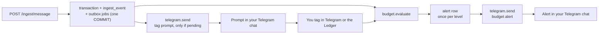

---

## 15. Security (non-negotiable requirements)

This app holds the most sensitive data a person has. Treat these as release blockers.

### 15.1 Authentication and sessions
- Passwords hashed with **Argon2id** (tuned ≥ 64 MB memory); minimum length 12; check against breached-password list.
- **Mandatory 2FA** (TOTP) with **passkeys/WebAuthn** as the preferred option. Recovery codes shown once, stored hashed.
- Short-lived **access tokens (≤ 15 min)** + **rotating refresh tokens** (stored hashed, reuse detection revokes the whole session family).
- Cookies: `HttpOnly; Secure; SameSite=Strict`. CSRF tokens on state-changing requests.
- Login rate-limiting + progressive lockout; generic error messages (no user enumeration).
- Auto-logout on idle.

### 15.2 Data protection
- **TLS 1.2+ everywhere**; HSTS.
- **Encryption at rest** (disk/DB) **plus field-level encryption** (AES-256-GCM, keys in a secret manager / KMS, never in the repo) for TOTP secrets and other stored secrets. Ingest tokens are stored only as hashes.
- **No bank credentials, UPI PINs, card numbers, or OTPs are ever collected or stored.** The app reads *results* of payments only; it never initiates money movement.
- **Parsed bank messages are never stored.** The server parses the forwarded text and discards it. Only parsed fields are kept (type, amount, payee, reference, time, account last 4). The one exception is a message the parser cannot read: it is stored encrypted (AES-256-GCM) in `unparsed_messages`, visible only to you, deleted when resolved and expired after 30 days. OTP-like text is dropped before parsing or logging and is never kept.
- Backups encrypted; restore tested.

### 15.3 iPhone capture endpoint

| Risk | Control |
|---|---|
| **OTP leaves the phone** | Keyword triggers (`debited`/`credited`) so OTP texts never match; the server also drops anything with OTP words **before** parsing or logging, and returns `202` without storing. |
| Stolen or guessed token | Per-device token, 256-bit random, shown once, stored **hashed** on the server, **ingest-only** (it can create transactions, never read anything), revocable instantly. |
| Token sniffed in transit | HTTPS only, HSTS; no plain HTTP endpoint exists. |
| Replayed request | `nonce` must be new per device; `receivedAt` must be within 5 minutes of server time; otherwise `409`. |
| Spoofed "bank" messages | Optional sender allow-list per device; server only accepts text that parses to a real amount and direction; unknown shapes are rejected; high-volume bursts are rate limited per device and per IP. |
| Raw message stored | **Not stored** once parsed. Only parsed fields (type, amount, payee, reference, time, account last 4) are kept. Unreadable messages (never OTPs) are kept encrypted in Needs a look for at most 30 days. |
| Message never arrives, or arrives hours late | The payment is booked at the time written in the message; the balance check (3.6) books any gap as Unaccounted and merges a late arrival. |
| Logs leak data | Logs never contain message text, amounts or payees; only ids and outcome codes. |
| Cross-user leakage | Every row has `user_id` and Postgres row-level security enforces it. |
| Token inside the Shortcut | It lives in your phone's Shortcuts store, protected by the passcode; rotate it from the web app any time. |
| Lost phone | Revoke the device; audit log shows its last events. |

What leaves the phone: **only the bank's debit/credit text** (account digits and balance, if the bank includes them). What never leaves: OTPs, other messages, your contacts, GPay.

For stricter privacy later, move parsing **into the Shortcut** (the "Match Text" action supports regular expressions) so only parsed fields are sent. It is more fragile per bank, so start server-side.


### 15.4 Telegram bot

| Risk | Control |
|---|---|
| Someone else talks to the bot | Whitelist by numeric Telegram user id; private chat only; unknown senders get **no reply** |
| Someone uses your unlocked Telegram | Every request needs an active `/signin` session; it ends on `/signout`, from the web app, or after 30 idle days; messages carry no bank details, so there is little to see |
| `/signin` code typed in the chat | Authenticator code accepted once per time step; the bot deletes your message; 3 wrong codes in 15 minutes pause sign-in for 15 minutes and are audited; Telegram never holds anything reusable |
| Fake webhook calls | Secret token header, random webhook path, HTTPS, optional Telegram IP allow-list, rate limit |
| Bot token leaked | Token lives only in the server's secret manager, never on the phone; rotate it from BotFather; ingest tokens are separate and can't touch Telegram |
| Stale or forged button taps | Opaque callback tokens, server-side lookup, ownership + open-prompt check, idempotent |
| Tags typed with nasty text | Normalised (lowercase, trimmed, length-limited), same validation as the web app |
| Telegram account or phone compromised | Turn on Telegram **two-step verification** and a passcode lock; switch Reveal off; `/signout`, end the session or `/unlink` from the web app; the database is not exposed through the bot (it only shows the prompts you were sent) |
| Over-sharing through commands | Balance, totals and reports are **not** available from the bot, and balances are never typed into it |
| Telegram outage or block | Transactions are already saved; the web app shows Needs a tag |
| Data deletion | Disconnecting deletes the link, pairings and prompt records; messages already in the chat are removed by the bot where possible, otherwise you delete the chat |

**Bottom line:** the **database stays as secure as before**. Telegram messages carry no bank details; the only exposure is the optional Reveal button, which you can turn off, or you can tag only in the web app.

### 15.5 Application hardening
- Input validation (pydantic) at every boundary; parameterised queries only (psycopg); output encoding.
- Row-Level Security so a bug can't leak across users.
- Security headers: strict **CSP**, `X-Content-Type-Options`, `Referrer-Policy`, `Permissions-Policy`.
- Dependency scanning (`pip-audit` for the backend, `npm audit` for the web app, Dependabot), lockfiles committed (`uv.lock`, `package-lock.json`), secrets scanning in CI.
- Structured logs with **no amounts/payees/PII in logs**; **append-only audit log** (login, device add/revoke, export, delete).
- Rate limits per user and per IP on every endpoint; body size limits.
- Self-serve **data export** and **account deletion** (hard delete incl. backups on a schedule).

### 15.6 Privacy
- Single-user private by default; no analytics SDKs, no ad trackers, no third-party data sharing.
- Telegram messages carry no amounts, payees, balances, account numbers, bank names or UPI IDs; only the optional Reveal button shows an amount and payee, briefly (section 5.8).

### 15.7 Trust boundaries

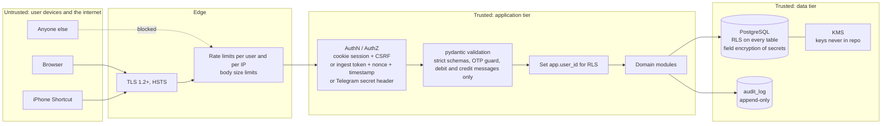

| Boundary | Control |
|---|---|
| Browser → API | `HttpOnly; Secure; SameSite=Strict` cookies, CSRF token on mutations, CSP and security headers, mandatory 2FA, passkeys preferred |
| Telegram → API | Secret-token header, random webhook path, whitelist by numeric Telegram user id, private chat only, opaque callback tokens, idempotent taps. Requires an active `/signin` session; Telegram sees no bank details (see section 5) |
| iPhone Shortcut → API | Per-device ingest-only bearer token (stored hashed), nonce + timestamp, OTP guard, same schema validation, debit and credit messages only |
| API → DB | Parameterised queries (psycopg); `app.user_id` set per request; RLS is the backstop |
| At rest | Disk/DB encryption + field-level AES-256-GCM for TOTP secrets and other secrets; ingest tokens stored only as hashes; keys in the secret manager |
| Data minimisation | The bank message is parsed and discarded (unreadable ones kept encrypted ≤ 30 days); logs never contain amounts, payees or PII |
| Accountability | Append-only audit log: login, device add/revoke, export, delete |
| Never stored | Bank credentials, UPI PINs, card numbers, OTPs |

---

## 16. Deployment and operations

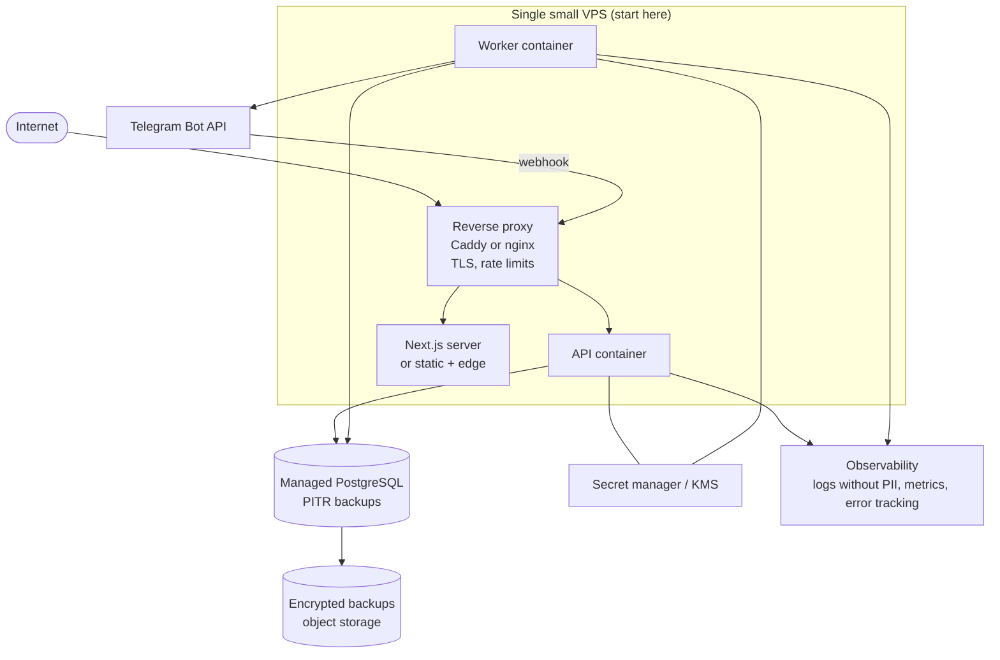

| Concern | Decision |
|---|---|
| Environments | `dev` (local Postgres), `staging` (seeded demo data matching the ui-spec dataset), `prod` |
| Config | 12-factor env vars; secrets only from the secret manager |
| Migrations | Plain SQL files per service, forward-only, applied at service start under an advisory lock (`bt.db.migrate`); RLS policies and revokes live in the migrations |
| Scaling | API stateless (scale out); worker concurrency per queue; Postgres is the only stateful part |
| Backups | Managed PITR plus nightly encrypted dump; **restore drill before launch** |
| Observability | Structured logs (no amounts/payees/PII), request ids, queue depth and job-failure metrics, alert on ingest error rate and on stuck outbox rows |
| CI | `ruff`, `pytest` (backend), typecheck and `vitest` (web), `pip-audit` / `npm audit`, secret scanning, migration dry-run |
| Real-time UI | Start with refetch-on-focus; add Server-Sent Events only if lag is noticeable (see section 21) |

---

## 17. Failure modes and consistency

| Scenario | Behaviour |
|---|---|
| Same event sent twice | `ON CONFLICT DO NOTHING`; outcome `duplicate`; `200` |
| Replay of a captured request | Rejected: nonce already used or timestamp too old |
| OTP or promo text reaches the endpoint | Dropped before parsing or logging (`202`, nothing stored) |
| Shortcut did not fire (iOS quirk, phone off or offline) | Nothing is created and nothing is queued; the Now page shows "last captured"; the next balance check books the gap as Unaccounted for you to tag or split |
| Shortcut fires hours late (locked phone) | The payment is booked at the time in the message and marked "captured 3 h after"; the balance check does not book a gap until the grace period has passed |
| Bank balance differs from the ledger | Gap under ₹1 ignored; otherwise wait the grace period, then one Unaccounted entry; a matching late message replaces it (3.6) |
| Bot session expired or signed out while payments arrive | Payments save; prompts are held; on `/signin` you get a count and then the prompts |
| Message cannot be parsed | `422`; the text is kept encrypted in Needs a look (never if OTP-like), a no-details nudge is sent; enter it by hand or fix the template (4.7) |
| Phone clock wrong | Timestamp-skew rejection (`409`) with a clear code |
| Description missing | Row stays `pending`; prompt sent; counts in balance, not in any category budget |
| Recurring and captured both appear | Linked within ±2 days, never double counted |
| UPI reversal / failed payment | Original becomes `reversed` (excluded); user prompted to add the refund as a credit |
| Worker crashes mid-evaluation | Outbox job retries; alert insert is unique per (budget, period, level), so no double alert |
| Budget limit raised after an alert | Alert re-arms for the new limit |
| DB failover | API retries idempotent writes; outbox jobs resume from the table |
| Telegram is down or rate-limits us | Transactions are already saved; prompts queue and retry (`retry_after`); the digest catches up; the web app shows Needs a tag |
| You tag the same item in Telegram and the web app | First write wins; the other side shows "already tagged" and refreshes |
| You tap an old button after the tag changed | Bot replies "already Food" and refreshes the message |
| You never tag a payment | Stays in Needs a tag; counted in the digest; never lost |
| Burst of several payments | One prompt per transaction, about a second apart, in order |
| Bot blocked or unlinked | Prompts stop; payments wait under Needs a tag in the web app |
| Compromised phone | Revoke the device; its token stops working immediately; the audit log shows its last events |
| Malformed or oversized request | pydantic/body-limit rejection before any DB work |

Consistency model: **strong** inside one request/transaction (ledger + outbox), **eventual** for alerts and Telegram messages (seconds).

---

## 18. Edge cases to handle

- Payment with no payee and no note → stays *Needs a tag*; Telegram prompt.
- Same amount to the same payee twice in minutes → distinct (different UPI refs); the dedupe key uses the reference, not just the amount.
- Recurring payment already captured from the phone → linked, not duplicated (3.5).
- Credit added by hand and the bank credit message arrives later (same amount, within a day) → linked, not doubled.
- Own-account transfer (a debit and a credit) → tag `#transfer`; excluded from spent, income, plans and budgets.
- Category renamed or merged → rules and budgets follow the category id, not the name.
- Deleting a category with transactions → must reassign (or archive), never orphan.
- Over-allocating a plan → allowed but flagged in red; never blocked.
- Time zones → store UTC, display in the user's zone; month boundaries use the user's zone.
- Amount parsing: `Rs.`, `INR`, `₹`, lakh-style commas (`1,25,000.50`).
- OTP or promotional text reaches the endpoint → dropped (`202`), nothing stored.
- Reversed or failed UPI → marked `reversed`, never counted as spend; a refund arrives as a credit to tag `#refund`.
- Pending (untagged) debit → counts in the balance immediately, but in no category budget until tagged.
- Bank wording changes → weak parse (amount and direction only) or Needs a look; never a wrong guess.
- A late message arrives after its gap was booked → replaces the Unaccounted entry, balance unchanged.
- Several payments missed at once → one Unaccounted entry for the total gap; split it into the real parts.
- Balance in a message is older than one already used → ignored for the check.
- Signed out of the bot for days → prompts are held, nothing is lost; the Ledger shows them all.

---

## 19. Phased delivery plan

The build is split into **12 phases (0 to 11)**. Every phase ends with something you can run and check, and each phase below lists everything it needs from the rest of this document: what to build, the data, the API, the screens, the security controls, the flows, the tests and the exit criteria. Read one phase top to bottom and you have the whole job.

**How to read a phase**

| Block | Meaning |
|---|---|
| **Goal / you can** | The outcome in one line, and what you can do when it is finished |
| **Depends on** | Phases that must be finished first |
| **Build** | Modules, jobs and behaviour (section 8, 14, and the section named) |
| **Data** | Tables, columns and constraints (section 9) |
| **API** | Endpoints (section 9, 11) |
| **Screens** | Pages from [`docs/ui-spec/`](docs/ui-spec/README.md) and the canvas; "needs design" means no design exists yet |
| **Security** | Controls from section 15 that this phase must ship with |
| **Tests** | What must pass (the matching items in section 20) |
| **Risks** | What could go wrong and how the phase handles it |
| **Exit** | The check that closes the phase |

**Size** is relative effort for one developer (S small, M medium, L large). It is a planning aid, not a promise; nothing has been built or timed yet.

### 19.1 Roadmap

| Phase | Name | You can, at the end | Size | Depends on | Design status |
|---|---|---|---|---|---|
| **0** | Validate the assumptions | Know whether capture works on your phone and bank | S | none | n/a (no product code) |
| **1** | Foundation and sign-in | Create an account, secure it, sign in over HTTPS | L | 0 | Auth screens designed (canvas) |
| **2** | Ledger core and balance | Add money in and out by hand, see a correct balance | M | 1 | Pages 01, 02, 07 specified |
| **3** | Categories, tags and plan | Tag payments, create categories from tags, split a month | M | 2 | Pages 02, 03 specified |
| **4** | Recurring payments | Rent and SIP post themselves | S | 3 | Page 05 specified |
| **5** | iPhone capture | A real bank message appears in the web app | L | 3, 0 | Setup step 1 and Needs a look designed |
| **6** | Telegram inbox | Tag payments from Telegram after `/signin` | L | 5 | Setup steps 2 and 3 and the Devices and Telegram page designed |
| **7** | Balance check | A missed payment becomes an Unaccounted entry you can tag or split | M | 5 | Check panel, Unaccounted row and split designed |
| **8** | Budgets and alerts | Limits turn yellow and red, and Telegram warns you | M | 3 (6 for alerts) | Page 04 specified |
| **9** | Trends | Monthly and daily charts | S | 3 | Page 06 specified |
| **10** | Onboarding, settings, account safety | A new user sets everything up from the Setup guide; export and delete | M | 1 to 9 | Setup, Profile, Security and Devices designed |
| **11** | Hardening and launch | Pass the security list, restore a backup, run it for real | M | 1 to 10 | n/a |

```mermaid
flowchart LR
  p0["0 Validate"] --> p1["1 Foundation<br/>and sign-in"]
  p1 --> p2["2 Ledger core"]
  p2 --> p3["3 Categories<br/>and plan"]
  p3 --> p4["4 Recurring"]
  p3 --> p5["5 iPhone capture"]
  p0 --> p5
  p5 --> p6["6 Telegram inbox"]
  p5 --> p7["7 Balance check"]
  p3 --> p8["8 Budgets<br/>and alerts"]
  p6 --> p8
  p3 --> p9["9 Trends"]
  p4 --> p10["10 Onboarding,<br/>settings, safety"]
  p6 --> p10
  p7 --> p10
  p8 --> p10
  p9 --> p10
  p10 --> p11["11 Hardening<br/>and launch"]
```

**Two tracks.** The web screens can run ahead of the backend on a **mock API** that returns the `docs/ui-spec` dataset, so a page can be built and judged before its real endpoints exist. Each phase then swaps the mock for the real endpoints.

**Definition of done for every phase**
- Tests for the phase pass in CI; migrations are forward-only and include row-level-security policies and revokes.
- Every page built follows its `docs/ui-spec` checklist (fits the window, type-scale tokens only, colour meaning).
- Logs contain no amounts, payees or message text; money is integer paise.
- The README status and the acceptance checklist (section 20) are updated, and the phase is demoed on staging.

---

### Phase 0 · Validate the assumptions

**Goal.** Replace the guesses with facts before any product code. Capture and the Telegram behaviours are designed but untested.
**You can.** Say with evidence whether capture works on your phone and bank, and what the plan must change.
**Depends on.** nothing. **Size.** S.

**Build (throwaway spikes, no product code)**
1. **Locked-phone test** (section 4.10, step 1). Create the two-action Shortcut and point it at a throwaway receiver (a free webhook inspector or a tiny local server). Send test texts in each state: unlocked, locked, Low Power Mode, a Focus mode on, and left alone overnight. Record the delay for each.
2. **Real message samples.** Collect 5 debit and 5 credit SMS with digits and names hidden. Record for each: sender ID, whether it has the date and time, payee, UPI reference, "Avl Bal"; the trigger words that match; and whether your bank skips small payments.
3. **OTP safety.** Confirm that a real OTP never triggers the automation.
4. **Telegram spike.** A throwaway bot that proves: `setWebhook` with the secret header; inline buttons and callbacks; editing a message (the Reveal and re-hide trick); deleting its own message and deleting your typed code in a private chat; a burst of five messages with the per-chat pacing; `retry_after` handling; a held-then-released queue.
5. **Hosting and domain.** Pick the VPS, managed Postgres and a domain with HTTPS (needed for the Shortcut and the webhook).

**Data / API / Screens.** none.
**Security.** Post **only invented test texts** (such as `Rs 1.00 debited test`) to any third-party receiver. Never post a real bank message to a service you do not control.

**Tests.** A results table (state, delay, arrived yes/no) and the sample-message sheet, saved in the repo notes.
**Risks.** Everything in this phase is a risk check; the table below says what each result changes.

| If you find | Then |
|---|---|
| Locked-phone delay is long or messages go missing | Add the parked bank email forwarding route (section 21) as a second source in Phase 5; lean harder on the balance check (Phase 7) |
| The SMS has no payee | Every new payment prompts you; payee memory helps less |
| The SMS has no "Avl Bal" or no date | Balance checks are manual only; payment time falls back to `receivedAt` |
| The bank skips small UPI alerts | Expect small Unaccounted entries; the balance check is essential |
| Telegram cannot delete your typed code | `/signin` still works (code is single-use); note the code stays visible in the chat |
| The automation never fires from your bank's sender | The trigger word or sender must change; capture needs another route before Phase 5 starts |

**Exit.** The results table and sample sheet exist; section 21 decisions (hosting, email forwarding) are settled; a go or no-go on Phase 5 is written down.

---

### Phase 1 · Foundation and sign-in

**Goal.** A deployable skeleton where only you can sign in, with data isolation in place from day one.
**You can.** Create an account, enrol an authenticator and a required passkey, save recovery codes, sign in, stay signed in safely, and reset a lost password. Existing accounts without a passkey are restricted to security setup until one is enrolled.
**Depends on.** Phase 0. **Size.** L.

**Build**
- Repository (Python services with their workers, web), FastAPI, pydantic on every boundary, psycopg with SQL migrations, local Postgres.
- CI: lint, tests, `pip-audit`/`npm audit` and Dependabot, secret scanning, migration dry-run.
- Shared libraries: `crypto` (AES-256-GCM, Argon2id, token hashing), `money` (integer paise, INR format), `queue` (outbox and Postgres job queue, wired but with no jobs yet).
- Modules `auth` and `audit`; request context that sets `app.user_id`; the row-level-security template every later table copies.
- Security headers and strict CSP, rate limits per user and per IP, body size limits.
- Secret manager or KMS integration; environments `dev`, `staging` (seeded with the `docs/ui-spec` dataset) and `prod`; deployable skeleton behind a reverse proxy with TLS (section 16).
- Web shell and shared components from `00-design-system`.

**Data.** `users` (password hash, encrypted TOTP secret, timezone, `pending_email`, `delete_after`), `auth_factors` (passkeys and hashed recovery codes), `user_settings`, `sessions` (family id, hashed refresh token, revoked at), `audit_log` (append-only: `REVOKE UPDATE, DELETE`). Row-level security on every table.
**API.** `POST /auth/register`, `/auth/login`, `/auth/refresh`, `/auth/logout`; `/auth/2fa/enable`, `/auth/2fa/verify`; `/auth/passkey/*`; recovery-code reset; `GET /me`.
**Flows.** 10.7 (sign-in, 2FA, session rotation).
**Screens.** Sign in, Create account, Secure your account (authenticator, passkey, recovery codes), Reset password: **designed and specified** (`docs/ui-spec/12` to `15`).

**Security (section 15.1, 15.2, 15.5).** Argon2id (at least 64 MB memory), minimum 12 characters, breached-password check; **mandatory TOTP and passkey enrollment** before app access; enrolled passkeys are preferred at sign-in, with TOTP and recovery-code fallback; access token 15 minutes or less, rotating refresh token with reuse detection that revokes the whole family; `HttpOnly; Secure; SameSite=Strict` cookies and CSRF tokens; login rate limit with progressive lockout and generic errors; auto-logout on idle; TLS 1.2+ and HSTS; encryption at rest and field encryption for secrets.

**Tests.** Logging in without 2FA is impossible; a second user cannot read the first user's rows (row-level security test); reusing an old refresh token revokes the family; the audit log cannot be updated or deleted; no PII in logs.
**Risks.** Passkey (WebAuthn) support is the fiddly part; test the browser origin and device enrollment over HTTPS, and keep TOTP and recovery codes available as fallbacks.
**Exit.** Registration, authenticator enrolment, sign-in, refresh rotation and reset all work on **staging over HTTPS**; CI is green; the row-level-security test passes.

---

### Phase 2 · Ledger core and balance

**Goal.** Money in and out by hand, with the balance derived correctly and never reset.
**You can.** Add a credit, add a payment you missed, see the available balance, and scroll your history.
**Depends on.** Phase 1. **Size.** M.

**Build**
- Module `ledger`: the single writer for money rows; every write emits an outbox job.
- Balance derived on read: `opening + Σ credits − Σ debits` (not reversed); month views are filters in the user's time zone; no month-end job.
- Cursor pagination `(occurred_at, id)`; indexes from section 12.
- Add credit returns the updated row **and** the new balance and plan figures.
- Manual debit (`source = manual`). The Ledger control for it is to be confirmed against `02-ledger` when that page is built.

**Data.** `transactions` (type, `amount_minor`, `occurred_at`, payee, description, category id, source, status, `dedupe_key`, `captured_at`); `user_settings.opening_balance_minor`. Constraints: `UNIQUE (user_id, dedupe_key)`, `amount_minor > 0` with `type` carrying direction, row-level security.
**API.** `GET /dashboard` (balance part), `GET /ledger`, `POST /credits`, `GET /credits?limit=3`, `PATCH /settings` (opening balance), `PATCH /transactions/:id` (basic fields).
**Flows.** 10.3 (add credit by hand), 10.6 (balance and rollover); lifecycle in section 13.
**Screens.** Ledger (read side), Add credit, Now (balance hero).
**Security.** Money is integer paise; every row has `user_id`.

**Tests.** The balance carries over unchanged on the 1st of the next month; a credit raises the balance by its amount; month boundaries follow the user's time zone; the Ledger loads older entries on scroll and by button; Add credit shows the live new balance (section 20, Product and UI).
**Risks.** Sign bugs and float creep: use `bigint` paise and explicit `credit`/`debit` types.
**Exit.** On staging, a hand-entered credit and debit give the right balance, and the three pages match their specs.

---

### Phase 3 · Categories, tags and the monthly plan

**Goal.** Categories appear from tags, and a month is split into planned amounts.
**You can.** Tag any payment, type a never-seen tag and get a category, and plan a month (₹50,000 across SIP, Rent and so on).
**Depends on.** Phase 2. **Size.** M.

**Build**
- Module `classification`: resolution order **payee memory → keyword rule → you choose**; a new tag creates a category on the spot; cascade (tag a payee once and other pending payments to it follow).
- Module `plan`: plan total, lines, "unassigned = total − assigned"; over-allocating is allowed but flagged, never blocked.
- `#transfer` excludes a movement from spent, income, plans and budgets.
- Pending (untagged) debits count in the balance but in no category budget (Uncategorised).

**Data.** `categories` (`UNIQUE (user_id, lower(name))`; deleting one with transactions is blocked, reassign or archive instead), `tag_rules` (kind `keyword | payee`, hits), `plans`, `plan_lines`.
**API.** `PATCH /transactions/:id` (tag, category, `#transfer`), `GET|PUT /plans/:month`, `GET|POST|PATCH|DELETE /categories`.
**Flows.** 10.2 (untagged debit gets a tag), lifecycle `pending → confirmed`.
**Screens.** Plan, the Ledger "tag it" flow, Now (plan and flow groups).
**Security.** Tag text is normalised (lowercase, trimmed, length-limited).

**Tests.** ₹50,000 with ₹10,000 SIP and ₹20,000 Rent shows ₹20,000 unassigned; `#gym` creates a Gym category; renaming or merging follows the category id, not the name; over-allocating shows red.
**Risks.** Rule collisions (a payee that matches two rules): the resolution order is fixed and tested.
**Exit.** The Plan and Ledger pages work against real data; payee memory auto-tags a repeat payment.

---

### Phase 4 · Recurring payments

**Goal.** Payments that leave on their own are posted for you.
**You can.** Define rent, SIP and subscriptions; see the 30-day timeline; pause a rule.
**Depends on.** Phase 3. **Size.** S.

**Build**
- Module `recurring`: rules with schedule, next due, paused, end date.
- Job `recurring.post` (cron every few minutes, dedupe key `rec:ruleId:dueDate`, safe to repeat).
- **Matching:** a captured debit within ±2 days of a due date is **linked** to the rule instead of being counted twice (fully exercised once capture exists in Phase 5).

**Data.** `recurring_rules`; `transactions.recurring_id`.
**API.** `GET|POST|PATCH|DELETE /recurring`.
**Flows.** 10.4.
**Screens.** Repeats; the next-recurring line on Now.

**Tests.** A ₹20,000 rent rule posts on its due date and is not double counted when also captured.
**Risks.** Time-zone and due-date edge cases (month ends, 31st): covered by tests.
**Exit.** A rule posts once on its due date on staging, and pausing stops it.

---

### Phase 5 · iPhone capture

**Goal.** A real bank message becomes a transaction without you typing anything.
**You can.** Create a device token, set up the Shortcut with the Setup guide, and watch a debit or credit appear in the web app under Needs a tag (or auto-tagged for a known payee).
**Depends on.** Phase 3 and the Phase 0 results. **Size.** L.

**Build**
- Module `devices`: 256-bit ingest tokens shown once, stored hashed, ingest-only, revocable at once.
- Module `ingest`, pipeline in this order: **authenticate → rate limit → nonce and timestamp → OTP guard → parse → (unreadable: keep encrypted, 422) → dedupe → classify → save plus outbox jobs**.
- **Parser** (section 4.7): bank templates as versioned data over a generic fallback; only amount and direction are required (a weak parse still captures); payment time read from the message, with `receivedAt` as a fallback; reversals, failed and refund handling; credits link to a hand-added credit within one day; a sender allow-list.
- **Unreadable messages:** stored encrypted in `unparsed_messages`, never if OTP-like, expire after 30 days.
- Job `retention.sweep` (expire unparsed messages and old `ingest_events`).
- The test table of real messages (from Phase 0) runs in CI.
- If Phase 0 required it, add the **email forwarding** route as a second source here.

**Data.** `devices`, `ingest_events` (`UNIQUE (device_id, nonce)`, outcome), `unparsed_messages`; `transactions.device_id`, `captured_at`.
**API.** `POST /ingest/message`; `POST /devices`, `GET /devices`, `DELETE /devices/:id`; `GET /unparsed`, `POST /unparsed/:id/resolve`, `POST /unparsed/:id/dismiss`.
**Flows.** 10.1 (captured from the iPhone), section 4 throughout.
**Screens.** Ledger Needs a tag for captured debits **and** credits; Setup guide **step 1** (token, Shortcut screens with copy buttons, live test) is designed; the **Needs a look** queue is designed (a **LOOK** link on Now and Ledger); "last captured" on Now. The Devices page is designed and built in Phase 10.

**Security (section 15.3).** Keyword triggers keep OTPs off the phone, and the server drops OTP-like text before parsing or logging (`202`); hashed ingest-only token; HTTPS only; nonce and timestamp (five minutes) against replay; sender allow-list and rate limits; Zod strict schema; logs carry ids and outcome codes only; revoke a lost phone at once.

**Tests (section 20, Capture).** A debit reaches the server and appears; a credit appears as money in and links to a hand-added one; a known payee is auto-tagged; the same message twice makes one transaction; an OTP is dropped with `202`; a revoked token and a replayed request are rejected; a late message is booked at the time written in it; an unreadable message lands in Needs a look; a changed wording is still captured as a weak parse.
**Risks.** Shortcut reliability and delay (tolerated by design, caught by Phase 7); bank wording drift (templates as data, Needs a look); OTP leakage (guard on both sides).
**Exit.** A real debit from your bank appears in the web app, and one week of real use gives a parse-success rate and a delay figure to compare with the Phase 0 table.

---

### Phase 6 · Telegram inbox

**Goal.** Payments reach a private Telegram chat with no bank details, and you tag them there.
**You can.** Connect the bot, `/signin`, tag a payment with one tap or a typed new tag, and see the same tag in the web app.
**Depends on.** Phase 5. **Size.** L.

**Build** (section 5)
- Your own bot; bot token and webhook secret in the secret manager; `POST /telegram/webhook/<random path>` with the secret-token header, HTTPS, optional IP allow-list.
- Module `telegram`: **pairing** (single-use code, five minutes, stored hashed, made only while signed in with 2FA); **whitelist** by numeric Telegram id, private chat only; **sessions**: `/signin` with an authenticator code (once per time step, bot deletes the message, three wrong codes pause sign-in for 15 minutes), `/signout`, idle expiry (default 30 days), end from the web.
- **Messages with no bank details** ("Money out · 6:42 pm"), category buttons with opaque callback tokens, **Reveal** (30 seconds then re-hidden, can be switched off), **Later**, **transfer**, typed **＋ New tag** (about two minutes), "Add to this month's plan?" after a credit, tidy-up (keep, one line or delete).
- **Held prompts:** while there is no active session the prompts are held and released on `/signin` with a count.
- Jobs: `telegram.send` (per-chat queue about one per second, honours `retry_after`), `telegram.sync_prompt`, `telegram.digest` (count only), `telegram.expire`; the no-details nudge "1 message could not be read" for Needs a look.
- Cascade: tag a payee once and other pending payments to it auto-tag, with their messages edited.
- Commands: `/signin`, `/signout`, `/pending`, `/undo`, `/pause`, `/unlink`.

**Data.** `telegram_links` (telegram user id, chat id, `allow_reveal`, `session_idle_days`, digest hour), `telegram_pairings`, `telegram_sessions`, `telegram_prompts` (status includes `held`).
**API.** `POST /telegram/webhook/<secret>`, `POST /telegram/pairing`, `DELETE /telegram/link`, `DELETE /telegram/session`, `GET|PATCH /settings` (Reveal, session days, digest).
**Flows.** 10.8, 5.1, 5.3, 5.5 (pairing and sign-in), 5.6 (sync).
**Screens.** Setup guide **steps 2 and 3** (bot token, link, `/signin`, Reveal, session length, digest, after-tag) are designed; the **Devices and Telegram** page (link status, bot session, Reveal, idle days, digest, after-tag) is designed; build its Telegram part here and the iPhone part in Phase 10.

**Security (section 15.4).** Whitelist plus private chat plus active session on every update; strangers get no reply; secret header and random path; bot token only in the secret manager; opaque, idempotent callbacks that re-check ownership; no balances, totals or reports in the bot; no bank details in messages.

**Tests (section 20, Telegram).** Only the linked id gets replies; five payments in a minute arrive as five ordered messages; a tag in Telegram updates the web app and the reverse edits the message; tagging a payee auto-tags the others; a typed tag creates a category; a stale or double tap does nothing; no message holds an amount or payee (except after Reveal); without `/signin` nothing is sent and prompts are held, then released; wrong or reused codes are refused; Telegram down loses nothing.
**Risks.** Telegram behaviours proven in the Phase 0 spike; Telegram outage or block (payments wait in the web app); rate limits (queue and `retry_after`).
**Exit.** From a real captured payment you can tag it in Telegram and see it in the web app, and `/signout` really silences the bot.

---

### Phase 7 · Balance check and Unaccounted

**Goal.** What the bank knows and the ledger missed is caught, not lost.
**You can.** Type your bank balance (or let a message supply it), and have any gap become one Unaccounted entry you tag or split.
**Depends on.** Phase 5 (balance from messages); a manual-only version only needs Phase 2. **Size.** M.

**Build** (section 3.6)
- Module `reconcile`; job `balance.reconcile` (after an ingest that carried a balance, after a manual check, and every 30 minutes for open checks past the grace period).
- Gap = bank balance − ledger balance for the one tracked account; ignore under ₹1; **wait the grace period (default six hours)**; book one Unaccounted debit or credit; a later real message with the same direction and amount (within three days) **replaces** it; **split** into categories (parts must add up); only the newest message by its own time may supply a balance.
- A weekly Telegram nudge with no amounts and a button that opens the web app.

**Data.** `balance_checks`; `transactions.source = unaccounted` (status `pending`); `user_settings.reconcile_grace_hours`.
**API.** `POST /balance-check`, `GET /balance-checks`, `POST /transactions/:id/split`.
**Flows.** 10.9.
**Screens.** Designed: the **CHECK** panel and the Unaccounted row with its split action, both in the Ledger (the Devices page shows the last check and the grace period).
**Security.** Balances are typed in the web app only, never in Telegram.

**Tests.** A bank balance lower than the ledger by ₹X books one Unaccounted debit after the grace period; a matching late message replaces it with the balance unchanged; a split must add up; gaps under ₹1 are ignored; an out-of-order older balance is ignored.
**Risks.** False gaps from bank holds or pending items: the grace period and an **ignore** action (`balance_checks.status = ignored`) absorb them. Watch the real Unaccounted total during the Phase 11 soak.
**Exit.** On a real week of data, the ledger balance matches the bank balance after resolving Unaccounted entries.

---

### Phase 8 · Budgets and alerts

**Goal.** Limits that change colour and warn you once per level.
**You can.** Set a limit per category, see it go green, yellow (at your alert level, default 80%) and red (exceeded), and get a Telegram warning.
**Depends on.** Phase 3 (and Phase 6 for Telegram alerts). **Size.** M.

**Build** (sections 3.4, 10.5)
- Module `budgets`: limit, period, warn percentage, active.
- Job `budget.evaluate`, triggered by **writes** through the outbox (not a timer), collapsing bursts; alert rows make firing idempotent.
- Pace warning ("fast"): projected month-end over the limit.
- Alerts sent through `telegram.send` as category and level only ("Food reached 80%"), never a rupee figure; a raised limit re-arms the alert.

**Data.** `budgets`, `alerts` (`UNIQUE (budget_id, period_key, level)`); `user_settings` alert level (70, 80 or 90) and pace warning.
**API.** `GET|POST|PATCH|DELETE /budgets`, `GET /alerts`, `POST /alerts/:id/read`, `PATCH /settings`.
**Flows.** 10.5.
**Screens.** Limits; the warnings on Now.

**Tests.** A ₹5,000 Food limit alerts at your level and again when exceeded, once each; a worker crash causes no double alert; a raised limit re-arms.
**Risks.** Double alerts after retries: the unique key prevents them.
**Exit.** Crossing a limit on staging produces exactly one alert per level.

---

### Phase 9 · Trends

**Goal.** See progress over time.
**You can.** Read income versus spent by month, the balance line, a category-by-month heatmap and the day-by-day spend bars.
**Depends on.** Phase 3. **Size.** S.

**Build.** Module `reports` (pure queries; nothing cached): daily spend excluding fixed payments, months (income, spent, kept, balance), category matrix. Use the indexes from section 12.
**Data.** none new.
**API.** `GET /reports/daily?month=`, `GET /reports/months?range=6`, `GET /reports/category-matrix?range=6`.
**Screens.** Trends; day-by-day bars on Now.
**Tests.** Figures match the definitions in section 12 (the sample dashboard numbers reproduce); `#transfer` is excluded; queries stay fast on a year of data.
**Risks.** Slow queries: add an index first; a snapshot table only if profiling shows a real problem (parked).
**Exit.** Both pages render real data with correct totals.

---

### Phase 10 · Onboarding, settings and account safety

**Goal.** A new user can set everything up without help, and can leave with their data.
**You can.** Follow the Setup guide from nothing to a working system, change settings, manage phones and sessions, export your data and delete the account.
**Depends on.** Phases 1 to 9. **Size.** M.

**Build**
- **Setup guide wired end to end:** step 1 iPhone, step 2 Telegram (token, link, `/signin`), step 3 Telegram privacy, step 4 first month (bank balance, plan, alert level), then the summary; progress is saved and any step can be redone from Settings. (Passkeys here if not done in Phase 1.)
- **Settings:** connect and disconnect Telegram, Reveal, session days, digest time, after-tag, alert level, balance-check grace.
- **Devices and capture:** registered phones, last captured, rotate and revoke a token, channel status.
- **Security:** change password, 2FA and passkeys, regenerate recovery codes, list and end sessions, view the audit log.
- Self-serve **data export** and **account deletion** (hard delete, including backups on a schedule).

**Data.** none new; `users.delete_after` marks a scheduled deletion and `retention.sweep` removes the account and every row after it passes; deletion cascades through every table.
**API.** `GET /sessions`, `DELETE /sessions/:id`, `GET /audit`, `POST /account/export`, `DELETE /account`, plus the Settings and Devices endpoints from earlier phases.
**Flows.** Setup (screens designed), 10.7.
**Screens.** All designed: Setup guide, Profile (export, delete, email change), Security (password, authenticator, passkeys, recovery codes, sessions, activity log) and Devices and Telegram, plus the Account menu in the shared header.
**Security.** Re-authenticate (2FA) before changing password or 2FA, creating an export or deleting; audit every one.

**Tests.** Export contains every row; deletion leaves nothing; ending a session works at once; a new account reaches a working capture and tagging flow using only the Setup guide.
**Risks.** Design backlog (three unbuilt screens): design them at the start of the phase.
**Exit.** A fresh account is fully set up from the Setup guide on a real phone, and export and delete both work.

---

### Phase 11 · Hardening and launch

**Goal.** Safe to rely on with real money data.
**You can.** Use it daily with confidence and recover from a failure.
**Depends on.** Phases 1 to 10. **Size.** M.

**Build and check**
- **Security pass** through every table in section 15 (authentication, data protection, capture endpoint, Telegram bot, application hardening, trust boundaries); a dependency audit; a CSP and security-headers review; rate limits on every endpoint.
- **Backups:** managed point-in-time recovery plus a nightly encrypted dump, and a **restore drill** (restore into staging and compare).
- **Observability:** structured logs with no PII, request ids, queue depth and job-failure metrics, alerts on ingest error rate and stuck outbox rows.
- **Privacy review:** search logs and Telegram messages for amounts, payees and message text.
- **Runbook:** rotate the bot token, rotate an ingest token, revoke a device, what to do when Telegram or the Shortcut is down.
- **Soak (two weeks of real use).** Track capture success against your bank statement, the Unaccounted total as a share of spending, parse-failure rate, delay distribution and prompt latency. Fix the worst cause first.
- Walk the full acceptance checklist (section 20) on production.

**Tests.** Every item in section 20 passes; the restore drill succeeds; the soak numbers are recorded and acceptable to you.
**Risks.** Surprises from real data volume and wording: that is what the soak is for.
**Exit.** Section 20 is fully ticked, the restore drill has been done, and you have used it for two weeks.

---

## 20. Acceptance checklist

Each group below is closed by a phase in [section 19](#19-phased-delivery-plan): Product (phases 2, 3, 4, 8), Capture (5, 7), Telegram (6), Security (1, 5, 6, 11) and UI (every phase that builds a page). Phase 11 walks the whole list on production.

**Product**
- [ ] Setting total ₹50,000 and allocating ₹10,000 SIP + ₹20,000 Rent shows ₹20,000 unassigned.
- [ ] Typing a never-seen tag `#gym` creates a `Gym` category with no setup.
- [ ] On the 1st of the next month, the balance carries over unchanged.
- [ ] A recurring ₹20,000 rent posts on its due date and is not double-counted if also captured.
- [ ] A budget of ₹5,000 on Food alerts at your alert level and again when exceeded, once each.

**Capture**
- [ ] A bank debit SMS reaches the server within 30 seconds of arriving and appears under Needs a tag.
- [ ] A bank credit SMS appears as money in, needs a tag, and is linked (not doubled) to a credit added by hand.
- [ ] A known payee is tagged automatically; a new payee triggers a prompt.
- [ ] Firing the same message twice creates one transaction.
- [ ] An OTP never triggers the automation and, if forced, is dropped with `202` and nothing stored.
- [ ] A revoked device token is rejected; a replayed request (old nonce or timestamp) is rejected.
- [ ] The Shortcut fires with the phone locked and unlocked; the locked delay is measured and recorded (real-device test).
- [ ] A delayed message is booked at the time written in it, not the arrival time.
- [ ] A message the parser cannot read lands in Needs a look (encrypted); an OTP-like one is never kept.
- [ ] With a changed bank wording, amount and direction are still captured (weak parse).
- [ ] A bank balance ₹X lower than the ledger books one Unaccounted debit after the grace period; a matching late message replaces it without changing the balance.
- [ ] An Unaccounted entry can be split and the parts must add up to it.

**Telegram**
- [ ] Only the linked Telegram id gets replies; strangers and group chats get nothing.
- [ ] No Telegram message contains an amount, payee or balance (except after tapping Reveal, which re-hides after 30 seconds).
- [ ] Without `/signin` the bot sends nothing and prompts are held; `/signin` releases them; `/signout`, web sign-out and 30 idle days all end the session.
- [ ] A reused or wrong `/signin` code is refused; three wrong codes pause sign-in; the bot deletes the code message.
- [ ] Five payments in a minute arrive as five messages, in order, each taggable independently.
- [ ] Tagging in Telegram updates the web app; tagging in the web app edits the Telegram message.
- [ ] Tagging a payee also auto-tags the other pending payments to that payee.
- [ ] Typing a new tag in the bot creates a category.
- [ ] A stale or double tap changes nothing the second time.
- [ ] If Telegram is down, nothing is lost: payments appear in the web app and prompts send later.

**Security**
- [ ] Logging in without 2FA is impossible; no raw bank text, amounts or payees appear in logs.
- [ ] Every table is protected by row-level security; the ingest token cannot read anything.

**UI (see each page's checklist in `docs/ui-spec/`)**
- [ ] Every page fits the window with no page-level scroll from 1100×620 to 2560×1440; only inner panels scroll.
- [ ] Every font size is a role token from the shared type scale; no raw pixel sizes.
- [ ] Debits, spent amounts and balances are black; credits, income and kept are green.
- [ ] A limit bar is green under the alert level, yellow at or above it (default 80%), red once exceeded.
- [ ] Ledger loads older entries on scroll and via the `load older entries` button.
- [ ] Add credit shows the live new balance and new plan, then a success state.

---

## 21. Open decisions and parked ideas

### Open decisions

| Question | Options | Default / suggestion |
|---|---|---|
| Telegram message detail | No details, with an optional Reveal button | **No details**; Reveal on by default, can be switched off |
| Telegram session length | Until `/signout` / idle limit | Until `/signout`, plus **30 idle days** |
| Balance check grace period | 1 h / 6 h / 24 h | **6 hours** |
| Tracked accounts | One / several | **One** bank account; cash by hand |
| After tagging | Keep / edit to one line / delete | **Edit to one line** |
| Daily digest | Off / daily / twice daily | Daily at 9 pm |
| Pending debits and category budgets | Count after tagging only / count in "Uncategorised" | After tagging only; show as Uncategorised in the Ledger |
| Hosting | Self-hosted / managed cloud | Single small VPS + managed Postgres |
| Multi-user | Just you / family | Just you (schema already keyed by `user_id`) |
| Accent colour | Emerald `#00875A` / Caribbean `#007F95` | Emerald (the swap is one variable set) |
| Alert level default | 70 / 80 / 90% | 80% |
| Front-end stack | Next.js + CSS variables / Tailwind | Next.js with the `docs/ui-spec` tokens as CSS variables |
| Real-time updates to the web app | Refetch on focus / Server-Sent Events | Refetch first; add SSE only if lag is noticeable |
| iPhone parsing location | Server (discard body) / inside the Shortcut | Server first; move into the Shortcut for stricter privacy later |
| Time zone | Per-user setting / fixed IST | Per user, default Asia/Kolkata |
| Settings, Devices, Security screens | Design now / with the auth and Telegram milestones | Designed and specified (`docs/ui-spec/09` to `11`); build them with those milestones, reusing the shell |

### Already decided

iPhone only; the Shortcut is the capture route and delays are tolerated, not fought; Telegram is the tagging inbox and carries no bank details; the bot needs `/signin`; credits come from bank messages or by hand; the ledger is checked against the bank balance and gaps become Unaccounted; amounts are derived on read (no cached totals).

### Parked: not part of this architecture

Documented once here so nothing is lost, and deliberately **not** in the diagrams, tables, jobs or API above. Revisit only for the reason given.

| Idea | Why parked | Revisit when |
|---|---|---|
| Android capture app (SMS and notification parsing, HMAC-signed events, FCM) | You use an iPhone | You switch to Android |
| Account Aggregator | Only regulated entities can use it; personal-use route unconfirmed | An AA provider confirms a personal-use route |
| Pay-through-app (UPI link with your note) | Optional; the link scheme is untested on iPhone; the Shortcut plus payee memory covers most cases | You want the GPay note captured for every payment |
| Screen-reading on GPay's success screen (back-tap Shortcut) | Experimental, fragile, untested | Payee memory is not enough |
| Statement import (CSV or PDF) | No module planned; gaps can be added by hand | Shortcut gaps become frequent |
| Web Push and email | Telegram covers notifications | Telegram becomes unacceptable (privacy or availability) |
| Bank email alerts forwarded to the server (a second capture source that does not need the phone; HDFC says email covers every transaction) | Adds an inbound-mail surface and a parser per bank | The one-day locked-phone test (4.10) shows long delays or misses |
| Several accounts and cash tracking | Balance check assumes one account | You hold money in more than one tracked account |
| "Teach this message" UI (build a parser template from a pasted sample) | Templates are edited in the repo for now | Wording changes become frequent |
| Cached month totals (snapshot table) | Derive-on-read is fast enough | Profiling shows a real problem |
| Category rollover | The balance already carries over; the UI has no rollover control | You want per-category envelopes |
| Hashtag parsing from message text | The bank message has no note | A channel that carries your note is added |
| Telegram Mini App and a `/today` command | Extra exposure of amounts | You want the web app inside Telegram |
