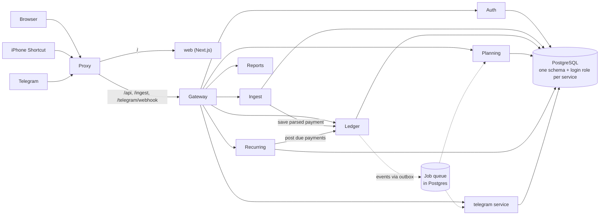
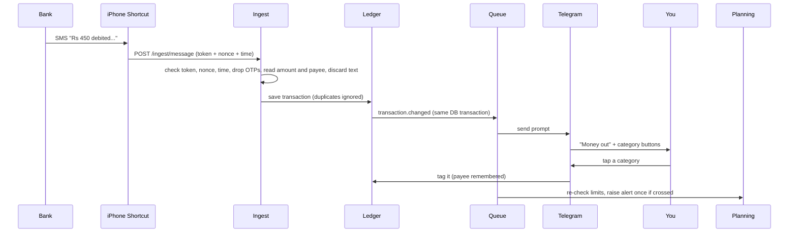

# Budget Tracker

A private budget tracker for iPhone and Indian bank SMS. Every bank debit or credit message is captured automatically, shows up in a Telegram chat and the web app, and you tag it with one tap. Amounts are in INR (₹).

## About and how it works

You decide how much to plan each month and split it across categories. The app does the rest:

1. **Capture.** An iPhone Shortcut forwards bank debit and credit messages to your server. (iPhone apps cannot read SMS, so the Shortcut does it.)
2. **Read.** The server pulls out the amount, direction, time and payee, then throws the message away.
3. **Tag.** Known payees are tagged automatically. New ones arrive in Telegram with category buttons. Tag once and the payee is remembered.
4. **Track.** Balance, limits, alerts, trends and recurring payments are worked out from your tagged payments.

Where a payment can come from:

| Source | Used for |
|---|---|
| iPhone Shortcut | Bank SMS (main route) |
| Telegram bot | Tagging payments on the go |
| Web app | Everything, plus hand-added credits |

If a message arrives late or never, the payment is booked at the time written in the message, and a balance check books any gap as "Unaccounted" for you to tag.

### Web app pages

Now · Ledger · Plan · Limits · Repeats · Trends · Add credit · Needs a look · Account (profile, security, devices) · Setup guide

## Architecture

**Stack:** Python 3.12 + FastAPI services, PostgreSQL 17, a Next.js web app, Caddy as the public proxy, all run by Docker Compose. Each service owns its own database schema and never reads another service's tables.



| Service | Job |
|---|---|
| proxy (Caddy) | The only public entry. Routes `/` to the web app and `/api`, `/ingest`, `/telegram/webhook` to the gateway |
| gateway | The only door to the backend: checks login, CSRF and rate limits, adds security headers, forwards by path |
| auth | Users, sessions, 2FA, passkeys, recovery codes, audit log, data export, account deletion |
| ingest | Device tokens, the OTP guard and the bank-message reader |
| ledger | Transactions, categories, tag rules, credits, balance checks |
| planning | Monthly plans, limits, alerts |
| recurring | Repeating payments and the cron that posts them |
| reports | Dashboard and trend views, built on read from other services (stores nothing) |
| telegram | The bot, tagging prompts, daily digest, the encrypted bot token |

### How services work together

- **Calls:** services talk over typed HTTP clients. Reads may retry; writes are never blindly retried.
- **Events and jobs:** a change and its event are saved in the same database transaction (outbox pattern). A relay moves them into a Postgres queue (`SKIP LOCKED`). Failed jobs retry with backoff (2 s up to 10 min, 5 tries) before being marked failed. Delivery is at-least-once, so every consumer is idempotent.
- **Cron:** nightly cleanup per service, recurring-payment posting, balance checks and the Telegram digest run from the same queue. Only one replica fires each tick.
- **Events used:** `transaction.changed` (planning re-checks limits, Telegram updates prompts), `credit.added`, `alert.created`, `unparsed.created`, `account.deleted` (every service purges that user), `audit.record`.
- **Derived, not stored:** balance, spend per category, pace and trends are calculated when read, so there are no cached totals to drift out of date.
- **Money:** whole paise as integers, never floats. Months and "today" use your time zone.
- **Shared code:** `packages/bt` holds what every service needs (money, crypto, contracts, DB access, queue, HTTP clients). Details: [ARCHITECTURE](docs/ARCHITECTURE.md).
- **Deploy:** one Docker image per service on a shared base image. A one-shot `db-init` job creates roles and schemas, then services start, then the gateway, then the proxy.

### What happens to one bank message



## System design

Built for one person's money data, so correctness and privacy come before scale: one Postgres database, small services that own their data, safe retries, and a balance check that catches anything lost. Details: [SYSTEM_DESIGN](docs/SYSTEM_DESIGN.md).

## Security

| Area | What we do |
|---|---|
| **Sign-in** | • 12+ character password, common ones rejected<br>• Hashed with Argon2id<br>• Authenticator app is mandatory<br>• Passkeys and 10 recovery codes (hashed) |
| **Sessions** | • Access token lasts 15 min, refresh token rotates<br>• A reused refresh token means it was copied, so the session is revoked<br>• Ends after 12 h idle or 30 days |
| **Cookies and CSRF** | • `HttpOnly`, `Secure`, `SameSite=Strict`<br>• CSRF token on every change |
| **Brute force** | • 5 wrong passwords lock 30 s, doubling to 15 min<br>• Per-IP rate limits on login, reset, phone and webhook<br>• Generic errors, so emails cannot be guessed |
| **Idempotency (safe to repeat)** | • Phone request has a one-time `nonce` and a 5-min time window<br>• Unique dedupe key, so one SMS saves once<br>• Queue jobs can run twice with the same result: alerts fire once, credits count once<br>• Telegram taps and sign-in codes work once |
| **Encryption** | • AES-256-GCM for 2FA secrets, bot token, unreadable messages<br>• Tokens stored only as hashes<br>• Key comes from the environment |
| **Data isolation** | • One Postgres login and schema per service<br>• Row-level security on every user table |
| **Between services** | • Not exposed to the internet<br>• Signed 60-second token on every call<br>• Internal routes refuse outside requests |
| **Edge** | • HSTS, `nosniff`, `no-referrer`, strict CSP, Permissions-Policy<br>• Strict input validation, parameterised queries<br>• Constant-time secret checks |
| **Phone capture** | • Per-device token: ingest-only, shown once, revocable<br>• OTP-like text dropped unread (`202`), nothing stored<br>• Parsed messages are not kept |
| **Telegram** | • Only your Telegram id, private chat<br>• `/signin` with an authenticator code<br>• No amount, payee or balance in messages<br>• Webhook secret header, stored hashed |
| **Never collected** | • Bank logins, UPI PINs, card numbers, OTPs<br>• The app never moves money |
| **Logs and audit** | • Logs hold ids and outcome codes only<br>• Append-only audit log |
| **Your data** | • Export any time<br>• Delete account (7-day grace)<br>• Old rows cleaned nightly |

## Run it

You need Docker.

```bash
python3 scripts/gen-secrets.py   # once: writes .env with random secrets
docker compose up --build        # db, services, gateway, web and proxy
```

Open http://localhost:8088 and create your account. Back up `FIELD_KEY` from `.env`; encrypted data cannot be read without it. Registration allows one account unless you set `REGISTRATION=open`.

Then follow the in-app **Setup guide** (Account menu) to connect your iPhone Shortcut and Telegram bot.

Stop with `docker compose down` (add `-v` to wipe the database).

### Develop and test

```bash
uv sync                                      # Python environment
docker compose --profile test up -d test-db  # throwaway Postgres for tests
uv run pytest                                # backend tests
cd apps/web && npm install && npm test       # web tests
uv run python scripts/e2e.py                     # end-to-end check against the running stack
```

`scripts/e2e.py` needs `PUBLIC_URL` set and `REGISTRATION=open`; see the header of the script.
