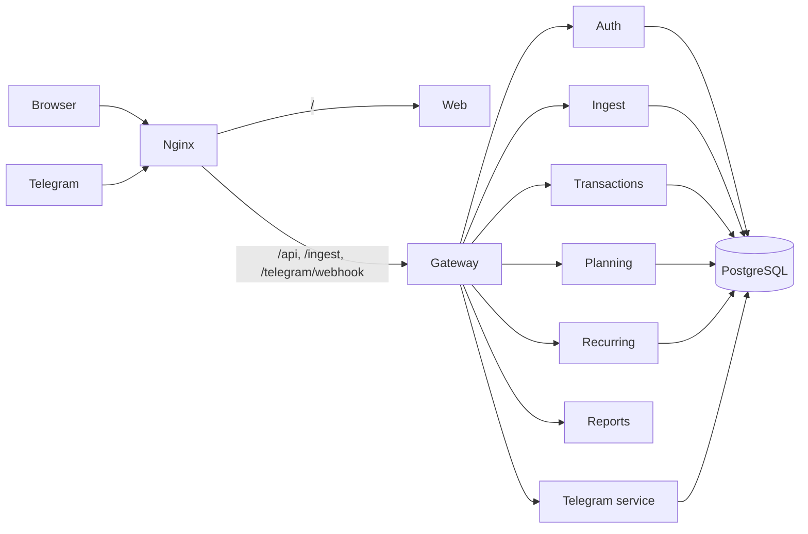

# LBStash

[](https://github.com/aayushsugandhi2703/LBStash/actions/workflows/release.yml)
[](https://github.com/aayushsugandhi2703/LBStash/actions/workflows/terraform.yml)
[](https://github.com/aayushsugandhi2703/LBStash/tags)
[](https://hub.docker.com/u/aayush2703)
[](https://lbstash.site)

A private budget tracker you run from a Telegram chat. Send `/350 food` when you spend, `+1500 salary` when money comes in. It is saved, tagged and shown in the web app. Amounts are in ₹.

## How it works

1. **Log.** `/350` = money out, `+1500` = money in. Add a tag (`/350 food`) or pick one from the buttons.
2. **Save.** The server stores it and deletes your message from the chat.
3. **Tag.** Known payees are tagged for you. Tag a new one once and it is remembered.
4. **Track.** Balance, limits, alerts, the forecast and repeating payments come from your tagged payments. A payment you forgot to log shows up as "Unaccounted".

The web app is for looking and sorting (tagging, plans, limits); you log in Telegram. Optionally, bank SMS text can flow in through `/ingest/message`.

## The three parts

| Part | What it is | Tech | Folders |
|---|---|---|---|
| **Backend** | 8 small services that own the data and rules | Python 3.12, FastAPI, PostgreSQL 17 | `backend/` |
| **Frontend** | The web app you use in the browser | Next.js (TypeScript) | `frontend/` |
| **Infra** | Runs and protects everything | Docker Compose, nginx, certbot / Cloudflare, Terraform (Oracle Cloud) | `infra/`, `docker-compose.yml` |



## Folder structure

```
lbstash/
├── backend/                     Python 3.12 + FastAPI (a uv workspace; also the Docker build folder of every Python image)
│   ├── services/                one folder per service
│   │   ├── gateway/             only door to the backend: login, CSRF, rate limits, the demo account's write guard
│   │   ├── auth/                users, sessions, 2FA, passkeys, audit log, the opt-in demo sign-in
│   │   ├── transactions/        payments, categories, tag rules, balance checks
│   │   ├── ingest/              optional bank-message route
│   │   ├── planning/            monthly plans, limits, alerts
│   │   ├── recurring/           repeating payments
│   │   ├── reports/             the numbers behind Now and Forecast: dashboard, daily, months, category matrix (stores nothing)
│   │   └── telegram/            the bot
│   │       (each has: src/  migrations/  tests/  Dockerfile  pyproject.toml)
│   ├── packages/lbstash/        code shared by every service (money, crypto, db, queue, clients)
│   ├── pyproject.toml, uv.lock  Python workspace and locked versions
│   └── .dockerignore
│
├── frontend/                    Next.js web app
│   ├── src/app/                 pages (welcome/About, sign-in, create-account, reset, pay, the app screens)
│   ├── src/components/          shared UI pieces
│   ├── src/features/            data and logic for each screen
│   ├── src/lib/                 API calls and hooks
│   ├── src/brand/               logo, name, icons
│   ├── src/common/, contracts/  copies of money rules and response types
│   ├── public/                  images and brand SVGs
│   ├── test/                    web tests
│   └── next.config.mjs, package.json, Dockerfile
│
├── infra/
│   ├── docker/base.Dockerfile   shared Python base image
│   ├── nginx/                   public entry: templates/, snippets/, certbot/, entrypoint.sh
│   ├── terraform/               builds the Oracle Cloud server (see its README): modules/, policies.txt
│   └── scripts/                 gen-secrets.py (makes .env), e2e.py (end-to-end test), update-changelog.py (used by Release)
│
├── demo/                        the read-only demo: sample-data builder and loader, compose overlay, tests (see its README)
├── .github/workflows/           terraform.yml (builds the server), release.yml (builds, deploys, tags), status.yml (live-site badge)
├── docs/                        application/ (architecture, service guide, release and deploy, brand), infrastructure/ (server setup, secrets), release/ (changelog)
├── docker-compose.yml           starts the whole stack (kept at the top so `docker compose up` just works)
├── .env, .env.example           secrets and settings (.env is never committed)
└── README.md
```

## Backend

Each service owns its own database schema and login, and never reads another's tables.

| Service | Job |
|---|---|
| gateway | Login check, CSRF, rate limits, security headers, forwards by path; refuses every write by the demo account |
| auth | Users, sessions, 2FA, passkeys, recovery codes, export, account deletion, the opt-in demo sign-in |
| transactions | Payments, categories, tag rules, credits, balance checks |
| ingest | Optional bank-message route: device tokens, OTP guard, parser |
| planning | Monthly plans, limits, alerts |
| recurring | Repeating payments and the cron that posts them |
| reports | The numbers behind Now and Forecast, worked out when read |
| telegram | Logging, tagging, Google Pay button, daily digest |

How they work together:
- **Calls** are typed HTTP clients. Reads may retry; writes are never blindly retried.
- **Events** are saved with the change (outbox), then moved to a Postgres queue. Failed jobs retry; every consumer is safe to run twice.
- **Money** is whole paise as integers, never floats. Months and "today" use your time zone.
- More: [Architecture](docs/application/ARCHITECTURE.md) (where the code lives and how the flows work), [Service guide](docs/application/SERVICE_GUIDE.md).

## Frontend

A Next.js app. `lbstash.site` always opens the **About** page (a sample month, Try the demo, Sign in, Create account); the app starts at `/now`. Pages: About · Now · Money (Activity, Repeats, Needs a look) · Budget (Plan, Limits) · Forecast · Account · Setup guide. Money in is logged in Telegram (`+1500 salary`); there is no Add credit page. It only talks to the gateway. Which page asks which service:

| Page | Asks (through the gateway) | Services behind it |
|---|---|---|
| About `/` | `POST /auth/demo` (demo only) | auth, with the gateway's read-only guard |
| Now `/now` | `/dashboard`, `/reports/daily` | reports, which reads transactions, planning, recurring, ingest |
| Money · Activity `/money` | `/transactions`, `/categories`, `/balance-check`, `/recurring` | transactions, recurring |
| Money · Repeats `/money/repeats` | `/recurring`, `/categories` | recurring (posts into transactions) |
| Needs a look `/money/unread` | `/unparsed`, `/transactions` | ingest, transactions |
| Budget · Plan `/budget` | `/plans/:month`, `/categories`, `/recurring` | planning (reads spend from transactions), recurring |
| Budget · Limits `/budget/limits` | `/budgets`, `/alerts`, `/settings` | planning, gateway |
| Forecast `/forecast` | `/reports/daily`, `/reports/months`, `/reports/category-matrix`, `/plans/:month`, `/budgets`, `/recurring`, `/dashboard` | reports, planning, recurring |
| Account, Security, Devices | `/me`, `/account`, `/sessions`, `/devices`, `/telegram` | auth, ingest, telegram |
| Setup | `/settings`, `/plans/:month`, `/telegram` | gateway, planning, telegram |

Logo, name and colours: [Brand](docs/application/BRAND.md).

## Demo

The About page (`/`, shown to visitors who are not signed in) shows a sample October you can scrub with a slider, tells the product as one month in days, and has a **Try the demo** button. It opens a read-only account with six months of sample data (payments, plan, limits, repeats, forecast), so people can see the app before making an account. It is opt-in and lives in [`demo/`](demo/README.md): a data builder and loader, a compose overlay and tests. Turning it on sets `DEMO_MODE` for auth and the gateway; the demo user can look but never change anything.

## Infra

- **nginx** is the only public entry. `/` goes to the web app; `/api`, `/ingest`, `/telegram/webhook` go to the gateway. Nothing else is exposed.
- **Docker images:** one per service on a shared, slimmed Python base (built from `backend/`; the web image from `frontend/`) (about 240MB each; web about 225MB). The 8 Python images share the same base layers, so together they take roughly one image of disk.
- **Start order:** `db-init` creates roles and schemas, then the services, gateway, web and nginx start.
- **https:** Cloudflare Tunnel or Let's Encrypt (see [Deployment](#deployment)).
- **Server:** a free Oracle Cloud VM, built with [Terraform](infra/terraform/README.md).

## Security

- **Sign-in:** 12+ character password (Argon2id), authenticator app required, passkeys, 10 hashed recovery codes. Optional allowed-IP list.
- **Sessions:** 15-minute access token; refresh token rotates and a reused one revokes the session. `HttpOnly`, `Secure`, `SameSite=Strict` cookies and a CSRF token on every change.
- **Brute force:** 5 wrong passwords lock for 30 s, doubling up to 15 min. Per-IP limits.
- **Data:** AES-256-GCM for secrets, tokens stored as hashes, one Postgres login and schema per service, row-level security on user tables.
- **Between services:** not on the internet; a signed 60-second token on every call.
- **Telegram:** only your account can link; your message is deleted after it is read; sensitive prompts stay hidden until you tap Reveal.
- **Never collected:** bank logins, UPI PINs, card numbers, OTPs. The app never moves money.
- **Yours:** export any time, delete your account (7-day grace), append-only audit log, logs hold ids only.

### The server

How the Oracle Cloud VM is protected, from the outside in. The first-boot script is [`cloud-init.yaml`](infra/terraform/modules/compute/cloud-init.yaml); Terraform runs it once, when the VM starts for the first time.

| Layer | What is done | Where |
|---|---|---|
| **Cloud network** | A network security group lets in only web ports 80 and 443 (from the addresses you allow, default everyone), SSH on 22 (from `ssh_ingress_cidrs`, default everyone: set it to `["your-ip/32"]` to allow only yourself) and ICMP type 3 for path MTU. Everything else, including the published local port 8088, is dropped before it reaches the VM. | `infra/terraform/modules/nsg` |
| **Host firewall** | On first boot the script replaces Oracle's default rules with its own `iptables` set: default **DROP** for incoming traffic; allowed are loopback, replies to connections the VM started, ICMP, and *new* connections on 22, 80 and 443 only. Saved with `iptables-persistent`, so it survives a reboot. | `cloud-init.yaml` |
| **SSH** | Keys only: `PasswordAuthentication no`, `KbdInteractiveAuthentication no`, `PermitRootLogin no`. Your public key is the only one placed on the VM, plus a separate **deploy key** that only GitHub Actions holds (as a GitHub secret). | `cloud-init.yaml`, `SECRETS` |
| **Brute-force bans** | `fail2ban` is installed and enabled; Ubuntu's default setup watches SSH and bans addresses that keep failing. | `cloud-init.yaml` |
| **Updates** | Package lists are updated and all packages upgraded on first boot. Later OS updates are yours to run (`sudo apt update && sudo apt upgrade`); the app updates through the Release workflow. | `cloud-init.yaml` |
| **Containers** | One Docker network; only nginx publishes ports. The database and every service are reachable only inside it; the gateway is also bound to `127.0.0.1`. Python images run as an unprivileged `app` user, the web image as `node`. Images are public and hold no secrets. | `docker-compose.yml`, Dockerfiles |
| **Public entry** | nginx is the only door: `/` to the web app; `/api`, `/ingest`, `/telegram/webhook` to the gateway. `server_tokens off`, HSTS, `nosniff`, `Referrer-Policy: no-referrer`, `X-Frame-Options: DENY`, 1 MB body limit. https from Let's Encrypt (certbot) or Cloudflare. | `infra/nginx` |
| **Secrets** | `gen-secrets.py` makes random values for every password and key and writes `.env` with mode `600` on the VM. They never go in an image or in Git. GitHub holds only what the workflows need, listed in [Secrets](docs/infrastructure/SECRETS.md). | `infra/scripts`, `.env` |
| **Backups** | A private Object Storage bucket (`NoPublicAccess`) is created for database backups. The backup script is not written yet. | `infra/terraform/modules/object_storage` |

Not done yet, so you know: SSH is open to the whole internet by default (fail2ban and key-only login limit the risk), unattended OS updates are not switched on, and backups are not scheduled.

## Deployment

Pick one. Always **back up `FIELD_KEY`** from the `.env`: encrypted data cannot be read without it. Oracle Cloud creates the `.env` for you; for the other two, run `python3 infra/scripts/gen-secrets.py` first.

### Oracle Cloud (free)

An always-on server for about ₹0/month. Terraform builds it; GitHub Actions builds the images (amd64 + arm64), stores them on Docker Hub and updates the server.

Add the GitHub secrets first ([Secrets](docs/infrastructure/SECRETS.md), one place for all of them), then follow [Server setup](docs/infrastructure/SERVER_SETUP.md) and [Release and deploy](docs/application/RELEASE.md).

In short: create the server with **Actions > Terraform**, point your domain at it, then run **Actions > Release** with a version (`x.y.z`) after each merge to `main`.

### Cloudflare Tunnel

No public IP or open ports needed.

1. In Cloudflare, create a tunnel (Network > Tunnels) to `http://nginx:80`. Copy its token.
2. In `.env`, set `TUNNEL_TOKEN`, `COMPOSE_PROFILES=tunnel` and `PUBLIC_URL=https://lbstash.site`.
3. `docker compose up -d --build`

### Locally with Docker

For trying it, and for development and tests.

```bash
python3 infra/scripts/gen-secrets.py
docker compose up --build
```

Open http://localhost:8088. Stop with `docker compose down` (`-v` also wipes the database).

Telegram needs https, so use Oracle Cloud or Cloudflare Tunnel for the bot.

**Run the tests** (optional):

```bash
docker compose --profile test up -d test-db  # throwaway Postgres (run from the top folder)
export TEST_DATABASE_URL=postgres://lbstash_admin:<POSTGRES_PASSWORD from .env>@127.0.0.1:5544/lbstash

cd backend
uv sync                                      # Python environment
uv run pytest services/auth/tests            # backend tests, one service at a time
uv run python ../infra/scripts/e2e.py        # end-to-end test (needs PUBLIC_URL and REGISTRATION=open)

cd ../frontend && npm install && npm test    # web tests
```
