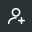

# Brand

The logo, the **LBStash** wordmark, and the icon for every service and page. All files are in `frontend/public/brand`. Colours are in [COLOURS.md](COLOURS.md).

## Logo

A lowercase **b** made of two plain shapes: a stem and a coin, white on a square tile.

| File | Use |
|---|---|
| `mark.svg` | the mark alone, on `#00875A`. Tab icon, app icon, avatars |
| `logo.svg` | mark and wordmark side by side, for light backgrounds. README, emails, docs |
| `LogoMark` in `frontend/src/brand/logo.tsx` | the mark inside the app. It follows `--accent`, so it changes with the theme |
| `Logo` in the same file | mark and wordmark together (sign-in screens) |

- **Smallest size:** 16px for the mark, 96px wide for the lockup.
- **Clear space:** half the mark's width on every side.
- **Never:** stretch it, rotate it, round the tile, recolour the white shapes, or put the wordmark in capitals.

## The wordmark

Spell it **LBStash**: capital L, capital B, capital S, rest lowercase. Never `LBSTASH`, `lbstash` or `Lbstash`. Set in two colours: **LB** in ink, **Stash** in the accent green.

| | |
|---|---|
| Typeface | Geist (the app's own font, self-hosted by `next/font`) |
| Weight | 600 (semi-bold) |
| Letter spacing | `-0.03em` |
| Line height | `1` |
| Size | In the app: 20px (`1.25rem`) beside the default 24px mark. In `logo.svg`: 22 units beside a 32-unit mark. Keep the word about 0.7 to 0.8 times the mark's height |
| Colour | **LB** `#0E0E10` (`--ink`) and **Stash** in the accent (`--accent`, `#00875A`) on light backgrounds. On a dark background outside the app, or on the accent colour, all white. In the app's dark mode `LB` follows `--ink` (light) and `Stash` stays green (`--accent`, lighter in dark) |
| Gap to the mark | 10px in both |

```css
/* frontend/src/app/globals.css */
.logo { display: inline-flex; align-items: center; gap: 10px; }
.wordmark { font-size: 1.25rem; font-weight: 600; letter-spacing: -0.03em; line-height: 1; }
.wordmark .stash { color: var(--accent); }   /* LB<span class="stash">Stash</span> */
```

In `logo.svg` the same style is written as attributes: `font-family="Geist, system-ui, sans-serif" font-size="22" font-weight="600" letter-spacing="-0.7"`. The two colours are a `<tspan>`. The text stays live, so it shows Geist only where Geist is installed and falls back to the system font elsewhere.

## Tab icons

Every page has its own tab icon, so open tabs are easy to tell apart. `pageIcon()` in `frontend/src/brand/brand.ts` maps a path to its file, and `PageIcon` (mounted once in `app/layout.tsx`) swaps the icon as you move between pages, and keeps watching the page head in case Next adds the icon link late. The home page and any path with no icon of its own keep the main mark.

Safari does not show SVG tab icons and uses a PNG instead, so every page icon also has a `<name>.favicon.png` (180 by 180), and `PageIcon` swaps the SVG and the PNG links together. In Safari the tab icons only appear if **Safari > Settings > Tabs > Show website icons in tabs** is on.

To add a page: add its three files in `public/brand/pages/` (`.svg` image, `.favicon.svg`, `.favicon.png`) and one line in `PAGE_ICONS`. Make the PNG from the favicon SVG at 180 by 180.

## Icons

Each icon comes in two files. The **image** (`<name>.svg`) has a fine line and a wide margin, for docs and cards. The **favicon** (`<name>.favicon.svg`) has a bolder line that fills more of the tile, so it stays clear at 16px.

### Services (`public/brand/services/`)

One ink colour, `#2F3A35`, for every service, so they read as a family. Only the symbol changes. The services have no web pages of their own (their API docs are switched off), so these are for READMEs, dashboards and the container registry.

| | Service | Symbol |
|---|---|---|
|  | `gateway` | an archway: the one way in |
|  | `auth` | a shield with a tick |
|  | `transactions` | list lines |
|  | `planning` | four blocks |
|  | `recurring` | a circling arrow |
|  | `reports` | a rising line |
|  | `telegram` | a paper plane |
|  | `ingest` | an arrow into a tray |

### Pages (`public/brand/pages/`)

The symbols are the same ones used in the app's navigation. Pages inside the signed-in app use the accent green (`#00875A`). Sign-in and account setup pages use graphite (`#2B3236`), so they read as a separate area.

| Signed in | Path | | Sign in and setup | Path |
|---|---|---|---|---|
|  `now` | `/` (tab keeps the main mark) | |  `sign-in` | `/sign-in` |
|  `transactions` | `/transactions` | |  `create-account` | `/create-account` |
|  `plan` | `/plan` | |  `reset` | `/reset` |
|  `limits` | `/limits` | |  `secure` | `/secure` |
|  `repeats` | `/repeats` | | | |
|  `trends` | `/trends` | | | |
|  `credit` | `/credit` | | | |
|  `account` | `/account` | | | |
|  `security` | `/account/security` | | | |
|  `devices` | `/account/devices` | | | |
|  `setup` | `/setup` | | | |
