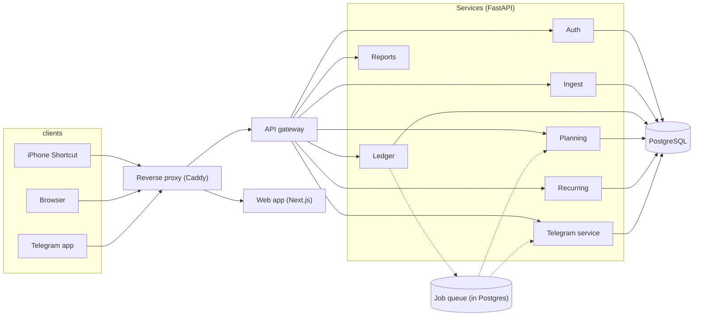
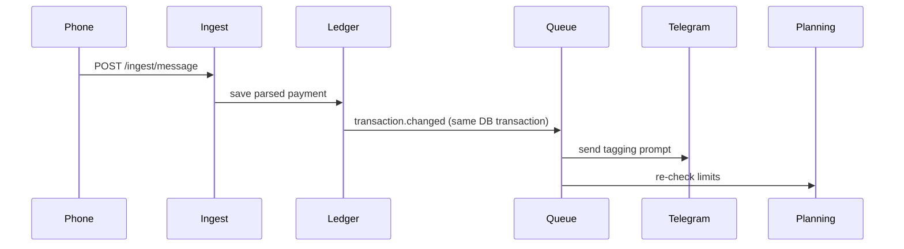
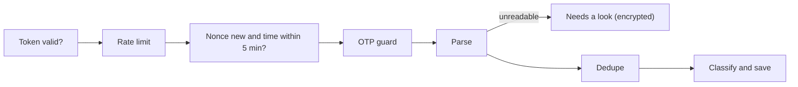

# System Design

Written in the style of Alex Xu's *System Design Interview*: four steps, from the problem to the bottlenecks. Terms are explained in one line where they first appear.

1. [Understand the problem and scope](#step-1-understand-the-problem-and-scope)
2. [High-level design](#step-2-high-level-design)
3. [Design deep dive](#step-3-design-deep-dive)
4. [Wrap up](#step-4-wrap-up)

---

## Step 1: Understand the problem and scope

### What are we building?

A private budget tracker. Bank debit and credit SMS flow in by themselves, you tag each one with a tap, and you see balance, limits and trends.

### Functional requirements

| # | Requirement |
|---|---|
| F1 | Capture every bank debit and credit message from an iPhone, with no typing |
| F2 | Tag each payment (one tap, payee remembered) in Telegram or the web app |
| F3 | Show balance, plan, per-category limits, alerts, trends and repeating payments |
| F4 | Add cash or other credits by hand |
| F5 | Find payments that never arrived (balance check) |
| F6 | Export and delete your data |

### Non-functional requirements

| Quality | Target | Why it matters |
|---|---|---|
| **Durability** | A captured payment is never lost | Money data |
| **Correctness** | No double counting (**idempotency**) | The same SMS can be sent twice |
| **Consistency** | Strong for money, eventual (seconds) for alerts and Telegram prompts | Balance must be exact, notifications can lag |
| **Availability** | Best effort; late is fine | iOS may run the Shortcut late |
| **Latency** | Payment visible in under 30 s when the phone is unlocked | Feels instant |
| **Security and privacy** | Highest priority | Details: [README](../README.md#security) |
| **Simplicity** | Few moving parts to run | One person runs it |

### Assumptions and back-of-the-envelope estimation

Estimation = rough numbers to pick a sensible design. These are assumptions for a heavy personal user.

| Item | Estimate |
|---|---|
| Users | 1 per install (a household at most) |
| Bank messages | 50 a day, about 1,500 a month |
| Average **QPS** (queries per second) | 50 / 86,400 s, about 0.0006 |
| Peak QPS | About 10 (several SMS landing together) |
| Web reads | About 100 page loads a day |
| Row size | About 1 KB per transaction with indexes |
| Storage | 1,500 x 12 x 1 KB, about 20 MB a year; 5 years about 100 MB |

**Conclusion:** the load is tiny. One Postgres instance is plenty, and effort goes into correctness and security, not scale.

### Out of scope

Android app, Account Aggregator (bank APIs), statement import, email capture, push notifications. The design leaves room for them.

### Constraints

- iOS apps cannot read SMS, so the capture must use the **Shortcuts** app.
- Shortcuts may run late while the phone is locked, so nothing may depend on speed.
- The bank message rarely has the note you typed in GPay, so the "why" is added by you.

---

## Step 2: High-level design

### Components

| Term | In this system |
|---|---|
| **Reverse proxy** | Caddy: the one public door, adds TLS and security headers |
| **API gateway** | Checks login, CSRF and rate limits, then routes by path |
| **Microservice** | A small service that owns its own data |
| **Message queue** | A Postgres table of jobs that workers claim |
| **Outbox pattern** | An event is saved in the same transaction as the change, then relayed to the queue |
| **Rate limiter** | Caps requests per IP and per device |

### API design

REST over HTTPS. Browser calls live under `/api`.

| Area | Main endpoints |
|---|---|
| Capture | `POST /ingest/message` (device token + nonce) |
| Ledger | `GET /ledger`, `PATCH /transactions/:id` (tag), `POST /credits`, `POST /balance-check` |
| Plan and limits | `PUT /plans/:month`, `GET/POST /budgets`, `GET /alerts` |
| Repeats | `GET/POST/PATCH/DELETE /recurring` |
| Reports | `GET /dashboard`, `GET /reports/*` |
| Account | `/auth/*`, `/sessions`, `/devices`, `/audit`, `/account/export` |
| Telegram | `POST /telegram/webhook/<secret>` and `/telegram/*` setup routes |

### Data schema

Each service has its own **schema** (a namespace in Postgres) and its own login, so a service never reads another's tables.

| Schema | Main tables |
|---|---|
| auth | users, sessions, refresh_tokens, auth_factors, login_throttle, audit_log |
| ledger | transactions, categories, tag_rules, balance_checks |
| ingest | devices, ingest_events (nonces), unparsed_messages |
| planning | plans, plan_lines, budgets, alerts |
| recurring | recurring_rules |
| telegram | telegram_bots, telegram_links, telegram_sessions, telegram_prompts |

Key choices: money is stored as whole **paise** (integers, never floats); every user table has `user_id` plus **row-level security (RLS)**; transactions have a unique `(user_id, dedupe_key)`; balance and totals are **computed on read**, not cached.

### Core flow

---

## Step 3: Design deep dive

### 3.1 Ingestion pipeline (capture)

Order of checks, cheapest first, so bad input costs little:

| Response | Meaning |
|---|---|
| `201` | New payment saved |
| `200` | Duplicate, already saved |
| `202` | OTP, promo or non-payment: dropped, nothing stored |
| `422` | Looked like a payment but unreadable: kept encrypted in Needs a look |
| `401` / `409` | Bad token / replayed nonce or old timestamp |

- **Idempotency:** the nonce stops replays; the unique dedupe key stops duplicates. Sending the same SMS ten times creates one payment.
- **Parser:** a small library of bank templates plus a generic fallback. Unknown wording is never guessed.
- **Payment time** comes from the message text. The Shortcut's run time is only a fallback.

### 3.2 Reliable events (outbox and queue)

- The change and its event commit together, so there is no "saved but never announced".
- A relay copies outbox rows to `queue.job` every ~500 ms. Workers claim jobs with `FOR UPDATE SKIP LOCKED`, so two workers never take the same job.
- Failed jobs retry with **exponential backoff** (2 s up to 10 min, 5 tries), then are marked failed.
- Delivery is **at-least-once**, so every consumer is idempotent. Net effect: **exactly-once results**.

### 3.3 Tagging and payee learning

1. Known payee or keyword rule: tagged automatically.
2. Otherwise status stays `pending` and a Telegram prompt with category buttons goes out.
3. One tap confirms it and teaches the payee. **First write wins**, so a repeated tap changes nothing.

Pending payments already count in the balance (amount first, description later).

### 3.4 Balance check (reconciliation)

You enter your bank balance. `gap = bank - ledger`. If there is a gap, wait a **grace period** (a late SMS may still arrive and merge). If it persists, one **Unaccounted** entry is booked for you to tag or split. This is how the system tolerates lost messages without ever trusting delivery.

### 3.5 Limits and alerts (event-driven)

`transaction.changed` triggers a `budget.evaluate` job for the affected categories. An alert is raised **once** per budget, period and level. No timers poll the data.

### 3.6 Telegram privacy

Telegram stores what it is sent, so messages carry no amount, payee, balance or account number: only "Money out, 6:42 pm" and category buttons. An optional **Reveal** button shows details for 30 seconds.

### 3.7 Auth, sessions and rate limiting

Short-lived access token (15 min) plus rotating refresh token with reuse detection; progressive lockout; per-IP limits on login, second step, reset, ingest and webhook. Details: [README](../README.md#security).

### 3.8 Consistency choices

| Data | Model | How |
|---|---|---|
| Transactions, balance | Strong | One Postgres, ACID transactions |
| Plan total after a credit | Eventual (seconds) | Event, applied once per transaction |
| Alerts, Telegram prompts | Eventual | Queue with retries |
| Reports | Always fresh | Computed on read |

---

## Step 4: Wrap up

### Bottlenecks and how they would scale

| Part | Limit | Next step |
|---|---|---|
| Postgres (single node) | Single point of failure | Backups now; **replication** and a standby later |
| Reads (reports) | Heavy aggregates | **Read replica**, then **cache** hot summaries |
| Queue in Postgres | Throughput of one DB | Move to a managed broker (SQS, Kafka) if events grow |
| Stateless services | One copy each | Run more copies behind a **load balancer**; `SKIP LOCKED` and the cron lock keep them safe |
| Data growth | 100 MB over 5 years | **Partition** by month, or **shard** by `user_id`, only if it ever matters |

### Failure handling

| Failure | Result |
|---|---|
| Shortcut late or never | Booked at the message time; balance check finds the gap |
| Duplicate SMS | One payment (nonce + dedupe key) |
| Service crash mid-way | Event still in the outbox; job retries |
| Handler runs twice | Same result (idempotent) |
| Telegram down | Payments saved; web app shows "Needs a tag" |
| Database restart | Services wait; unsent events are still stored |
| Unknown bank wording | Goes to Needs a look, never guessed |
| Phone lost | Revoke the device token |

### Monitoring and operations

- Health checks on every container; `docker compose ps` shows status.
- Logs hold ids and outcome codes only (no amounts or payees).
- Back up the database and `FIELD_KEY` (without it, encrypted data cannot be read).
- Nightly retention jobs clear expired rows and old nonces.

### Trade-offs

| Chose | Gave up |
|---|---|
| Microservices | More parts than a monolith needs at this size, in return for clear data ownership and security boundaries |
| Postgres as queue | Raw throughput, in return for one less system to run |
| Server-side parsing | The raw SMS briefly reaches the server, in return for one parser to fix for all banks |
| Compute on read | Some CPU per report, in return for numbers that cannot drift |

### Future work

Android capture, Account Aggregator, statement import, push and email alerts, parsing inside the Shortcut so only parsed fields leave the phone.
